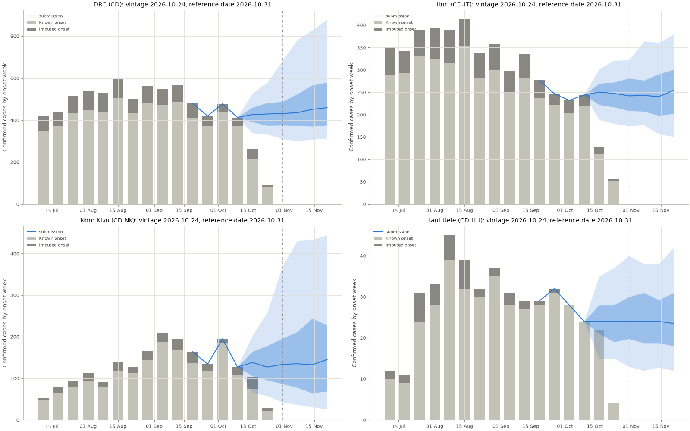

<!-- bdbv-submission:epiforecasts-persistence:2026-10-31 -->
## epiforecasts-persistence submission for 2026-10-31

> [!NOTE]
> **Automated submission.** A scheduled GitHub Actions workflow in [seabbs/bdbv-hub-baseline-forecasts](https://github.com/seabbs/bdbv-hub-baseline-forecasts) fitted the model, ran the checks below and opened this pull request. No person reviewed it before it was opened. If the hub data change before the window closes, the workflow updates this pull request in place.
>
> This is a **dry run**: nothing was pushed or opened.

**Produced by: main model (stand-in).** 
The main model (stand-in) cleared every check, with warnings.

**Stand-in:** the `main` config runs the persistence baseline until the PyRenew renewal model is integrated.

| check | status |
| --- | --- |
| Overall | WARN (stand-in) |
| Convergence | N/A (no sampler) |
| Posterior predictive checks | N/A (persistence has no sampler and no posterior) |
| Forecast checks | WARN (bounds flagged) |
| Hub validation | PASS |
| Data coherence | PASS (national (CD) equals the sum of the provinces in every week) |

> [!WARNING]
> Submitted with warnings:
> - bounds: CD-TO: 95th centile 108 is 5.4 times the bound base 20

### Nowcast and forecast

Observed cases by onset week in the data vintage used, with the submitted median and 50% and 90% intervals. Weeks up to the reference date are a nowcast; later weeks are a forecast.

National (`CD`) summary of the submitted samples:

| week ending | median | 90% interval |
| --- | --- | --- |
| 2026-10-10 | 413 | 413 to 413 |
| 2026-10-17 | 427 | 339 to 528 |
| 2026-10-24 | 430 | 333 to 580 |
| 2026-10-31 | 432 | 311 to 683 |
| 2026-11-07 | 436 | 302 to 782 |
| 2026-11-14 | 452 | 308 to 828 |
| 2026-11-21 | 460 | 314 to 881 |

### Submission

|  |  |
| --- | --- |
| Model | `epiforecasts-persistence` |
| Model and config | persistence (`main`) |
| Version | 0.1.0, code [`fd9d26eaed`](https://github.com/seabbs/bdbv-hub-baseline-forecasts/commit/fd9d26eaedecf543c851271d365d52db09fff85c) |
| Reference date | 2026-10-31 |
| Data vintage (`as_of`) | 2026-10-24 |
| Hub data commit | [`187015937f`](https://github.com/InsightNet-US/BDBV-Modeling-Hub/commit/187015937fc7c0fc28cc769fb938ed89c9e18ae8) |
| Hub checkout | [`88478a33b6`](https://github.com/InsightNet-US/BDBV-Modeling-Hub/tree/88478a33b6f81dc717eec16d3ec0417c8f0d5588) |
| File | `model-output/epiforecasts-persistence/2026-10-31-epiforecasts-persistence.csv` |
| Contents | 9 locations, 9000 rows |
| Built | 2026-10-27 18:14 UTC |

Fallback chain

#### Produced by: main model (stand-in)

The main model (stand-in) cleared every check, with warnings.

**Stand-in:** the `main` config runs the persistence baseline until the PyRenew renewal model is integrated.

| step | candidate | convergence | predictive checks | forecast checks | hub validation | outcome |
| --- | --- | --- | --- | --- | --- | --- |
| `main` | main model (stand-in) | N/A | N/A | WARN | PASS | WARN |
| `retry-1` | main model, retry 1 (longer warm-up, new seed, target acceptance 0.95) | n/a | n/a | n/a | not run | not needed |
| `retry-2` | main model, retry 2 (target acceptance 0.99, tree depth 12) | n/a | n/a | n/a | not run | not needed |
| `fallback` | fallback variant (data-driven delays and missingness, no spatial coupling, weekly Rt) | n/a | n/a | n/a | not run | not needed |
| `persistence` | persistence baseline | n/a | n/a | n/a | not run | not needed |

Convergence diagnostics

#### Fit convergence

| fit | status | max R-hat | min ESS bulk | min ESS tail | divergences | draws |
| --- | --- | --- | --- | --- | --- | --- |
| `main` | N/A | n/a | n/a | n/a | n/a | n/a |

- `main` has no sampler, so convergence does not apply.

Thresholds. Fail: R-hat above 1.1, bulk ESS below 25, tail ESS below 25, divergences above 0.05 of draws. Warn: 1.05, 100, 100, 0.01.

Posterior predictive checks

#### Posterior predictive checks for `main`: N/A

`main`: no posterior, so posterior predictive checks do not apply (persistence has no sampler and no posterior).

Forecast checks

#### Forecast checks for `main`: WARN

| check | status | result |
| --- | --- | --- |
| schema | PASS | format matches the hub's round |
| values | PASS | all values finite and non-negative |
| samples | PASS | 100 full trajectories per location |
| coverage | PASS | 9 locations, weeks 2026-10-10 to 2026-11-21 |
| national_sum | PASS | CD is the exact sum (national.json: 8 modelled provinces) |
| bounds | WARN | CD-TO: 95th centile 108 is 5.4 times the bound base 20 |
| growth | PASS | forecast growth within the cap |
| observed | PASS | close to observed (2026-10-24) |
| baseline | PASS | close to persistence baseline |
| previous | N/A | no last week's submission to compare with |

Findings

**bounds**

- WARN: CD-TO: 95th centile 108 is 5.4 times the bound base 20

Data coherence

National against the sum of the provinces in the data vintage used.

| stream | weeks with a gap | largest gap | total gap |
| --- | --- | --- | --- |
| observed | 0 | 0 | 0 |
| imputed | 0 | 0 | 0 |
| total | 0 | 0 | 0 |

How the model handles it: The submitted national value is the sum of the province values for each sample. Cases the hub counts nationally but in no province would need a modelled unassigned component added to that sum; the current models have none, so such a gap is left out of the national forecast.

Workflow run and artefacts: https://github.com/seabbs/bdbv-hub-baseline-forecasts/actions/runs/40556037584

This was opened by a bot. Please ping @seabbs for any questions.
