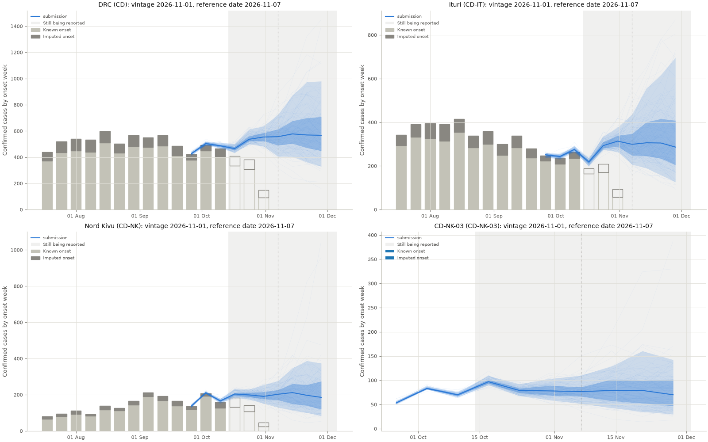

<!-- bdbv-submission:seabbs-renewal:2026-11-07 -->
Automated submission of `seabbs-renewal` for 2026-11-07, from data as of 2026-11-01, for 187 locations.

All checks passed, with warnings on baseline. Dry run: nothing was pushed.

This round in our docs: https://samabbott.co.uk/BDBVHubRenewal/submission/rounds/2026-11-07/

Checks

| check | status |
| --- | --- |
| Convergence | PASS (max R-hat 1.026, min bulk ESS 145, 8 divergences in 1000 draws) |
| Posterior predictive checks | PASS |
| Forecast checks | WARN (baseline flagged) |
| Hub validation | PASS |
| Data coherence | PASS (national (CD) equals the sum of the provinces in every week) |

Convergence

PASS (max R-hat 1.026, min bulk ESS 145, 8 divergences in 1000 draws).

The model used BVDOutbreakSize release `results-3306` (data to 2026-10-25, joint R-hat 1.042, limit 1.1).

Posterior predictive checks

Share of observed weekly all streams counts inside the in-sample predictive intervals.

|  | 50% | 90% | 50%, last 4 weeks | 90%, last 4 weeks |
| --- | --- | --- | --- | --- |
| all provinces | n/a | n/a | n/a | n/a |
| CD | 0.83 | 0.98 | 0.75 | 1 |
| CD-BU | 0.91 | 1 | 0.62 | 1 |
| CD-HU | 0.9 | 1 | 1 | 1 |
| CD-IT | 0.78 | 0.98 | 1 | 1 |
| CD-NK | 0.72 | 0.98 | 0.5 | 1 |
| CD-NU | 1 | 1 | 1 | 1 |
| CD-SK | 0.98 | 0.98 | 1 | 1 |
| CD-SU | 0.97 | 1 | 0.75 | 1 |
| CD-TO | 0.88 | 0.98 | 0.75 | 0.88 |

PIT: KS distance 0.061 from uniform.

Forecast checks

- WARN baseline: CD-IT-05: median 26.5 against random walk baseline 1 over 2026-11-14 to 2026-11-28 (ratio 5.25) (and 4 more)
- Passed: schema, values, samples, coverage, zones, national_sum, bounds, plausible, growth, observed.

National summary

Submitted `CD` samples.

| week ending | median | 90% interval |
| --- | --- | --- |
| 2026-10-17 | 466 | 435 to 502 |
| 2026-10-24 | 536 | 500 to 611 |
| 2026-10-31 | 554 | 483 to 637 |
| 2026-11-07 | 556 | 406 to 724 |
| 2026-11-14 | 578 | 404 to 870 |
| 2026-11-21 | 570 | 362 to 974 |
| 2026-11-28 | 567 | 329 to 980 |

Provenance

|  |  |
| --- | --- |
| File | `model-output/seabbs-renewal/2026-11-07-seabbs-renewal.csv` |
| Contents | 187 locations, 187000 rows |
| Model | renewalbvd (`bvd`), version 0.1.0, code [`7d19c4246a`](https://github.com/seabbs/BDBVHubRenewal/commit/7d19c4246ae4bf478d436a70c8eea1b99baa7d5c) |
| Data vintage (`as_of`) | 2026-11-01 |
| Hub data commit | [`d67f1b74e0`](https://github.com/InsightNet-US/BDBV-Modeling-Hub/commit/d67f1b74e0ecd1b32bb3d57554d871502acb2eca) |
| Hub config | [`b66c18270b`](https://github.com/InsightNet-US/BDBV-Modeling-Hub/tree/b66c18270b3cf90bb6668f1a2a6ec759867e0916) |
| Built | 2026-11-03 16:32 UTC, [workflow run](https://github.com/seabbs/BDBVHubRenewal/actions/runs/41663922529) |

This was opened by a bot. Please ping @seabbs for any questions.
