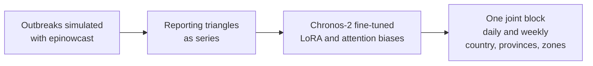

# Fine-tuned foundation

We fine-tune the Chronos-2 forecasting model on outbreaks simulated with epinowcast, so that it can nowcast from a reporting triangle laid out as series.
The fine-tuned model forecasts daily and weekly series in one joint block, for the country, the provinces and the health zones.
The [paper](../paper.md) and its supporting information describe the project and its methods, and this section links to them.

- [Paper](../paper.md): the main text and the supporting information, which hold the methods (the simulation grid, the training and the evaluation) and the results.
- [Using the fine-tuned model](../methods/finetuned-chronos.md): loading a released checkpoint and nowcasting your own reporting triangle.
- [German nowcast benchmark](../germany.md): the paper's retrospective case study.

How the hub submission uses these models is on [Foundation models](../methods/foundation.md) and [Baseline models](../methods/baselines.md), under Hub submission.

Next: [Paper](../paper.md).
