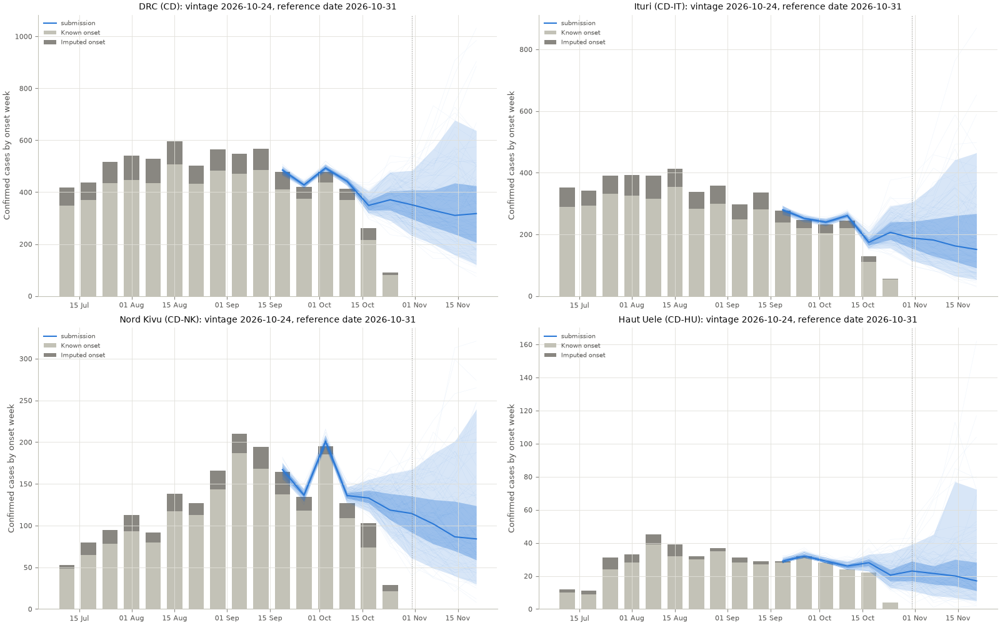
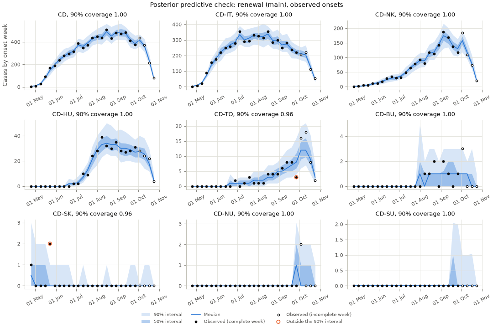

# Getting started

Install the package, fit the model to the latest data and write a hub file.
{ .page-subtitle }

## Install

The package needs Python 3.13 or later, [uv](https://docs.astral.sh/uv/) and [Task](https://taskfile.dev).
`task validate-hub` also needs R with `hubValidations`.

```bash
task setup      # the package, PyRenew (JAX, NumPyro) and the dev and docs groups
task test       # the tests
task test-slow  # small real model fits
task lint       # ruff and mypy
```

The tidy data in `data/` are committed, so nothing needs downloading to start.
`task data` refreshes them from the hub.

## Fit the model

This is a small fit of the main variant, `renewal`, to the latest vintage.
It uses 2 chains of 200 warm-up and 200 draws.
On 2 cores it took 18 minutes and peaked at 2 GB of memory.
The submission workflow uses 2 chains of 500 warm-up and 500 draws.

```console
$ uv run bdbvhubrenewal fit --model renewal --config main \
    --sampler-json '{"num_chains": 2, "num_warmup": 200, "num_samples": 200}' \
    --out output/fits/main
Fitted config 'main' on vintage 2026-10-24 (sampler nuts); wrote output/fits/main.
```

The fit directory holds what the submission workflow reads:

| File | What it holds |
|---|---|
| `samples.csv.gz` | 100 joint trajectories for every province and week, drawn at fit time |
| `diagnostics.json` | R-hat and ESS of every sampled parameter, and per-chain sampler checks |
| `ppc.json` | In-sample posterior predictive checks of the known and imputed onsets |
| `trajectories.json` | The variant and the provinces it reports |
| `fit.json`, `progress.log` | What was fitted, and progress lines |

Each chain in `diagnostics.json` reports divergences, the share of draws at the tree depth cap, the mean acceptance, E-BFMI and the step size.
`worst_rhat` lists the ten parameters with the highest R-hat.
From this run:

| Chain | Draws | Divergences | Share at depth cap | Mean acceptance | E-BFMI | Step size |
|---|---|---|---|---|---|---|
| 0 | 200 | 0 | 1.00 | 0.93 | 0.64 | 0.0061 |
| 1 | 200 | 1 | 0.99 | 0.93 | 0.67 | 0.0056 |

The worst R-hat is 1.68, for a province offset of the starting imputed share $\pi$.
A run this short is for checking the pipeline, not for submission.

## Forecast from the fit

```console
$ uv run bdbvhubrenewal nowcast --model renewal --config main \
    --fit output/fits/main --out output/candidates/main
Wrote output/candidates/main/model-output/epiforecasts-seabbsrenewal/2026-10-31-epiforecasts-seabbsrenewal.csv (9000 rows, locations incl. CD).
```

The hub file has 100 samples for the 8 provinces with cases and the national total, over 10 weeks.
National sample $k$ is the sum of province sample $k$.
`national.json` beside it lists the modelled provinces and any national cases not assigned to a province.

```console
$ uv run bdbvhubrenewal plot-submission \
    --submission output/candidates/main/model-output/epiforecasts-seabbsrenewal/2026-10-31-epiforecasts-seabbsrenewal.csv \
    --out nowcast.png
```



## Check the fit

```console
$ uv run bdbvhubrenewal plot-ppc --ppc output/fits/main/ppc.json --out ppc.png
```



In this run, all 27 national weeks of known onsets and all 27 weeks of imputed onsets fall in the 90% predictive interval.

## Run the evaluation

```bash
task backtest           # development backtest and recovery check
task backtest-lopo      # leave one province out
task backtest-heldout   # score the held-out vintages
task docs               # build this site into _site/
```

The backtest fits use the `[sampler]` settings in `config/backtest.toml`, 2 chains of 500 warm-up and 500 draws.
`BDBV_RENEWAL_SAMPLER` overrides them, for example `'{"num_chains": 2, "num_warmup": 300, "num_samples": 300}'`.
Each forecast of a renewal variant is a fit, so a full backtest takes hours.
`--models` runs some models and keeps the others' rows in `results/`, which is committed.
The docs build runs only persistence and reads the variants from there.

The comparison with hub forecasts downloads other teams' files, so it is run on its own:

```bash
uv run bdbvhubrenewal compare-hub --fetch
```

Every command is listed on the [CLI page](development/cli.md).
