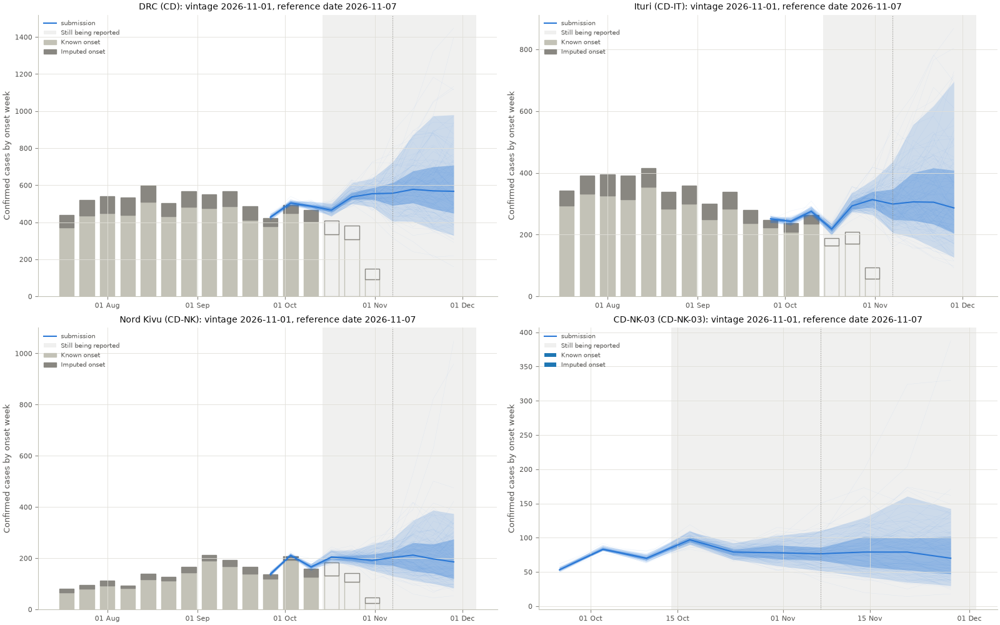

# Hub submission

Each week we submit forecasts to the [BDBV Modeling Hub](https://github.com/InsightNet-US/BDBV-Modeling-Hub).
We evaluate every model against the random walk and the random walk nowcast on the hub's own releases, and compare them with the other hub teams.

- [Nowcast](../nowcast.md): the current nowcast of every model.
- [Backtest](../backtest.md): every model scored on past releases.
- [Comparison with hub forecasts](../comparison.md): our models against the hub teams.
- Data: the [hub data](../data.md) and how we [read it](../methods/data.md).
- Methods: [evaluation](../methods/evaluation.md) and the [pairing sensitivity](../pairing.md).
- Submission: the [workflow](../submission/workflow.md), the [hub specification](../submission/hub-spec.md), [opting in](../submission/opting-in.md) and the [submission log](../submission/rounds/index.md).

Next: [Nowcast](../nowcast.md).
