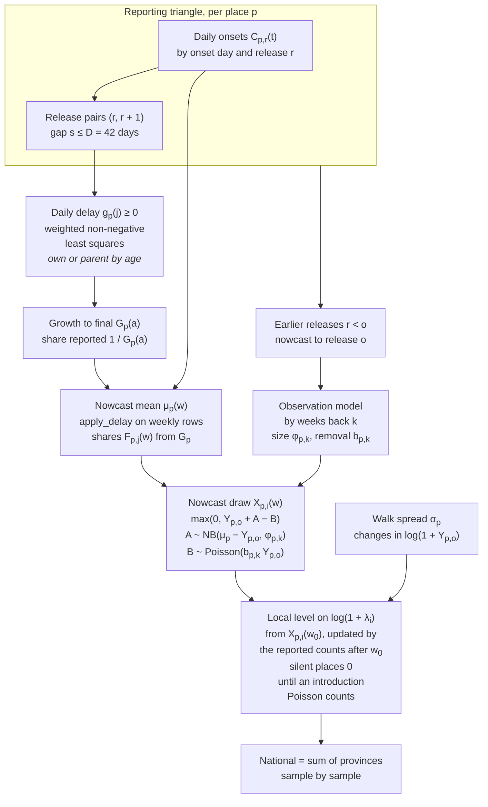
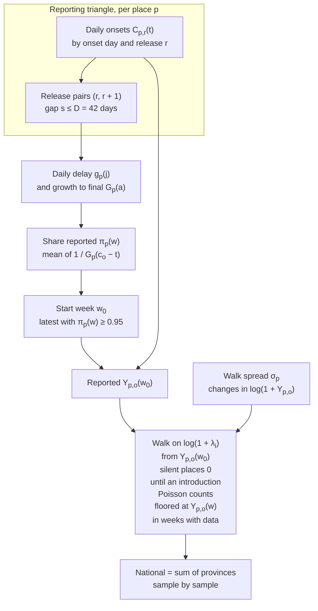

# Baseline models

`randomwalknowcast`, its partially pooled variant `pprandomwalknowcast`, and `randomwalk`, their comparison model.
{ .page-subtitle }

The data and notation are on the [Data methods page](data.md#target-and-notation).
The renewal models are on the [Renewal models](model.md) page.
`randomwalknowcast` nowcasts the recent weeks with baselinenowcast[^bnc-paper][^bnc-package] and forecasts with a random walk from the nowcast.
`randomwalk` is the same walk from the latest complete week, with no nowcast.
Both run at province and zone level ([Health zones](#health-zones)), and national is the sum of the provinces.

## Structure

`randomwalknowcast` nowcasts each recent week and walks forward from each nowcast draw.

`randomwalk` uses the same delay only to find its start week.

## Daily release snapshots

Both models use the daily onsets of each hub release ([Data](data.md#release-snapshots)).
$C_{p,r}(t)$ is the known plus imputed onsets in place $p$ on day $t$ at release $r$.
$Y_{p,r}(w)$ is their sum over the days of week $w$.
A forecast is made from the vintage of its date, whose latest release is $o$.
Release $r$ has cut-off $c_r$.
Day $t \le c_r$ is observed at $r$ and is $a = c_r - t$ days old.
Days after the cut-off are not observed.
$w$ is $k$ weeks back when it is $k$ weeks before the week holding the release cut-off.

A pair of consecutive releases $(r, r + 1)$ has gap $s = c_{r+1} - c_r$ days.
$D = 42$ days is baselinenowcast's `max_delay`, and a pair is in window when $1 \le s \le D$.
Only in-window pairs inform the delay.
A pair outside the window keeps its counts in the data.
A model raises if the vintage has no snapshots or no in-window pair.

## Delay

The delay follows baselinenowcast[^bnc-paper][^bnc-package] on the daily snapshots, with one extension.
Releases are batched reports of one daily delay.
With $g_p(j) \ge 0$ the daily log development factor at age $j$, and $g_p(j) = 0$ for $j \ge D$, a day of age $x$ at release $r$ grows to release $r + 1$ by $\exp \sum_{j=x}^{x+s-1} g_p(j)$.
For each gap $s$ and age $x = 0, \dots, D - 1$,

$$
\log \frac{\sum C_{p,r+1}(t)}{\sum C_{p,r}(t)} = \sum_{j=x}^{x+s-1} g_p(j),
$$

summed over the in-window pairs of gap $s$ and over days $t$ of age $x$ at $r$ that both releases observe.
$g_p$ is the non-negative least squares fit of all these equations, each weighted by its denominator $\sum C_{p,r}(t)$, with no smoothing over age.
With a gap of 1 only, $\exp g_p(x)$ is baselinenowcast's chain ladder factor.
Cells a release does not observe are skipped, not filled, and a gap and age with a zero denominator give no equation.
The parent of a province is the country, whose counts are the sum of its provinces.
Only onset days less than $1.5 D = 63$ days before the cut-off of the latest release used contribute to the sums, as baselinenowcast's default `n_history_delay`, and a retrospective fit uses the cut-off of its own release.
Before the sums, each day's increments between its releases go through baselinenowcast's `preprocess_negative_values`, so a downward revision is set to zero and taken from the earlier increments of that day and no ratio falls below 1.
This applies to the delay only, because the removals below still allow negative revisions.
The preprocessing runs along releases for each onset day, where baselinenowcast runs it along the delay columns of a reporting triangle.

The growth of a day's count from age $a$ to final is

$$
G_p(a) = \exp \sum_{j=a}^{D-1} g_p(j),
\qquad
G_p(a) = 1 \text{ for } a \ge D,
$$

and $1 / G_p(a)$ is the share of it reported.
There is no growth past $D$, so an equation whose ages run past $D$ puts that growth on its ages below $D$.

## Nowcast

Each hub week is a reference time of a weekly reporting triangle, with a column every 7 days after $c_o$ and a last one at $c_o + D$, where $F = 1$.
The share of week $w$ reported by column $j$ is

$$
F_{p,j}(w) = \frac{1}{n_w} \sum_{t \in w,\ t \le c_o} \frac{1}{G_p(c_o - t + 7j)},
$$

with $n_w$ the days of $w$ observed at $o$.
baselinenowcast's `apply_delay` fills the row from $x_0 = Y_{p,o}(w)$, adding at each column

$$
x_j = x_{j-1} + \frac{x_{j-1} + 1 - F_{p,j-1}(w)}{F_{p,j-1}(w)} \big(F_{p,j}(w) - F_{p,j-1}(w)\big),
$$

and the last column is the nowcast mean $\mu_p(w)$.
The $+1$ is baselinenowcast's.
It gives a week with 0 reported the mean $1 / F_{p,0}(w) - 1 - \sum_{j \ge 1} (F_{p,j}(w) - F_{p,j-1}(w)) / F_{p,j}(w)$, about 2 to 3 cases at $F_{p,0}(w) = 0.22$, and it adds less to a week the more complete it is.
With $\text{rem} = \mu_p(w) - Y_{p,o}(w) \ge 0$ the count still to come, the final count is new reports minus removals, as in epinowcast,

$$
X_{p,i}(w) = \max\big\{0,\ Y_{p,o}(w) + A - B\big\},
\qquad
A \sim \text{NB}\big(\text{rem},\ \phi_{p,k}\big),
\qquad
B \sim \text{Poisson}\big(b_{p,k}\, Y_{p,o}(w)\big).
$$

$A$ is baselinenowcast's negative binomial on the remaining count, with mean $\text{rem}$ and size $\phi_{p,k}$.
$B$ removes a share $b_{p,k}$ of the count reported, so counts can be revised down.
Before the floor the mean is $\mu_p(w) - b_{p,k} Y_{p,o}(w)$.
Weeks with no day younger than $D$ at $o$ have $\text{rem} = 0$ and $b_{p,k} = 0$, so they keep their reported count.
Sample $i$ is one draw of $X_{p,i}(w)$ per week.

**Fit.**
For each earlier release $r < o$ with an in-window pair among the releases up to $r$, a nowcast $\hat y_p(w)$ is made from the data up to $r$, with the delay of $r$.
It is the same weekly fill from $c_r$, with the $g_p$ of $r$ and the shares taken relative to the count at $c_o$, so its last column is at $c_o$.
For weeks back $k$ with a day younger than $D$ at $r$, and where $Y_{p,r}(w) > 0$ or $\hat y_p(w) > 0$, the count of $w$ on days up to $c_r$ is compared between releases $r$ and $o$.
A rise is the new reports $A_{p,r}(w)$ and a fall the removals $B_{p,r}(w)$, so both are weekly, as the forecast is.
With $\widehat{\text{rem}} = \hat y_p(w) - Y_{p,r}(w)$,

$$
\phi_{p,k} = \arg\max_\phi \sum \log \text{NB}\big(A_{p,r}(w);\ \widehat{\text{rem}},\ \phi\big),
\qquad
b_{p,k} = \frac{\sum B_{p,r}(w)}{\sum Y_{p,r}(w)},
$$

summed over the kept releases.
$\phi_{p,k}$ is fitted by maximum likelihood on $[0.1, 1000]$, one size per $k$, as baselinenowcast does.
A week with $\widehat{\text{rem}} = 0$ says nothing about $\phi$, so it is left out of that fit.
The weeks in the fit of $\phi_{p,k}$ are the errors at $k$.
$b_{p,k}$ is the Poisson maximum likelihood estimate of the removals.
Where the estimate chosen by the [pooling rule](#own-or-pooled-estimates) has fewer than 3 errors at $k$, $\phi_{p,k} \approx 2.2$, the median of epinowcast's prior $1 / \sqrt{\phi} \sim \mathcal{N}^+(0, 1)$.

## Own or pooled estimates

The places form a hierarchy of zone, province and country.
The delay is chosen by age.
A place uses its own $g_p(x)$ when its denominator $\sum C_{p,r}(t)$ at age $x$, summed over the pairs, is at least 10 cases.
Otherwise it uses its parent's at that age.
The country uses its own.

The size $\phi_{p,k}$ and the walk spread $\sigma_p$ are chosen by the place's level $\ell_p$, the mean of $Y_{p,o}(w)$ over weeks 3 to 6 back.
A place with $\ell_p \ge 10$ cases a week uses its own $\sigma_p$.
It uses its own $\phi_{p,k}$ when it also has at least 3 errors at $k$.
Otherwise it uses the pooled estimate of its nearest parent that meets the same rule, and otherwise the country's.
A pooled estimate uses the errors and weekly changes of the parent's children with $\ell \ge 10$ together, or the parent's own where none has.
The removal rate $b_{p,k}$ is always the place's own, so a place with no falls has none.

## Walk

Both models walk forward on $\log(1 + \lambda)$ from a start value $x_i$ in sample $i$.
For $h \ge 1$ weeks after the start,

$$
\log\{1 + \lambda_i(h)\} = \max\Big(0,\ \log\{1 + x_i\} + \sigma_p \sum_{j=1}^{h} z_{i,j}\Big),
\qquad
z_{i,j} \sim \mathcal{N}(0, 1),
\qquad
\tilde y_i(h) \sim \text{Poisson}\big(\lambda_i(h)\big).
$$

Steps are summed within a sample, so each sample is one trajectory.
`randomwalk` starts from its start week ([Random walk](#random-walk)).
`randomwalknowcast` starts from the week holding $c_o$ ([Random walk on a nowcast](#random-walk-on-a-nowcast)).

$\sigma_p$ is the sample standard deviation of the weekly changes of $\log\{1 + Y_{p,o}(w)\}$ over the 9 weeks ending at the start week of `randomwalk`, so up to 8 changes.
With fewer than 2 changes it is 0.

A place with no case reported in the 9 weeks up to the week holding $c_o$ is silent.
A silent place is exactly 0 until its first introduction, with no walk noise around 0 and no nowcast of its zero weeks.
After the start week of `randomwalk`, an introduction comes in each week with probability $q_p$ times the share of the week not yet reported, and $q_p$ in weeks without data.
The introduction brings a count drawn from Poisson(1) given at least 1, and the place walks from it.
$q_p$ is the share of weeks with a case among the weeks that follow 9 weeks with none.
It pools the place and its siblings (the zones of its province, or the provinces of the country), in weeks up to the start week of `randomwalk`, and the country uses its own weeks.
It is estimated at each origin from the counts reported then.

## Random walk

`randomwalk` makes no nowcast.
Its start week $w_0$ is the latest week with

$$
\pi_p(w) = \frac{1}{7} \sum_{t \in w,\ t \le c_o} \frac{1}{G_p(c_o - t)} \ge 0.95,
$$

the estimated share of the week's final count reported, under the delay above.
If any place, parents included, has no such week, `randomwalk` raises (`NoCompleteWeek`) and gives no forecast for the vintage.
For the spread and introductions of `randomwalknowcast`, a place with no such week starts at the first week.
$x_i = Y_{p,o}(w_0)$ for every sample.
Weeks up to $w_0$ are the reported counts.
Later weeks with data are walk draws, floored at the reported count.

## Random walk on a nowcast

`randomwalknowcast` runs the walk as a local level on $\log(1 + y)$, filtered on the reported counts by a scalar Kalman filter.
Its start week $w_0$ is the latest full week that is at least 5% reported and has at least 5 cases, else the first week.
A silent place starts at the start week of `randomwalk` instead.
Weeks up to $w_0$ are the nowcast draws $X_{p,i}(w)$.
In sample $i$ the level at $w_0$ is $\log\{1 + X_{p,i}(w_0)\}$ with variance 0.
Each later week $u$ up to the week holding $c_o$ is not nowcast.
In it the level takes a step of variance $\sigma_p^2$ and is then updated by the observation $\log\{1 + Y_{p,o}(u) / \pi_p(u)\}$ with variance $1 / \{\pi_p(u) + Y_{p,o}(u)\}$.
This is the delta-method variance of a Poisson final count thinned to the share reported.
A week with $\pi_p(u) = 0$ gives no update.
The level at the week holding $c_o$ is drawn from the filter, and the levels of earlier weeks back to $w_0$ are drawn given it.
So the weeks after $w_0$ and the forecast are one trajectory.
Each of these weeks is a Poisson draw from its level, floored at the count reported.
The walk starts from the drawn level at the week holding $c_o$.

## Health zones

`randomwalk` and `randomwalknowcast` run on each zone's own release snapshots with the same code as for provinces.
Each zone takes its delay, size and walk spread by the rules [above](#own-or-pooled-estimates).
Zone samples sum to their province's samples, sample by sample and week by week.
Province sample $Y^{(i)}(w)$ is apportioned over the zones in proportion to the zone model's own sample $x^{(i)}_z(w)$ of the same id and week:

$$
y^{(i)}_z(w) \approx Y^{(i)}(w)\, \frac{x^{(i)}_z(w)}{\sum_{z'} x^{(i)}_{z'}(w)}.
$$

Largest remainders make the values whole numbers that sum to $Y^{(i)}(w)$.
Where every $x^{(i)}_z(w)$ is 0 the split uses the Dirichlet mean shares of the [Renewal models](model.md#split-of-province-samples) page.

## Partially pooled variant

`pprandomwalknowcast` is `randomwalknowcast` with the delay $g_p$, the walk spread $\sigma_p$, the size $\phi_{p,k}$ and the removal rate $b_{p,k}$ partially pooled over zones, provinces and the country, in place of the [own-or-pooled rule](#own-or-pooled-estimates).
The nowcast draws, the walk and the zone reconciliation are the same.
Each is fitted in numpyro with NUTS, with 2 chains of 500 warm-up and 500 draws run in sequence from the prior medians, at target acceptance 0.9.

Each parameter $\theta$ of place $p$ is its parent's plus an offset for the place's tier,

$$
\theta_p = \theta_{\mathrm{pa}(p)} + \tau_{v(p)}\, z_p,
\qquad
z_p \sim \mathcal{N}(0, 1),
\qquad
\tau_v \sim \mathcal{N}^+(0, 0.5^2),
$$

with $v(p)$ the tier of $p$ (province or zone) and one $\tau_v$ for each tier and parameter.
$\theta$ is $\log g_p(j)$ for each age $j$, $\log \sigma_p$, and $\log \phi_{p,k}$ and $\log b_{p,k}$ for each week back $k$.
The country's values have priors $\mathcal{N}(-3, 2^2)$, $\mathcal{N}(\log 0.2, 1)$, $\mathcal{N}(0, 1.5^2)$ and $\mathcal{N}(\log 0.005, 1.5^2)$.
A place's counts are the sum of its children's, so for the walk spread and the nowcast uncertainty only the places forecast (the provinces, or the zones at zone level) enter the likelihood, and their parents are latent centres.

- **Delay.** For each gap $s$ and age $x$ with $\sum C_{p,r}(t) > 0$, the increment is Poisson,

  $$
  \sum C_{p,r+1}(t) - \sum C_{p,r}(t) \sim \text{Poisson}\Big(\sum C_{p,r}(t)\, \big(e^{\sum_{j=x}^{x+s-1} g_p(j)} - 1\big)\Big),
  $$

  with the sums, window and preprocessing of the [delay](#delay).
  With one place and a gap of 1 its maximum likelihood estimate is baselinenowcast's chain ladder factor.
  A place's increments at age $x$ enter only where its denominator there, summed over the pairs, is at least 10 cases, as in the [own-or-pooled rule](#own-or-pooled-estimates), and the country's always do.
  Other ages are informed only through the pooling.
  A parent's increments are its children's summed, so a case at an age where both fit their own enters the likelihood once for each level.
  It is fitted at the origin and at each earlier release that gives errors.
- **Walk spread.** The weekly changes of $\log\{1 + Y_{p,o}(w)\}$ over the [walk](#walk) window are $\mathcal{N}(0, \sigma_p^2)$.
  Changes between two weeks with no cases are left out.
- **Nowcast uncertainty.** The new reports $A_{p,r}(w)$ are $\text{NB}(\widehat{\text{rem}}, \phi_{p,k})$ and the removals $B_{p,r}(w)$ are $\text{Poisson}(b_{p,k} Y_{p,r}(w))$, on the errors of [the fit](#nowcast), made with the pooled delay of each earlier release.

The posterior medians of $g_p$, $\sigma_p$, $\phi_{p,k}$ (kept in $[0.1, 1000]$) and $b_{p,k}$ replace the estimates of `randomwalknowcast`.
So the forecasts carry the pooled point estimates, not their posterior spread.
It is scored on the real releases at province and zone level.

## Limitations

While the release history in the delay window is shorter than $D$, no chain to the final count can be checked against a final count.
Each delay factor rests on one onset day per age per pair, and the youngest ages rest on few cases even nationally.
The onset clock assumes a constant lag from the latest onset day to extraction, but the lag varies between releases.
The chain ladder treats reporting speed as fixed by age and step, but speed and backlogs vary between releases.
The observation model is learnt from the earlier releases, which may be few.
Counts include the hub's imputed onsets, which are re-drawn as cases gain onsets, so changes between releases mix reporting with imputation.
Places are sampled independently, so a shock to a whole release is not shared, and the national band is a sum of independent provincial bands.
The walk has no drift, and its spread comes from 8 weekly changes, which for small places include Poisson noise.
`pprandomwalknowcast` plugs in posterior medians, so the uncertainty in its pooled estimates does not widen its forecasts.

[^bnc-paper]: Johnson KE, Tang M, Tyszka E, Nemcova B, Wolffram D, Ergas R, Reich NG, Funk S, Mellor J, Bracher J, Abbott S (2025). Baseline nowcasting methods for handling delays in epidemiological data. Wellcome Open Research. [doi:10.12688/wellcomeopenres.25027.2](https://doi.org/10.12688/wellcomeopenres.25027.2).
[^bnc-package]: Johnson KE, Tyszka E, Bracher J, Funk S, Abbott S (2025). baselinenowcast: Methods for baseline nowcasting right-truncated epidemiological data. <https://github.com/epinowcast/baselinenowcast/>.
