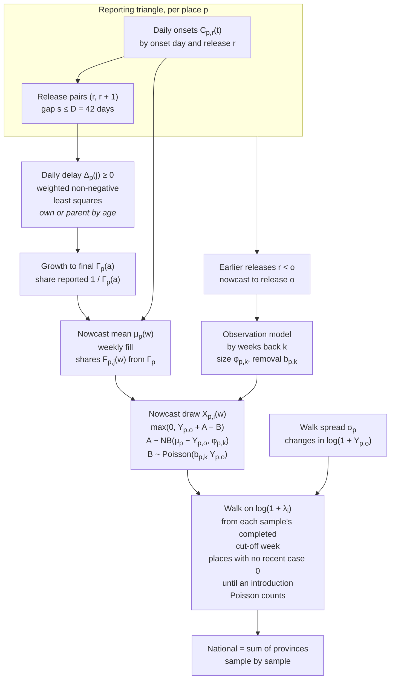
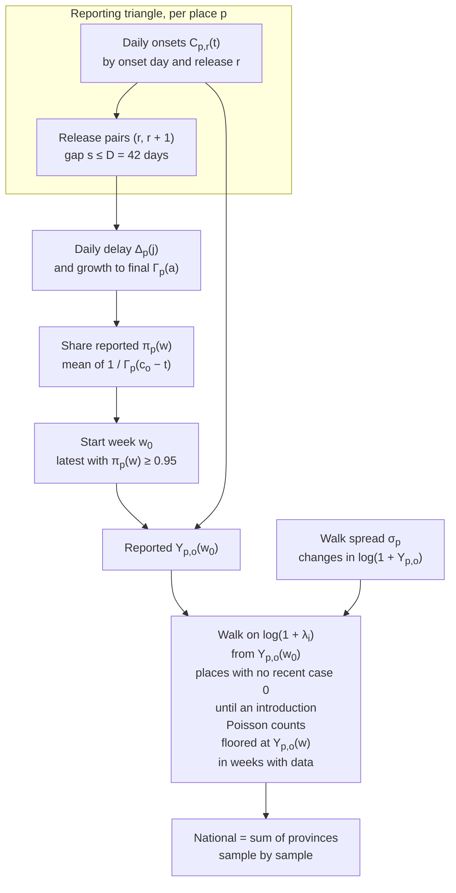

# Baseline models

`randomwalknowcast`, its generative partially pooled variant `pprandomwalknowcast`, and `randomwalk`, their comparison model.
{ .page-subtitle }

The data and notation are on the [Data methods page](data.md#target-and-notation).
The renewal models are on the [Renewal models](model.md) page.
`randomwalknowcast` nowcasts the recent weeks with baselinenowcast[^bnc-paper][^bnc-package] and forecasts with a random walk from the nowcast.
`randomwalk` is the same walk from the latest complete week, with no nowcast.
Both run at province and zone level ([Health zones](#health-zones)), and national is the sum of the provinces.

In brief, `randomwalknowcast`:

1. follows baselinenowcast, through a JAX port of the R package with one named extension for release snapshots ([Delay](#delay));
2. has an observation model for the nowcast as in baselinenowcast, negative binomial new reports on the count still to come, fitted from retrospective nowcasts ([Nowcast](#nowcast));
3. nowcasts every week up to the cut-off and completes a partial cut-off week from a walk that starts at the latest full week at least 5% reported with at least 5 cases ([Start from the nowcast](#start-from-the-nowcast));
4. continues each nowcast trajectory with a random walk on $\log(1 + y)$ ([Forecast](#forecast));
5. takes the walk's variance net of Poisson noise ([Forecast](#forecast));
6. shares the delay, size and walk variance with a parent where a place has fewer than 10 cases a week ([Own or pooled estimates](#own-or-pooled-estimates)).

Two further rules keep places with few or no cases sensible: introductions for places with no recent case ([Forecast](#forecast)), and zone samples that sum to their province's ([Health zones](#health-zones)).

## Structure

`randomwalknowcast` nowcasts each recent week and walks forward from each nowcast draw.

`randomwalk` uses the same delay only to find its start week.

## Daily release snapshots

Both models use the daily onsets of each hub release ([Data](data.md#release-snapshots)).
$C_{p,r}(t)$ is the known plus imputed onsets in place $p$ on day $t$ at release $r$.
$Y_{p,r}(w)$ is their sum over the days of week $w$.
A forecast is made from the vintage of its date, whose latest release is $o$.
Release $r$ has cut-off $c_r$, its latest onset day ([Data](data.md#vintages)).
Day $t \le c_r$ is observed at $r$ and is $a = c_r - t$ days old.
Days after the cut-off are not observed.
$w$ is $k$ weeks back when it is $k$ weeks before the week holding the release cut-off.

A pair of consecutive releases $(r, r + 1)$ has gap $s = c_{r+1} - c_r$ days.
$D = 42$ days is baselinenowcast's maximum delay, and a pair is in window when $1 \le s \le D$.
Only in-window pairs inform the delay.
A pair outside the window keeps its counts in the data.
A model raises if the vintage has no snapshots or no in-window pair.

## Delay

The delay follows baselinenowcast[^bnc-paper][^bnc-package] on the daily snapshots, with one extension.
Releases are batched reports of one daily delay.
With $\Delta_p(j) \ge 0$ the daily log development factor at age $j$, and $\Delta_p(j) = 0$ for $j \ge D$, a day of age $x$ at release $r$ grows to release $r + 1$ by $\exp \sum_{j=x}^{x+s-1} \Delta_p(j)$.
For each gap $s$ and age $x = 0, \dots, D - 1$,

$$
\log \frac{\sum C_{p,r+1}(t)}{\sum C_{p,r}(t)} = \sum_{j=x}^{x+s-1} \Delta_p(j),
$$

summed over the in-window pairs of gap $s$ and over days $t$ of age $x$ at $r$ that both releases observe.
$\Delta_p$ is the non-negative least squares fit of all these equations, each weighted by its denominator $\sum C_{p,r}(t)$, with no smoothing over age.
With a gap of 1 only, $\exp \Delta_p(x)$ is baselinenowcast's chain ladder factor.
Cells a release does not observe are skipped, not filled, and a gap and age with a zero denominator give no equation.
The parent of a province is the country, whose counts are the sum of its provinces.
A place takes its own or a pooled $\Delta_p$ by the [own-or-pooled rule](#own-or-pooled-estimates).
Only onset days less than $1.5 D = 63$ days before the cut-off of the latest release used contribute to the sums, as in baselinenowcast's default, and a retrospective fit uses the cut-off of its own release.
Before the sums, each day's increments between its releases go through baselinenowcast's handling of negative values, so a downward revision is set to zero and taken from the earlier increments of that day and no ratio falls below 1.
This applies to the delay only, because the removals below still allow negative revisions.
The preprocessing runs along releases for each onset day, where baselinenowcast runs it along the delay columns of a reporting triangle.

The growth of a day's count from age $a$ to final is

$$
\Gamma_p(a) = \exp \sum_{j=a}^{D-1} \Delta_p(j),
\qquad
\Gamma_p(a) = 1 \text{ for } a \ge D,
$$

and $1 / \Gamma_p(a)$ is the share of it reported.
There is no growth past $D$, so an equation whose ages run past $D$ puts that growth on its ages below $D$.

## Nowcast

Each hub week is a reference time of a weekly reporting triangle, with a column every 7 days after $c_o$ and a last one at $c_o + D$, where $F = 1$.
The share of week $w$ reported by column $j$ is

$$
F_{p,j}(w) = \frac{1}{n_w} \sum_{t \in w,\ t \le c_o} \frac{1}{\Gamma_p(c_o - t + 7j)},
$$

with $n_w$ the days of $w$ observed at $o$.
baselinenowcast fills the row from $x_0 = Y_{p,o}(w)$, adding at each column

$$
x_j = x_{j-1} + \frac{x_{j-1} + 1 - F_{p,j-1}(w)}{F_{p,j-1}(w)} \big(F_{p,j}(w) - F_{p,j-1}(w)\big),
$$

and the last column is the nowcast mean $\mu_p(w)$.
With $\text{rem} = \mu_p(w) - Y_{p,o}(w) \ge 0$ the count still to come, the final count is new reports minus removals, as in epinowcast,

$$
X_{p,i}(w) = \max\big\{0,\ Y_{p,o}(w) + A - B\big\},
\qquad
A \sim \text{NB}\big(\text{rem},\ \phi_{p,k}\big),
\qquad
B \sim \text{Poisson}\big(b_{p,k}\, Y_{p,o}(w)\big).
$$

$A$ is baselinenowcast's negative binomial on the remaining count, with mean $\text{rem}$ and size $\phi_{p,k}$.
$B$ removes a share $b_{p,k}$ of the count reported, so counts can be revised down.
Before the floor the mean is $\mu_p(w) - b_{p,k} Y_{p,o}(w)$.
Weeks with no day younger than $D$ at $o$ have $\text{rem} = 0$ and $b_{p,k} = 0$, so they keep their reported count.
Sample $i$ is one draw of $X_{p,i}(w)$ per week.

$\phi_{p,k}$ and $b_{p,k}$ are fitted as follows.

1. Take each earlier release $r < o$ with an in-window pair among the releases up to $r$, and a cut-off at most $3D - 1.5D = 63$ days before $c_o$, the reference times baselinenowcast leaves for its retrospective nowcasts.
2. Nowcast from the data up to $r$ with the delay of $r$, $\hat y_p(w)$.
   It is the same weekly fill from $c_r$, with the shares taken relative to the count at $c_o$, so its last column is at $c_o$.
3. For weeks back $k$ with a day younger than $D$ at $r$, and where $Y_{p,r}(w) > 0$ or $\hat y_p(w) > 0$, compare the count of $w$ on days up to $c_r$ between releases $r$ and $o$.
   A rise is the new reports $A_{p,r}(w)$ and a fall the removals $B_{p,r}(w)$.
4. With $\widehat{\text{rem}} = \hat y_p(w) - Y_{p,r}(w)$, fit

    $$
    \phi_{p,k} = \arg\max_\phi \sum \log \text{NB}\big(A_{p,r}(w);\ \widehat{\text{rem}},\ \phi\big),
    \qquad
    b_{p,k} = \frac{\sum B_{p,r}(w)}{\sum Y_{p,r}(w)},
    $$

summed over the kept releases.
$\phi_{p,k}$ is fitted by maximum likelihood on $[0.1, 1000]$, one size per $k$, as baselinenowcast does.
A week with $\widehat{\text{rem}} = 0$ says nothing about $\phi$, so it is left out of that fit.
The weeks in the fit of $\phi_{p,k}$ are the errors at $k$.
$b_{p,k}$ is the Poisson maximum likelihood estimate of the removals.
Where the estimate chosen by the [pooling rule](#own-or-pooled-estimates) has no errors at $k$, $\phi_{p,k} \approx 2.2$, the median of epinowcast's prior $1 / \sqrt{\phi} \sim \mathcal{N}^+(0, 1)$.

## Own or pooled estimates

The places form a hierarchy of zone, province and country.
Each estimate is chosen by one rule.

1. **Level.** The place's level $\ell_p$ is the mean of $Y_{p,o}(w)$ over weeks 3 to 6 back.
2. **Own.** A place with $\ell_p \ge 10$ cases a week uses its own delay $\Delta_p$, size $\phi_{p,k}$ and walk spread $\sigma_p$.
   The walk spread also needs an own $\sigma_p^2 > 0$ ([below](#forecast)).
3. **Fallback.** Otherwise it uses the pooled estimate of its nearest parent that meets the same rule, and otherwise the country's.
   A pooled estimate uses together the pair sums, errors and weekly changes of the parent's children with $\ell \ge 10$, or the parent's own where none has.
6. **Removals.** The removal rate $b_{p,k}$ is always the place's own.
7. **Zone delays.** A zone takes its province's delay, whatever its level.
   A zone's own delay rests on few cases, and the nowcast divides by the share reported, so noise in it inflates the zones' nowcasts.

## Forecast

Both models forecast with a random walk on $\log(1 + \lambda)$ and Poisson counts.
From a start value $x_i$ in sample $i$, for $h \ge 1$ weeks after the start,

$$
\log\{1 + \lambda_i(h)\} = \max\Big(0,\ \log\{1 + x_i\} + \sigma_p \sum_{j=1}^{h} z_{i,j}\Big),
\qquad
z_{i,j} \sim \mathcal{N}(0, 1),
\qquad
\tilde y_i(h) \sim \text{Poisson}\big(\lambda_i(h)\big).
$$

Steps are summed within a sample, so each sample is one trajectory.
`randomwalk` starts from the latest complete week ([below](#start-from-the-latest-complete-week)).
`randomwalknowcast` starts from each sample's completed week holding $c_o$ ([below](#start-from-the-nowcast)).

$\sigma_p$ comes from the weekly changes $\Delta_w = \log\{1 + Y_{p,o}(w)\} - \log\{1 + Y_{p,o}(w - 1)\}$ over the 9 weeks ending at the latest complete week, so up to 8 changes.
Each change carries Poisson noise, and the walk draws Poisson counts on top, so the noise is taken out of the spread:

$$
\sigma_p^2 = s^2_\Delta - \overline{v\{Y_{p,o}(w - 1)\} + v\{Y_{p,o}(w)\}},
\qquad
v(y) = \frac{y}{(1 + y)^2},
$$

where $s^2_\Delta$ is the sample variance of the changes and the bar a mean over the changes.
$v$ is the delta-method variance of $\log(1 + Y)$ for $Y \sim \text{Poisson}(\lambda)$, $\lambda / (1 + \lambda)^2$, with the reported count for $\lambda$.
The noise matters only for small places. At 10 cases a week the term for a change is about 0.17, and at 250 it is under 0.01.
At a few cases a week the delta method understates the noise, so some of it stays in $\sigma_p$.
A place whose $\sigma_p^2$ is 0 or below, or which has fewer than 2 changes, has no own estimate, and takes its parent's by the [own-or-pooled rule](#own-or-pooled-estimates).
If no parent nor the country has a variance above 0, the model gives no forecast for that origin.
A pooled $\sigma_p$ uses the changes and noise of all the places in the pool together.

A place with no case in the 9 weeks to $c_o$ stays at 0 until a new introduction, which starts its walk from a Poisson(1) count given at least 1.
An introduction occurs each week after the latest complete week with probability $q_p$, times the share of the week not yet reported.
$q_p$ is estimated over the 9 weeks to the place's start week, the weeks that set its walk spread, from the place and its siblings.
A place with no case yet takes the rate of a first case: the share of weeks with a case among the weeks with no case before them.
A place seen before takes the rate of a re-introduction: the share of weeks with a case among the weeks with an earlier case but none in the 9 weeks before.
If the siblings have no introduction of that kind in the 9 weeks, all weeks to the start week count instead.
Without this rule a silent place would walk from a nowcast near 0, with baselinenowcast's $+1$ and a pooled spread, and so forecast a few cases every week.
Most zones and several provinces are silent at any origin, and their truth is almost always 0, so the rule keeps them at exactly 0 unless a case is likely from what their siblings show.

## Start from the latest complete week

`randomwalk` makes no nowcast.
Its start week $w_0$ is the latest week with

$$
\pi_p(w) = \frac{1}{7} \sum_{t \in w,\ t \le c_o} \frac{1}{\Gamma_p(c_o - t)} \ge 0.95,
$$

the estimated share of the week's final count reported, under the delay above.
If any place has no such week, `randomwalk` gives no forecast for the vintage.
$x_i = Y_{p,o}(w_0)$ for every sample.
Weeks up to $w_0$ are the reported counts.
Later weeks with data are walk draws, floored at the reported count.
Where no week reaches 0.95, `randomwalknowcast` takes the first week as the latest complete week.

## Start from the nowcast

`randomwalknowcast` walks on from each sample's own completed week holding $c_o$.

1. Weeks before the one holding $c_o$ are the nowcast draws $X_{p,i}(w)$.
2. If the week holding $c_o$ is full, its value in sample $i$ is its nowcast draw.
3. If it is partial, its nowcast covers its days up to $c_o$, and its later days add $\text{Poisson}(\lambda_i \cdot m / 7)$, with $m$ the missing days.
   $\lambda_i$ is the walk's rate for that week, walked by sample $i$ from its nowcast $X_{p,i}(w_0)$ of the start week $w_0$, the latest full week that is at least 5% reported and has at least 5 cases.
4. The weeks after it are the walk's draws from the sample's completed value of that week, $\log(1 + y)$ plus the walk's steps.
5. A place with no case in the 9 weeks to $c_o$, or with no start week, starts at the latest complete week instead.
   After it the place stays at 0 until an introduction, as above, floored at the counts reported.

## Health zones

`randomwalk` and `randomwalknowcast` run on each zone's own release snapshots in the same way as for provinces.
Each zone takes its size and walk spread by the rules [above](#own-or-pooled-estimates), and its province's delay.
Province sample $Y^{(i)}(w)$ is apportioned over the zones in proportion to the zone model's own sample $x^{(i)}_z(w)$ of the same id and week:

$$
y^{(i)}_z(w) \approx Y^{(i)}(w)\, \frac{x^{(i)}_z(w)}{\sum_{z'} x^{(i)}_{z'}(w)}.
$$

Largest remainders make the values whole numbers that sum to $Y^{(i)}(w)$, so zone samples sum to their province's samples ([Renewal models](model.md#health-zones)).
Where every $x^{(i)}_z(w)$ is 0 the split uses the Dirichlet mean shares of the [Renewal models](model.md#split-of-province-samples) page.
Zones are reconciled because their own walks are noisy and do not sum to their province's, which pools more data.
The split keeps each zone's share from its own sample, and the province sets the total, so the zone, province and national forecasts describe one set of trajectories.

## Partially pooled variant

`pprandomwalknowcast` is one generative model of the expected final counts and the reporting delay, in the style of epinowcast[^enw].
It is fitted with NUTS to the release snapshots, and its forecast samples are posterior predictive draws.
It keeps the random walk of `randomwalknowcast`, but makes the nowcast from the same model in place of a chain ladder, and partially pools over zones, provinces and the country in place of the [own-or-pooled rule](#own-or-pooled-estimates).

**Places.**
The places forecast are the leaves of the hierarchy: the provinces, or the zones at zone level.
A leaf with no case in the 9 weeks to $c_o$ is silent, as in `randomwalknowcast`.
Silent leaves are not fitted and draw introductions (below).
Every other leaf $p$ enters the likelihood.
A parent's counts are the sum of its children's, so the parents enter only as the centres the leaves are pooled towards, and each case enters once.

**Expected final counts.**
The expected final count of leaf $p$ in hub week $w$ is $\lambda_{p,w}$.
It is a random walk on the log scale over the 16 weeks to the week holding $c_o$,

$$
\log \lambda_{p,w} = \log \lambda_{p,w-1} + \delta_{p,w},
\qquad
\delta_{p,w} \sim \mathcal{N}(0, \sigma_p^2).
$$

Each onset day $t$ in week $w(t)$ expects $\lambda_{p,w(t)} / 7$ cases.

**Delay.**
A case is reported $d$ days after onset, with $d$ log-normal with location $\mu_p$ and scale $s$, cut to whole days and capped at $D = 42$.
The share of a day's final count reported by age $a$ is

$$
\pi_p(a) = \frac{F(a + 1;\ \mu_p, s)}{F(D + 1;\ \mu_p, s)}, \quad 0 \le a < D,
\qquad
\pi_p(a) = 1 \text{ for } a \ge D,
\qquad
\pi_p(-1) = 0,
$$

with $F$ the log-normal CDF.

**Observations.**
Day $t$ is $a_r(t) = c_r - t$ days old at release $r$.
Let $r'$ be the release before $r$, with $a_{r'}(t) = -1$ and $C_{p,r'}(t) = 0$ when $r$ is the first release that observes $t$.
The new reports between the two are

$$
C_{p,r}(t) - C_{p,r'}(t) \sim \text{NB}\Big(\frac{\lambda_{p,w(t)}}{7}\,\big\{\pi_p(a_r(t)) - \pi_p(a_{r'}(t))\big\},\ \phi\Big),
$$

for every onset day in the 16 weeks and every release up to $o$ that observes it.
This is epinowcast's reporting triangle, with each release a batch of report days.
It is right truncated by construction: a young day has seen only the start of its delay.
The counts first go through the [delay](#delay)'s handling of negative values, baselinenowcast's, so a downward revision is taken from earlier increments of the day and no increment is negative.
New reports of a day that was already $D$ days old at $r'$ have no probability under the model and are left out, as the chain ladder leaves out growth past $D$.
At 11-08 these are 412 of 10,878 national cases, 220 of them added by the 11-08 release.

**Pooling.**
$\mu_p$ and $\log \sigma_p$ of a place are its parent's plus an offset for its tier,

$$
\theta_p = \theta_{\mathrm{pa}(p)} + \tau_{v(p)}\, z_p,
\qquad
z_p \sim \mathcal{N}(0, 1),
$$

with $v(p)$ the tier of $p$ (province or zone) and one $\tau_v$ for each tier and parameter.
The delay scale $s$ and the dispersion $\phi$ are shared by all places.
With $s$ pooled as well, its $\tau$ fell towards 0 where a few large provinces pinned it, and 17% of the draws at 11-08 were divergent.

**Priors.**

| Parameter | Prior | Why |
|---|---|---|
| $\mu$ of the country | $\mathcal{N}(1.6, 1)$ | Median delay about 5 days, 2 to 13 within one sd |
| $\log s$ | $\mathcal{N}(\log 0.7, 0.5^2)$ | |
| $\log \sigma$ of the country | $\mathcal{N}(\log 0.2, 1)$ | Weekly log changes of about 0.2, 0.07 to 0.54 within one sd |
| $\log \phi$ | $\mathcal{N}(\log 10, 1.5^2)$ | |
| $\tau_v$ | $\mathcal{N}^+(0, 0.5^2)$ | A place within a factor of about 1.4 of its parent at the median |
| $\log \lambda_{p,w}$ in the first week | $\mathcal{N}(2, 3^2)$ | 0.02 to 3000 cases a week within two sd |

**Forecast.**
Each sample takes one posterior draw, and every draw is used once before any is used again.
A week's final count is the sum over its days.
A day up to $c_o$ is its count reported plus an NB draw of the rest, with mean $\lambda_{p,w(t)} / 7 \cdot \{1 - \pi_p(a_o(t))\}$ and size $\phi$.
A later day of the week holding $c_o$ is an NB draw with mean $\lambda_{p,w(t)} / 7$.
Later weeks continue the walk from the draw's last $\lambda$ with its $\sigma_p$, and their counts are NB with mean $\lambda$ and size $7 \phi$, the sum of seven days.
Weeks before the 16 fitted weeks are the counts reported.
National is the sum of the provinces by sample, and zones are reconciled to provinces as for `randomwalknowcast` ([Health zones](#health-zones)).

**Silent places.**
A silent leaf has no case to fit, and a walk from a $\lambda$ near 0 gave divergent draws.
As in `renewalsp` ([Renewal models](model.md)), it takes `randomwalknowcast`'s draws: its reported counts, then exactly 0 until an introduction, then a walk ([Forecast](#forecast)).
This is the one part of the model that is not drawn from its posterior.

**Scoring.**
On the reported target, the backtest maps its final counts to what a later release shows by the posterior median $\pi_p(a)$ of each place ([Evaluation](evaluation.md#real-releases)).

**Sampler.**
NUTS runs 2 chains of 500 warm-up and 750 draws, in sequence, from the prior medians, at target acceptance 0.9.
Each walk step is sampled as $\delta^*_{p,w} \sim \mathcal{N}(0, \sigma_p)$ and set to $\delta_{p,w} = \sqrt{\sigma_p}\, \delta^*_{p,w}$, numpyro's location-scale reparameterisation with centring $\tfrac{1}{2}$, halfway between centred and non-centred steps.
A large place's counts pin its walk, which suits centred steps, and a place with few cases leaves it to the prior, which suits non-centred ones.
In a trial at 11-08, with $\phi$ then pooled, half-centred steps gave 1 divergent draw in 1500, against 12 for non-centred steps, in half the leapfrog steps.
With $\phi$ shared, the fits at 10-17, 10-24, 11-01 and 11-08 have at most 1 divergent draw and a worst $\hat R$ of 1.013.
A fit whose worst split $\hat R$ is above 1.05, or with more than 1% of its draws divergent, raises, and the model gives no forecast for that origin.

**How it differs from `randomwalknowcast`.**

| | `randomwalknowcast` | `pprandomwalknowcast` |
|---|---|---|
| Delay | Chain ladder, non-parametric by age, own or parent's | Log-normal, $\mu_p$ pooled, $s$ shared |
| Nowcast | Chain-ladder fill, with NB new reports and Poisson removals fitted to retrospective nowcasts | NB new reports of the same model that fits the delay and the walk |
| Walk | On $\log(1 + y)$ from a nowcast draw, spread from 8 changes net of Poisson noise | On $\log \lambda$ over all 16 weeks, spread pooled, fitted jointly |
| Uncertainty in the estimates | None, point estimates | Each sample is a posterior draw |
| Removals | Poisson, counts can fall | None, the forecast is at least the count reported |
| Silent places | Introductions | `randomwalknowcast`'s draws, as in `renewalsp` |

## Limitations

While the release history in the delay window is shorter than $D$, no chain to the final count can be checked against a final count.
Each delay factor rests on one onset day per age per pair, and the youngest ages rest on few cases even nationally.
The cut-off is the latest onset day, which can be earlier than the true last report day.
The chain ladder treats reporting speed as fixed by age and step, but speed and backlogs vary between releases.
The observation model is learnt from the earlier releases, which may be few.
Counts include the hub's imputed onsets, which are re-drawn as cases gain onsets, so changes between releases mix reporting with imputation.
Places are sampled independently, so a shock to a whole release is not shared, and the national band is a sum of independent provincial bands.
The walk has no drift, and its spread comes from 8 weekly changes, net of a delta-method Poisson noise term that assumes no extra dispersion in the reported counts.
`pprandomwalknowcast`'s delay is log-normal, so it cannot take the shape of an irregular delay as the chain ladder can.

[^bnc-paper]: Johnson KE, Tang M, Tyszka E, Nemcova B, Wolffram D, Ergas R, Reich NG, Funk S, Mellor J, Bracher J, Abbott S (2025). Baseline nowcasting methods for handling delays in epidemiological data. Wellcome Open Research. [doi:10.12688/wellcomeopenres.25027.2](https://doi.org/10.12688/wellcomeopenres.25027.2).
[^enw]: Abbott S, Lison A, Funk S, Pearson C, Gruson H, Guenther F, et al. epinowcast: A Bayesian Framework for Real-Time Infectious Disease Surveillance. R package. [doi:10.5281/zenodo.5637165](https://doi.org/10.5281/zenodo.5637165). <https://github.com/epinowcast/epinowcast/>.
[^bnc-package]: Johnson KE, Tyszka E, Bracher J, Funk S, Abbott S (2025). baselinenowcast: Methods for baseline nowcasting right-truncated epidemiological data. <https://github.com/epinowcast/baselinenowcast/>.
