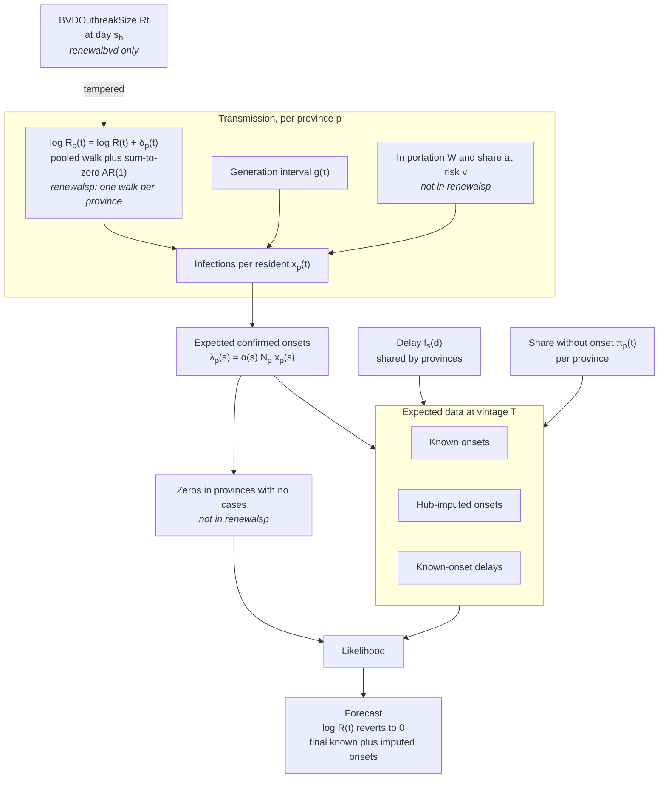

# Renewal models

The renewal models, with the maths of each.
{ .page-subtitle }

The data and notation are on the [Data methods page](data.md#target-and-notation).
How the models are built in code and sampled is on the [Implementation](implementation.md) page.

## Structure

The three renewal models share one generative structure.
`renewal` is the full model.
`renewalbvd` adds one likelihood term on Rt.
`renewalsp` fits each province on its own and drops the parts that link provinces.

Every time-varying part is a weekly random walk or AR(1), so it stays near constant unless the data show change.

### Time axis

The data weeks start one week before weekly onsets, summed over the modelled provinces, first reach 5, or their peak if lower.
They end with the week that holds the vintage date $T$.
The model axis starts 42 days (6 weeks) earlier, the length of the generation interval, for seeding.
Every weekly walk is held at its starting value over the 6 seeding weeks and the first data week.
The fit axis is the data weeks.
For `renewalbvd` it extends to the end of the week of $s_b$ when that week is after the data.

## Transmission

Provinces $p$ with cases have a renewal process, and provinces $q$ without cases an importation-only component.

### Reproduction number

$$
\log R_p(t) = \log R(t) + \delta_p(t).
$$

The pooled trend $\log R(t)$ is the unweighted mean of $\log R_p(t)$, not the national Rt.
It is a weekly random walk,

$$
\log R(t) = \log R(t - 1) + \sigma_R z(t),
\qquad
\sigma_R \sim \mathcal{N}^+(0, 0.2^2),
$$

with standard normal steps $z(t)$, sampled non-centred, and a start $\mathcal{N}(0, 0.5^2)$.
The province deviations sum to zero.
They are $\delta_p(t) = \sum_j Q_{pj}\, \eta_j(t)$, with $Q$ an orthonormal basis of the sum-to-zero subspace and $P - 1$ weekly AR(1) processes $\eta_j$ that decay towards 0, the pooled trend:

$$
\eta_j(t) = \phi\, \eta_j(t - 1) + \sigma_\delta z_j(t), \qquad \phi = 2^{-1/h}, \qquad h \sim \text{LogNormal}(\log 6, 0.6^2)\ \text{weeks}, \qquad \sigma_\delta \sim \mathcal{N}^+(0, 0.1^2).
$$

The shared $\sigma_\delta$ and $h$ pool the provinces.
The starting offsets are $\eta_j(0) = u_j$, with $u_j \sim \mathcal{N}(0, \sigma_v^2)$ and $\sigma_v \sim \mathcal{N}^+(0, 0.3^2)$, so $\delta_p(0) = \sum_j Q_{pj} u_j$.

### Renewal with importation and depletion

The renewal runs on infections per resident, dated by onset:

$$
y_p(t) = R_p(t) \sum_q W_{pq} \sum_{\tau \ge 1} x_q(t - \tau)\, g(\tau),
\qquad
x_p(t) = S_p(t)\big\{1 - e^{-y_p(t)/\nu}\big\},
\qquad
S_p(t + 1) = S_p(t)\, e^{-y_p(t)/\nu}.
$$

- $g$ is BVDOutbreakSize's Gamma generation interval (mean 15.3, SD 9.3 days), double interval censored as $G(d + 1) - 2G(d) + G(d - 1)$ with $G$ the integrated cdf, on lags 1 to 42 and renormalised (mean 14.8, SD 8.4 days).
- $W = (1 - \varepsilon) I + \varepsilon\, \mathrm{diag}(1/N) K^\top \mathrm{diag}(N)$ mixes transmission between provinces, with $\varepsilon \sim \text{Beta}(1, 100)$.
- $K$ is a row-normalised gravity kernel, $K_{qp} \propto N_p e^{-D_{qp}/300\,\text{km}}$ for $q \ne p$, with $D$ the great-circle distance between population-weighted province centres and $N_p$ the province population.
- $\nu \sim \text{LogNormal}(\log 0.05, 0.75^2)$ is the share at risk.
  $S_p$ starts at $\nu$ less the seed, so infections never exceed $\nu N_p$.

Seeds are expected confirmed onsets per day, $e_p \sim \text{LogNormal}(0, 1.5^2)$, or $I_{0,p} = e_p / (\alpha_0 N_p)$ infections per resident on the first data day.
Provinces with cases in the first data week are seeded at the start, projected back over the seeding weeks at the growth rate implied by $R_p$ and $g$, clipped to $[-0.05, 0.3]$ per day.
Later provinces start at $10^{-6}$ of that level and add $I_{0,p}$ to $y_p(t)$ each day of their first case week.

## Observation

### Ascertainment

Expected confirmed onsets are

$$
\lambda_p(s) = \alpha(s)\, N_p\, x_p(s),
\qquad
\operatorname{logit} \alpha(s) = \operatorname{logit} \alpha_0 + a(s),
$$

with $\alpha_0 = 0.6$ fixed and $a$ a national weekly random walk from zero with step SD $\mathcal{N}^+(0, 0.03^2)$.

### Delays

The onset-to-report delay $f_s(d)$, on days $d$ from 0 to 60, is shared by all provinces and comes from a discrete hazard:

$$
\operatorname{logit} h_s(d) = \beta(d) + \gamma(s),
\qquad
f_s(d) = h_s(d) \prod_{j < d}\{1 - h_s(j)\},
\qquad h_s(60) = 1.
$$

- $\beta$ is a random walk over delay, $\beta(0) \sim \mathcal{N}(-2, 1)$ with step SD $\mathcal{N}^+(0, 0.4^2)$, so the shape is smooth but not parametric.
- $\gamma$ is a weekly random walk over onset day from zero, with step SD $\mathcal{N}^+(0, 0.15^2)$, shifting all hazards together.

### Missing onsets

Cases reported on day $t$ without an onset are a share $\pi_p(t)$ of reports, with

$$
\operatorname{logit} \pi_p(t) = b(t) + \omega_p(t),
$$

a pooled weekly random walk $b$ plus sum-to-zero province deviations $\omega_p$ on the same basis $Q$.
The deviations are random walks, not AR(1).
The start is $\mathcal{N}(-2, 1)$ with province spread $\mathcal{N}^+(0, 0.5^2)$, sampled non-centred.
The step SDs are $\mathcal{N}^+(0, 0.3^2)$ for $b$ and $\mathcal{N}^+(0, 0.1^2)$ for $\omega$.

### Known onsets

A case reported on day $t$ is in the vintage published at $T$ with probability $c(t) = F_\ell(T - t)$, with $F_\ell$ the cdf of the report-to-publication lag.
The lag is uniform on 0 to 3 days.
Expected known onsets, right truncated by vintage, are

$$
\mathrm{known}_{p,T}(s) = \lambda_p(s) \sum_{d} f_s(d)\, \{1 - \pi_p(s + d)\}\, c(s + d).
$$

### Hub imputation

The hub gives each case reported without an onset one by subtracting a delay drawn from its published delays ([hub issue 61](https://github.com/InsightNet-US/BDBV-Modeling-Hub/issues/61)).
We model that procedure, bias included:

$$
M_p(t) = \pi_p(t) \sum_s \lambda_p(s)\, f_s(t - s),
\qquad
\mathrm{imputed}_{p,T}(s) = \sum_{t = s}^{T} \hat f_T(t - s)\, c(t)\, M_p(t).
$$

$M_p(t)$ are the cases reported on day $t$ without an onset.
$\hat f_T$ is the empirical pmf of all delays published at $T$, pooled and on 0 to 60 days, and is data.
Pooling and the handling of negative and long delays are assumed.

### Likelihood

- Weekly $\mathrm{known}_{p,T}$ and $\mathrm{imputed}_{p,T}$ are negative binomial, each stream with $1/\sqrt{\phi} \sim \text{HalfNormal}(0.25)$ and $\phi$ capped at 1000.
- Known-onset delays, pooled over provinces by onset week and delay on 0 to 60 days, are Dirichlet-multinomial given each week's total.
  Their probabilities come from $\lambda$, $f$, $\pi$ and $c$, with $1/\sqrt{\psi} \sim \text{HalfNormal}(0.1)$ and $\psi$ capped at $10^4$.
  Delays below 0 count as 0 and delays above 60 as 60.
- Provinces with no cases have Poisson weekly zeros with mean $\mu_q(s) = \kappa \sum_p K_{pq}\, \lambda_p(s)$, $\kappa \sim \text{LogNormal}(\log 10^{-3}, 2^2)$.
- Leaving a province out removes its known and imputed terms and its delays but keeps it in the latent process.

### Forecasts

The random walks carry $\alpha$, $f$ and $\pi$ to the forecast horizon, and each of 100 trajectories is one posterior draw.
Past the fit axis the pooled trend reverts towards $\log R = 0$ with a half-life of 2 weeks, $\log R(t) = 2^{-1/2} \log R(t - 1) + \sigma_R z(t)$, and the province deviations keep their AR(1).
This stops the unanchored walk from compounding growth over the horizon.
The half-life is fixed, not fitted, since no data inform the forecast weeks.
The same reversion applies in every renewal model and leaves the fit unchanged.
A trajectory is the final known plus final imputed counts.
Final known counts are those reported by the cut-off plus a negative binomial draw of those reported later, as in epinowcast.
Final imputed counts are a negative binomial draw centred on the current imputed count plus those expected later, since the hub re-imputes each vintage.
Provinces with no cases draw Poisson importations after the cut-off, which spread at the infection-weighted national Rt without depletion.
The national trajectory is the sum of the provinces plus an unassigned component, $\max\{0, Y_{CD}(w) - \sum_p Y_p(w)\}$ in data weeks and $\rho \sum_p \tilde y_{p,k}(w)$ after, with $\rho$ its share over the last 4 data weeks and $\tilde y_{p,k}$ trajectory $k$ of province $p$.

## Variants

| Variant | What differs from `renewal` |
|---|---|
| `renewal` | Nothing. It is the model above. |
| `renewalsp` | Each province fitted on its own, with no pooling, importation or depletion. |
| `renewalbvd` | A tempered likelihood term on the Rt of the latest BVDOutbreakSize release. |

### Partially pooled

`renewal` fits every province with cases in one model.
The provinces share the trend $\log R(t)$, the deviation SD $\sigma_\delta$ and half-life $h$, the start spread $\sigma_v$, ascertainment $\alpha$, the delay $f_s$, the trend $b$ of the missing-onset share, the share at risk $\nu$ and the importation share $\varepsilon$.
Each province has its own deviations $\delta_p$ and $\omega_p$ and its own seed.
Provinces are linked by importation through $W$, and provinces with no cases by $\mu_q$.

### Single patch

`renewalsp` runs the model once for each province $\ell$ with cases, on that province's known and imputed onsets and delays alone.
Each fit has its own time axis, set by that province's onsets.
A province with at least 20 cases in its last 6 data weeks, an outbreak province, has

$$
x_\ell(t) = R_\ell(t) \sum_{\tau \ge 1} x_\ell(t - \tau)\, g(\tau),
\qquad
\log R_\ell(t) = \log R_\ell(t - 1) + \sigma_{R,\ell} z_\ell(t),
\qquad
\operatorname{logit} \pi_\ell(t) = b_\ell(t).
$$

This is the main model with one province.
So $\delta = \omega = 0$, $W = I$ and there is no depletion, since one series cannot inform $\nu$.
Nothing is pooled across provinces.
Each province has its own $\log R_\ell$ walk and step SD, ascertainment $\alpha_\ell$, delay $f_{\ell, s}$, missing-onset walk $b_\ell$ and likelihood, with the main model's priors.
It is seeded at the start of its own axis.
Past the fit axis $\log R_\ell$ reverts towards 0 with the 2-week half-life of the main model.
Since there are no deviations, this pulls each province's Rt, not only a pooled trend, towards 1.
A province with cases but too few for its own fit, $y_w$ in each of its $n_w$ data weeks, has

$$
\lambda_\ell \sim \text{Gamma}\Big(\tfrac{1}{2} + \sum_w y_w,\ n_w\Big),
\qquad
\tilde y_\ell(w) \sim \text{Poisson}(\lambda_\ell),
$$

with one $\lambda_\ell$ per trajectory.
Provinces with no cases get no forecast.
The national forecast is the sum of the provinces plus the national cases in no province, as in the main model.

### BVDOutbreakSize-informed

Every renewal model takes from the BVDOutbreakSize main model its generation interval, the prior on the half-life of the province deviations and the sum-to-zero basis for them.
`renewalbvd` also takes the Rt estimates of one [BVDOutbreakSize](https://github.com/epiforecasts/BVDOutbreakSize) release, chosen as on the [Data methods page](data.md#bvdoutbreaksize-estimates).
Without such a release `renewalbvd` is `renewal`.
From the release it takes the posterior draws of the national $\log R$ and, where the release has province estimates, each patch's median and 90% interval with the hub provinces the patch covers.
With $a_b$ the release's data cut-off, the estimates are aligned to onset day $s_b = a_b + 6$, as BVDOutbreakSize dates Rt by infection.
For the nation $N$ and each patch $k$ with a modelled province, the model's Rt is weighted by infections over the data week that holds $s_b$,

$$
R_G(s_b) = \frac{\sum_{p \in G} O_p\, R_p(s_b)}{\sum_{p \in G} O_p},
\qquad
O_p = N_p \sum_{t \in \text{week}(s_b)} x_p(t),
\qquad
G \in \{N, k\}.
$$

With tempering $\zeta = 0.5$, the likelihood gains

$$
\mu_N \sim \mathcal{N}\big(\log R_N(s_b),\, \sigma_N^2/\zeta\big),
\qquad
m_k - m_N \sim \mathcal{N}\big(\log R_k(s_b) - \log R_N(s_b),\, \tau_k^2/\zeta\big),
\qquad
\tau_k^2 = \max(\sigma_k^2 - \sigma_N'^2,\, 0.05^2).
$$

$\mu_N$ and $\sigma_N$ are the mean and SD of the release's national log Rt draws.
$m_k$ and $\sigma_k$ are each patch's log median and SD, the SD from the 90% interval.
$m_N$ and $\sigma_N'$ are the same summaries of the national row in the patch table, or $\mu_N$ and $\sigma_N$ if it has none.
Leaving a province out drops the national term and the patch that holds it.
The term adds no parameters, and $\zeta = 0$ gives `renewal`.

## Health zones

Zone samples sum to their province's samples, sample by sample and week by week, and the national value stays the sum of the provinces.
The random walk baselines run at zone level and their samples set the zone shares of the province samples ([Baseline models](baselines.md#health-zones)).
Every other model's province forecast is split across the zones.

### Split of province samples

For province $p$ with zones $z$, let $o_z(w)$ be zone $z$'s published count for week $w$ and $O(w) = \sum_z o_z(w)$.
Each province sample $k$ draws its zone shares once, for all weeks:

$$
\theta^{(k)} \sim \text{Dirichlet}(a),
\qquad
a_z = r_z + n_0\, \frac{l_z + a_0}{\sum_{z'} (l_{z'} + a_0)}.
$$

$r_z$ is the zone's onsets over the 2 weeks before the vintage and $l_z$ those over the 16 weeks before it.
Recent shares are shrunk towards longer-run shares by $n_0 = 100$ pseudo-cases.
The floor $a_0 = 1/2$ gives a zone with no cases a small share.
Province samples are rounded.
Each zone keeps its published count and the rest of the province sample $Y^{(k)}(w)$ is split:

$$
y^{(k)}_z(w) = o_z(w) + m_z,
\qquad
m \sim \text{Multinomial}\big(Y^{(k)}(w) - O(w),\ \theta^{(k)}\big).
$$

A sample below the published total is drawn from the published zone counts without replacement instead.
