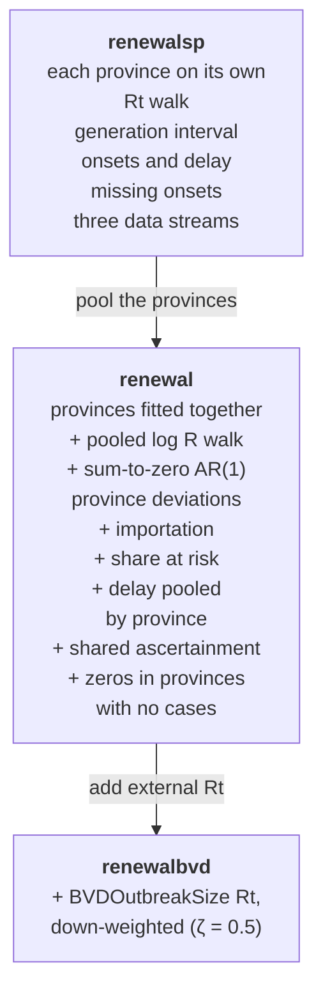
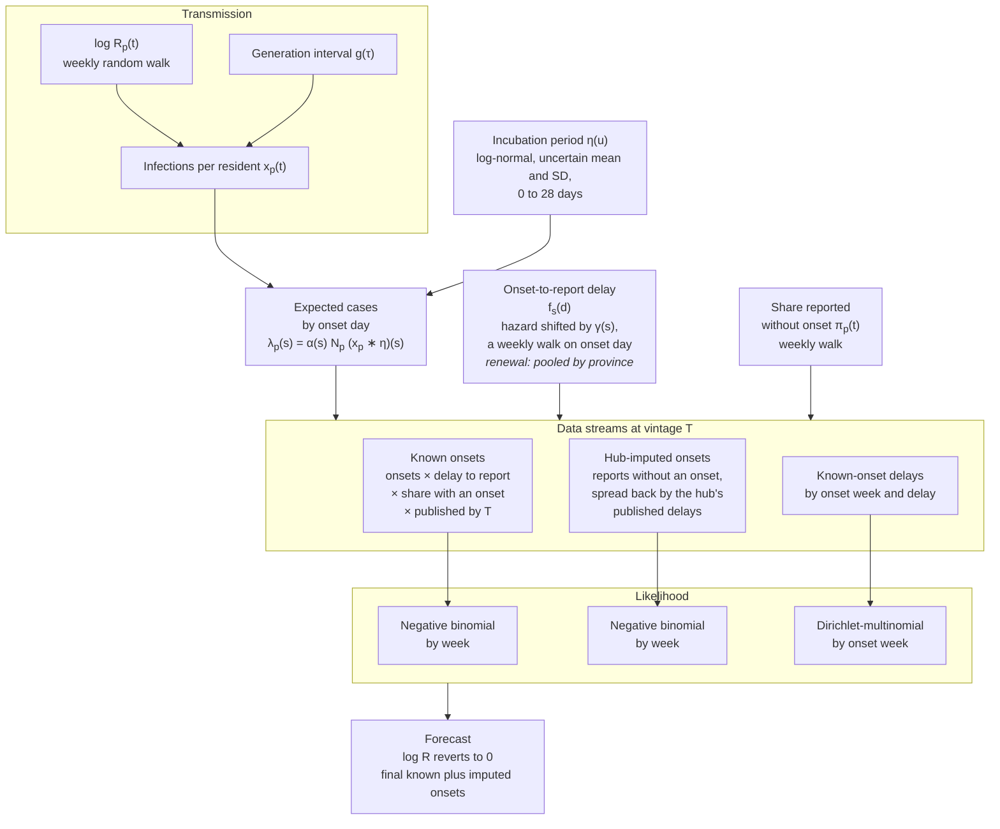
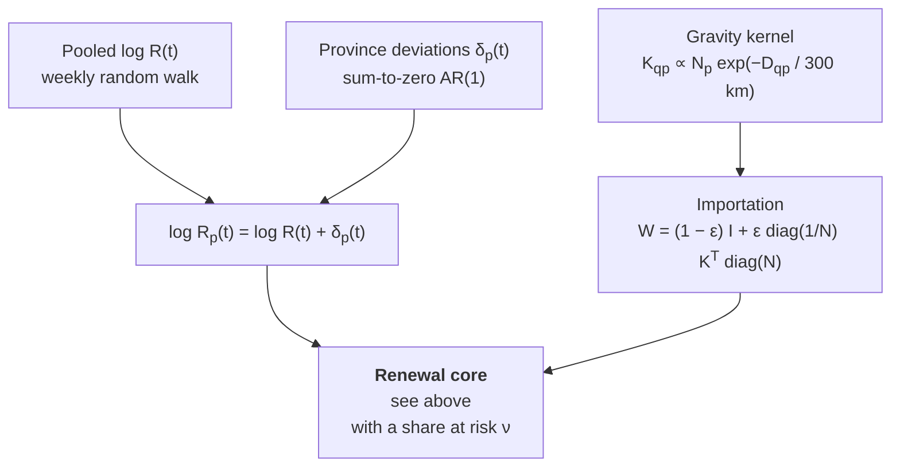
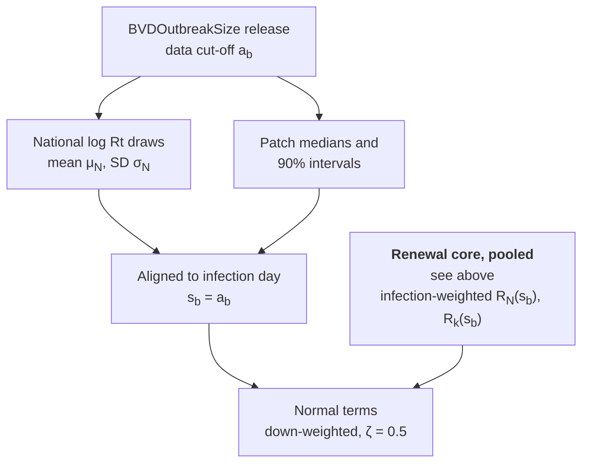

# Renewal models

The three renewal models, with the maths of each.
{ .page-subtitle }

The data and notation are on the [Data methods page](data.md#target-and-notation).
How the models are built in code and sampled is on the [Implementation](implementation.md) page.

## Overview

`renewalsp` fits a renewal model to each province on its own.
`renewal` fits the provinces together, pools them and links them by importation.
`renewalbvd` is `renewal` with a down-weighted likelihood term on the Rt of BVDOutbreakSize.
`seabbs-renewal` submits the first of `renewalbvd`, `renewalsp`, `renewal`, `randomwalknowcast` and `randomwalk`, in that order, to pass its checks ([Submission workflow](../submission/workflow.md#renewal-chain)).
The sections below build up from `renewalsp`, and each gives only the maths it adds.
Every time-varying part is a weekly random walk or AR(1), so it stays near constant unless the data show change.

## Single patch (`renewalsp`) { #single-patch }

`renewalsp` runs the model once for each province $p$ with cases, on that province's known and imputed onsets and delays alone.
Nothing is pooled across provinces.

A province with at least 20 cases in its last 6 data weeks, an outbreak province, gets this model.
A province with cases but too few for its own fit, $y_w$ in each of its $n_w$ data weeks, has

$$
\lambda_p \sim \text{Gamma}\Big(\tfrac{1}{2} + \sum_w y_w,\ n_w\Big),
\qquad
\tilde y_p(w) \sim \text{Poisson}(\lambda_p),
$$

with one $\lambda_p$ per trajectory.
Provinces with no cases get no forecast.

### Time axis

The data weeks start one week before weekly onsets, summed over the modelled provinces, first reach 5, or their peak if lower.
In `renewalsp` the modelled province is $p$ alone, so each fit has its own axis.
The data weeks end with the week that holds $T$, the release's last report day ([Data](data.md#vintages)).
The model axis starts 42 days (6 weeks) earlier, the length of the generation interval, for seeding.
Every weekly walk is held at its starting value over the 6 seeding weeks and the first data week.
The fit axis is the data weeks.

### Reproduction number

$$
\log R_p(t) = \log R_p(t - 1) + \sigma_R z(t),
\qquad
\sigma_R \sim \mathcal{N}^+(0, 0.2^2),
$$

with standard normal steps $z(t)$, sampled non-centred, and a start $\mathcal{N}(0, 0.5^2)$.

### Renewal

The renewal runs on infections per resident, dated by infection:

$$
x_p(t) = R_p(t) \sum_{\tau \ge 1} x_p(t - \tau)\, g(\tau).
$$

$g$ is BVDOutbreakSize's Gamma generation interval (mean 15.3, SD 9.3 days), double interval censored as $G(d + 1) - 2G(d) + G(d - 1)$ with $G$ the integrated cdf, on lags 1 to 42 and renormalised (mean 14.8, SD 8.4 days), as primarycensored's `dpcens(1:42, L = 1, D = 43)`[^pcens][^park].
Seeds are $e_p \sim \text{LogNormal}(0, 1.5^2)$ infections per day that will be confirmed, or $I_{0,p} = e_p / (\alpha_0 N_p)$ infections per resident, on the first data day.
The seed is projected back over the seeding weeks at the growth rate implied by $R_p$ and $g$, clipped to $[-0.05, 0.3]$ per day.

### Ascertainment

Onsets follow infections after the incubation period $\eta$, and expected confirmed onsets are

$$
\lambda_p(s) = \alpha(s)\, N_p \sum_{u = 0}^{28} x_p(s - u)\, \eta(u),
\qquad
\operatorname{logit} \alpha(s) = \operatorname{logit} \alpha_0 + a(s),
$$

with $N_p$ the province population, $\alpha_0 = 0.6$ fixed and $a$ a weekly random walk from zero with step SD $\mathcal{N}^+(0, 0.03^2)$.
$\eta$ is a log-normal incubation period for Bundibugyo virus disease with [BVDOutbreakSize's priors](https://github.com/epiforecasts/BVDOutbreakSize/blob/main/src/models/priors.jl) (`onset_incidence_model`) on its mean $\mu_\eta \sim \mathcal{N}(6.3, 0.54^2)$ and SD $\sigma_\eta \sim \mathcal{N}(3.5, 0.8^2)$, both truncated below at 1 day.
The mean prior reproduces the 95% CI of 5.2 to 7.3 days from the 2007 Uganda outbreak[^macneil].
MacNeil et al. give no interval on the spread, so the SD prior is BVDOutbreakSize's weakly informative choice around 3.5 days.
Each draw of $\eta$ is double interval censored in the same way on lags 0 to 28, the 99.9% quantile at the prior means, as `dpcens(0:28, plnorm, D = 29)`.
BVDOutbreakSize keeps lags 0 to 15 of its incubation period, up to its 98% quantile.
We keep lags 0 to 28.

### Delays

The onset-to-report delay $f_s(d)$, on days $d$ from 0 to 60, comes from a discrete hazard that varies with onset day:

$$
\operatorname{logit} h_s(d) = \beta(d) + \gamma(s),
\qquad
f_s(d) = h_s(d) \prod_{j < d}\{1 - h_s(j)\},
\qquad h_s(60) = 1.
$$

- $\beta$ is a random walk over delay, $\beta(0) \sim \mathcal{N}(-2, 1)$ with step SD $\mathcal{N}^+(0, 0.4^2)$, so the shape is smooth but not parametric.
- $\gamma$ is a weekly random walk over onset day from zero, with step SD $\mathcal{N}^+(0, 0.15^2)$, shifting all hazards together.

### Missing onsets

Cases reported on day $t$ without an onset are a share $\pi_p(t)$ of reports, with $\operatorname{logit} \pi_p(t) = b(t)$.
$b$ is a weekly random walk with start $\mathcal{N}(-2, 1)$ and step SD $\mathcal{N}^+(0, 0.3^2)$.

### Known onsets

A case reported on day $t$ is in the vintage published at $T$ with probability $c(t) = F_\ell(T - t)$, with $F_\ell$ the cdf of the report-to-publication lag.
The lag is the gap between a case's report and its first appearance in a release.
Its pmf on 0 to 7 days has a Dirichlet(1, ..., 1) prior and is learnt from consecutive releases (see Likelihood).
Expected known onsets, right truncated by vintage, are

$$
\mathrm{known}_{p,T}(s) = \lambda_p(s) \sum_{d} f_s(d)\, \{1 - \pi_p(s + d)\}\, c(s + d).
$$

### Hub imputation

The hub gives each case reported without an onset one by subtracting a delay drawn from a fit to its published delays ([imputation details](https://github.com/InsightNet-US/BDBV-Modeling-Hub/blob/main/auxiliary-data/imputation-details.md)).
We model that procedure, bias included:

$$
M_p(t) = \pi_p(t) \sum_s \lambda_p(s)\, f_s(t - s),
\qquad
\mathrm{imputed}_{p,T}(s) = \sum_{t = s}^{T} \hat f_T(t - s)\, c(t)\, M_p(t).
$$

$M_p(t)$ are the cases reported on day $t$ without an onset.
The hub draws a report hour from $\mathrm{Unif}(0, 24)$ and subtracts a generalised gamma delay in hours fitted to the non-negative delays published at 2026-10-17.
$\hat f_T$ is the daily pmf this implies, $\hat f_T(k) = \int_0^1 \{F_T(k + u) - F_T(k - 1 + u)\}\, du$ with $F_T$ the delay cdf in days, on 0 to 60 days, and is data.
Up to the 2026-10-24 release the hub fitted the delays as exact, and from 2026-11-01 as double interval censored ([hub issue 75](https://github.com/InsightNet-US/BDBV-Modeling-Hub/issues/75)).
We refit both, so $F_T$ is the fit the hub used for release $T$.

### Likelihood

- Weekly $\mathrm{known}_{p,T}$ and $\mathrm{imputed}_{p,T}$ are negative binomial, each stream with $1/\sqrt{\phi} \sim \text{HalfNormal}(0.25)$ and $\phi$ capped at 1000.
- Known-onset delays, by onset week and delay on 0 to 60 days, are Dirichlet-multinomial given each week's total.
  Their probabilities come from $\lambda$, $f$, $\pi$ and $c$, with $1/\sqrt{\psi} \sim \text{HalfNormal}(0.1)$ and $\psi$ capped at $10^4$.
  Delays below 0 count as 0 and delays above 60 as 60.
- Each delay-file row (location, onset week and delay) of release $k + 1$ was already in release $k$ with probability
  $$q = (1 - b_k) \frac{\sum_u F_\ell(T_k - t_u)}{\sum_u F_\ell(T_{k+1} - t_u)},$$
  averaged over the onset days $u$ of the row's week, with $t_u$ the report day for onset $u$ and $T_k$ release $k$'s last report day.
  $b_k \sim \text{Beta}(1, 19)$ is the share of rows that appear late whatever their age, such as onsets recorded later for cases first counted as imputed.
  The kept rows of each cell are beta-binomial with mean $q$ and concentration $1/(\phi^2 + 10^{-3})$, $\phi \sim \mathcal{N}^+(0, 0.5^2)$, capped at 1000 as the other concentrations are.
  Rows up to 60 days old at release $k$ enter.
  This term conditions on the later release, so it informs $F_\ell$ only.

### Forecasts

The random walks carry $\alpha$, $f$ and $\pi$ to the forecast horizon, and each of 100 trajectories is one posterior draw.
Past the fit axis $\log R_p$ reverts towards 0 with a half-life of 2 weeks, $\log R_p(t) = 2^{-1/2} \log R_p(t - 1) + \sigma_R z(t)$.
This stops the unanchored walk from compounding growth over the horizon.
The half-life is fixed, not fitted, since no data inform the forecast weeks.
The reversion leaves the fit unchanged.
A trajectory is the final known plus final imputed counts.
Final known counts are those reported by the cut-off plus a negative binomial draw of those reported later, as in epinowcast.
Final imputed counts are a negative binomial draw centred on the current imputed count plus those expected later, since the hub re-imputes each vintage.
The national trajectory is the sum of the provinces plus an unassigned component, $\max\{0, Y_{CD}(w) - \sum_p Y_p(w)\}$ in data weeks and $\rho \sum_p \tilde y_{p,k}(w)$ after, with $\rho$ its share over the last 4 data weeks and $\tilde y_{p,k}$ trajectory $k$ of province $p$.

## Partially pooled (`renewal`) { #partially-pooled }

`renewal` fits every province with cases in one model, on the axis set by their summed onsets.
The provinces share the trend $\log R(t)$, the deviation SD $\sigma_\delta$ and half-life $h$, the start spread $\sigma_v$, ascertainment $\alpha$, the publication lag, the trend $b$ of the missing-onset share, the share at risk $\nu$ and the importation share $\varepsilon$.
Each province has its own deviations $\delta_p$ and $\omega_p$ and its own seed.
Provinces are linked by importation through $W$, and provinces with no cases by $\mu_q$.
Each province has its own delay, pooled towards the national delay.
Leaving a province out removes its known and imputed terms and its delays but keeps it in the latent process.

### Pooled reproduction number

$$
\log R_p(t) = \log R(t) + \delta_p(t).
$$

The pooled trend $\log R(t)$ is the unweighted mean of $\log R_p(t)$, not the national Rt, and is the walk of `renewalsp`.
The province deviations sum to zero.
They are $\delta_p(t) = \sum_j Q_{pj}\, \eta_j(t)$, with $Q$ an orthonormal basis of the sum-to-zero subspace and $P - 1$ weekly AR(1) processes $\eta_j$ that decay towards 0, the pooled trend:

$$
\eta_j(t) = \phi\, \eta_j(t - 1) + \sigma_\delta z_j(t), \qquad \phi = 2^{-1/h}, \qquad h \sim \text{LogNormal}(\log 6, 0.6^2)\ \text{weeks}, \qquad \sigma_\delta \sim \mathcal{N}^+(0, 0.1^2).
$$

The shared $\sigma_\delta$ and $h$ pool the provinces.
The starting offsets are $\eta_j(0) = u_j$, with $u_j \sim \mathcal{N}(0, \sigma_v^2)$ and $\sigma_v \sim \mathcal{N}^+(0, 0.3^2)$, so $\delta_p(0) = \sum_j Q_{pj} u_j$.
Past the fit axis the pooled trend reverts as in `renewalsp`, and the deviations keep their AR(1).

### Importation and depletion

The renewal of `renewalsp` gains importation and a share at risk:

$$
y_p(t) = R_p(t) \sum_q W_{pq} \sum_{\tau \ge 1} x_q(t - \tau)\, g(\tau),
\qquad
x_p(t) = S_p(t)\big\{1 - e^{-y_p(t)/\nu}\big\},
\qquad
S_p(t + 1) = S_p(t)\, e^{-y_p(t)/\nu}.
$$

- $W = (1 - \varepsilon) I + \varepsilon\, \mathrm{diag}(1/N) K^\top \mathrm{diag}(N)$ mixes transmission between provinces, with $\varepsilon \sim \text{Beta}(1, 100)$.
- $K$ is a row-normalised gravity kernel, $K_{qp} \propto N_p e^{-D_{qp}/300\,\text{km}}$ for $q \ne p$, with $D$ the great-circle distance between population-weighted province centres.
- $\nu \sim \text{LogNormal}(\log 0.05, 0.75^2)$ is the share at risk.
  $S_p$ starts at $\nu$ less the seed, so infections never exceed $\nu N_p$.

Provinces with cases in the first data week are seeded at the start.
Later provinces start at $10^{-6}$ of that level and add $I_{0,p}$ to $y_p(t)$ each day for 7 days.
These 7 days start 5 days before the province's first case week.
That lead puts the most onsets of a week of seeded infections in the first case week (67%, with 9% before it) at the prior mean incubation period.

### Province delays

Each province's delay hazard adds a sum-to-zero offset $u_p$ and a sum-to-zero weekly walk $\zeta_p(s)$ to the national shift $\gamma(s)$, on the basis $Q$:

$$
\operatorname{logit} h_{p,s}(d) = \beta(d) + \gamma(s) + u_p + \zeta_p(s).
$$

The offsets have spread $\mathcal{N}^+(0, 0.5^2)$ and the walks start at 0 with step SD $\mathcal{N}^+(0, 0.1^2)$, both sampled non-centred.
So each province's delay follows the national one over time, with its own level and its own drift, each shrunk towards the national delay by a learnt spread.
Known-onset delays are scored by province.
Health zones take their province's delay, since the delay files list provinces only.

### Missing-onset deviations

The missing-onset share gains sum-to-zero province deviations $\omega_p$ on the same basis $Q$:

$$
\operatorname{logit} \pi_p(t) = b(t) + \omega_p(t).
$$

The deviations are random walks, not AR(1).
They start with province spread $\mathcal{N}^+(0, 0.5^2)$, sampled non-centred, and have step SD $\mathcal{N}^+(0, 0.1^2)$.

### Provinces with no cases

Provinces $q$ without cases have an importation-only component.
Their weekly zeros are Poisson with mean $\mu_q(s) = \kappa \sum_p K_{pq}\, \lambda_p(s)$, $\kappa \sim \text{LogNormal}(\log 10^{-3}, 2^2)$.
In the forecast they draw Poisson importations after the cut-off, which spread at the infection-weighted national Rt without depletion.

## BVDOutbreakSize-informed (`renewalbvd`) { #bvdoutbreaksize-informed }

Every renewal model takes from the BVDOutbreakSize main model its generation interval, the prior on the half-life of the province deviations and the sum-to-zero basis for them.
`renewalbvd` also takes the Rt estimates of one [BVDOutbreakSize](https://github.com/epiforecasts/BVDOutbreakSize) release, chosen as on the [Data methods page](data.md#bvdoutbreaksize-estimates).
Without such a release `renewalbvd` is `renewal`.

From the release it takes the posterior draws of the national $\log R$ and, where the release has province estimates, each patch's median and 90% interval with the hub provinces the patch covers.
With $a_b$ the release's data cut-off, the estimates are aligned to $s_b = a_b$, as both models date Rt by infection.
The fit axis extends to the end of the week of $s_b$ when that week is after the data.
For the nation $N$ and each patch $k$ with a modelled province, the model's Rt is weighted by infections over the data week that holds $s_b$,

$$
R_G(s_b) = \frac{\sum_{p \in G} O_p\, R_p(s_b)}{\sum_{p \in G} O_p},
\qquad
O_p = N_p \sum_{t \in \text{week}(s_b)} x_p(t),
\qquad
G \in \{N, k\}.
$$

With the term down-weighted by $\zeta = 0.5$, the likelihood gains

$$
\mu_N \sim \mathcal{N}\big(\log R_N(s_b),\, \sigma_N^2/\zeta\big),
\qquad
m_k - m_N \sim \mathcal{N}\big(\log R_k(s_b) - \log R_N(s_b),\, \tau_k^2/\zeta\big),
\qquad
\tau_k^2 = \max(\sigma_k^2 - \sigma_N'^2,\, 0.05^2).
$$

$\mu_N$ and $\sigma_N$ are the mean and SD of the release's national log Rt draws.
$m_k$ and $\sigma_k$ are each patch's log median and SD, the SD from the 90% interval.
$m_N$ and $\sigma_N'$ are the same summaries of the national row in the patch table, or $\mu_N$ and $\sigma_N$ if it has none.
Leaving a province out drops the national term and the patch that holds it.
The term adds no parameters, and $\zeta = 0$ gives `renewal`.
It is down-weighted because BVDOutbreakSize is fitted to largely the same data, so at full weight those data would count twice.

## Health zones

Zone samples sum to their province's samples, sample by sample and week by week, and the national value stays the sum of the provinces.
The random walk baselines run at zone level and their samples set the zone shares of the province samples ([Baseline models](baselines.md#health-zones)).
Every other model's province forecast is split across the zones.

### Split of province samples

For province $p$ with zones $z$, let $o_z(w)$ be zone $z$'s published count for week $w$ and $O(w) = \sum_z o_z(w)$.
Each province sample $k$ draws its zone shares once, for all weeks:

$$
\theta^{(k)} \sim \text{Dirichlet}(a),
\qquad
a_z = r_z + n_0\, \frac{l_z + a_0}{\sum_{z'} (l_{z'} + a_0)}.
$$

$r_z$ is the zone's onsets over the 2 weeks before the vintage and $l_z$ those over the 16 weeks before it.
Recent shares are shrunk towards longer-run shares by $n_0 = 100$ pseudo-cases.
The floor $a_0 = 1/2$ gives a zone with no cases a small share.
Province samples are rounded.
Each zone keeps its published count and the rest of the province sample $Y^{(k)}(w)$ is split:

$$
y^{(k)}_z(w) = o_z(w) + m_z,
\qquad
m \sim \text{Multinomial}\big(Y^{(k)}(w) - O(w),\ \theta^{(k)}\big).
$$

A sample below the published total is drawn from the published zone counts without replacement instead.

[^pcens]: Abbott S, Brand S, Azam J, Pearson C, Funk S, Charniga K. primarycensored: Primary Event Censored Distributions. [doi:10.5281/zenodo.13632838](https://doi.org/10.5281/zenodo.13632838).

[^park]: Park SW, Akhmetzhanov AR, Charniga K, Cori A, Davies NG, Dushoff J, Funk S, Gostic K, Grenfell B, Linton NM, Lipsitch M, Lison A, Overton CE, Ward T, Abbott S (2024). Estimating epidemiological delay distributions for infectious diseases. [doi:10.1101/2024.01.12.24301247](https://doi.org/10.1101/2024.01.12.24301247).

[^macneil]: MacNeil A, Farnon EC, Wamala J, Okware S, Cannon DL, Reed Z, Towner JS, Tappero JW, Lutwama J, Downing R, Nichol ST, Ksiazek TG, Rollin PE (2010). Proportion of deaths and clinical features in Bundibugyo Ebola virus infection, Uganda. Emerging Infectious Diseases 16(12):1969-1972. [doi:10.3201/eid1612.100627](https://doi.org/10.3201/eid1612.100627).
