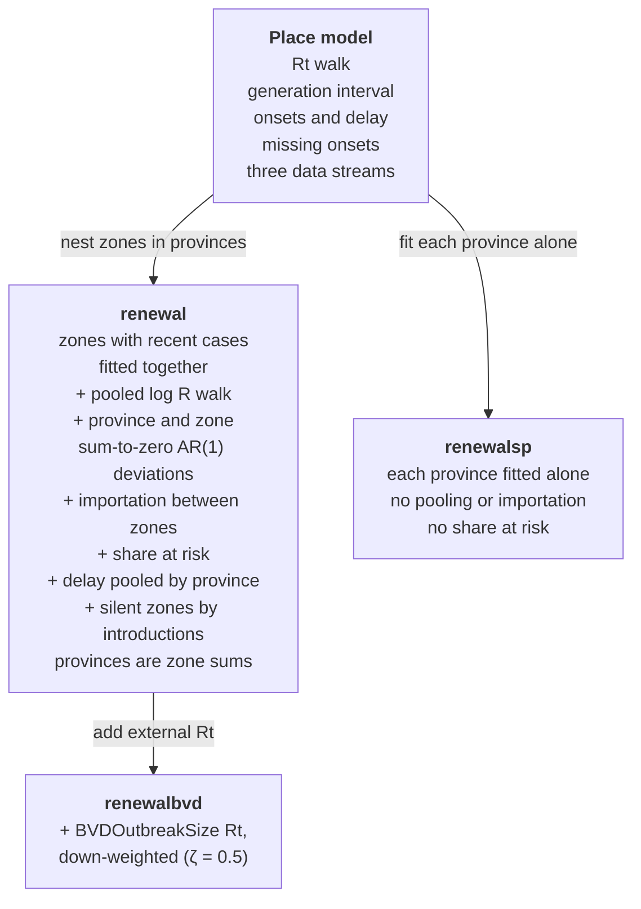
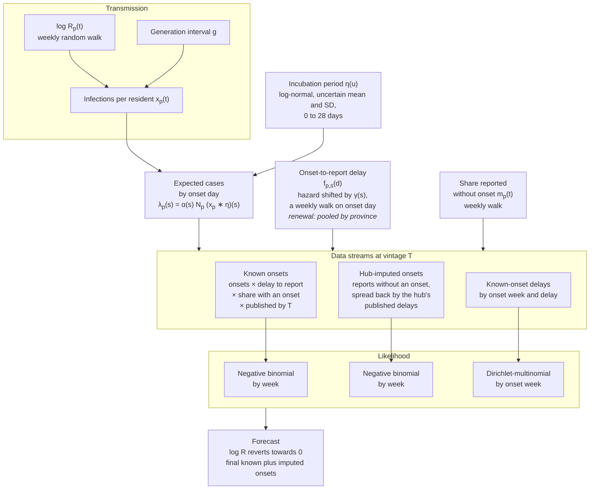
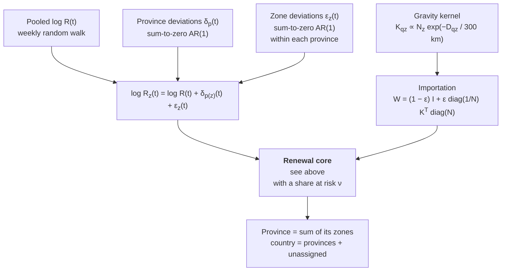
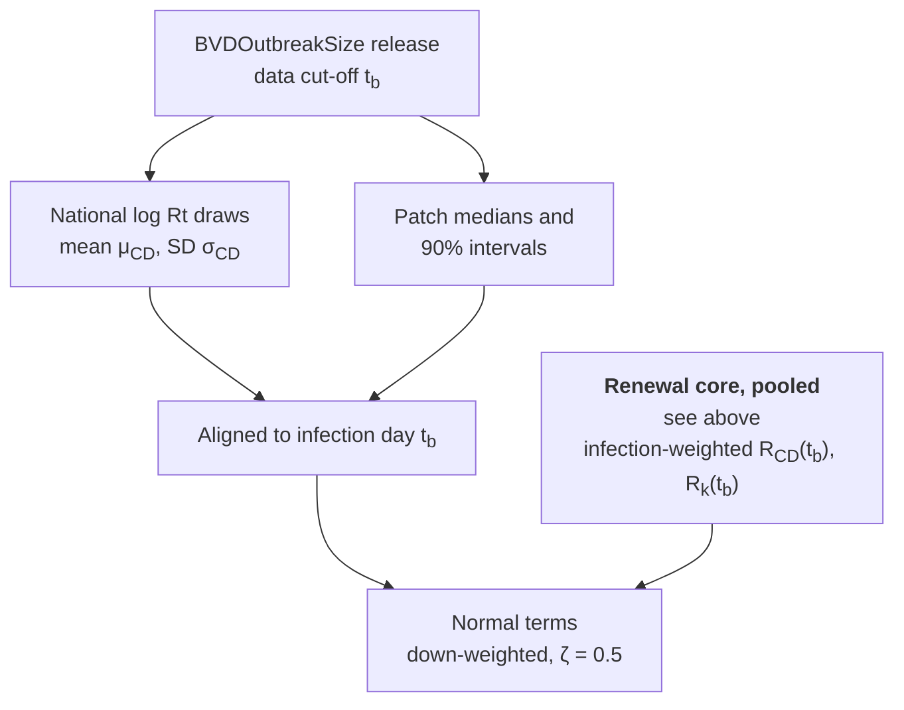

# Renewal models

The three renewal models, with the maths of each.
{ .page-subtitle }

The data and notation are on the [Data methods page](data.md#target-and-notation).
How the models are built in code and sampled is on the [Implementation](implementation.md) page.

## Overview

`renewal` fits the health zones with recent cases together, nests them in their provinces, pools them and links them by importation.
The zone fits are opt-in: with `[renewal] zones = false` in `config/hub.toml`, the default, `renewal` and `renewalbvd` fit the provinces as places instead, with province deviations, province delays and importation between provinces, and their zones are split from the provinces ([Health zones](#health-zones)).
`renewalsp` fits the place model to each province on its own, with no pooling or importation.
`renewalbvd` is `renewal` with a down-weighted likelihood term on the Rt of BVDOutbreakSize.
`seabbs-renewal` submits the first of `renewalbvd`, `renewalsp`, `renewal`, `randomwalknowcast` and `randomwalk`, in that order, to pass its checks ([Submission workflow](../submission/workflow.md#renewal-chain)).
The sections below give the model of each place, then what `renewal` adds to pool and link the zones, then how `renewalsp` and `renewalbvd` differ.
Each gives only the maths it adds.
Every time-varying part is a weekly random walk or AR(1), so it stays near constant unless the data show change.

## Place model { #province-model }

Each place $p$ has the model below: a province in `renewalsp`, a health zone in `renewal` and `renewalbvd`.

### Time axis

The data weeks start one week before weekly onsets, summed over the modelled places, first reach 5, or their peak if lower.
The data weeks end with the week that holds $T$, the release's cut-off ([Data](data.md#vintages)).
The model axis starts 42 days (6 weeks) earlier, the length of the generation interval, for seeding.
Every weekly walk is held at its starting value over the 6 seeding weeks and the first data week.
The fit axis is the data weeks, extended for `renewalbvd` as [below](#bvdoutbreaksize-informed).

### Reproduction number

$$
\log R_p(t) = \log R_p(t - 1) + \sigma_R z(t),
\qquad
\sigma_R \sim \mathcal{N}^+(0, 0.2^2),
$$

with standard normal steps $z(t)$, sampled non-centred, and a start $\mathcal{N}(0, 0.5^2)$.

### Renewal

The renewal runs on infections per resident, dated by infection:

$$
x_p(t) = R_p(t) \sum_{j \ge 1} x_p(t - j)\, g(j).
$$

$g$ is BVDOutbreakSize's Gamma generation interval (mean 15.3, SD 9.3 days), double interval censored as $G(d + 1) - 2G(d) + G(d - 1)$ with $G$ the integrated cdf, on lags 1 to 42 and renormalised (mean 14.8, SD 8.4 days), as in primarycensored[^pcens][^park].
Seeds are $e_p \sim \text{LogNormal}(0, 1.5^2)$ infections per day that will be confirmed, or $I_{0,p} = e_p / (\alpha_0 N_p)$ infections per resident, on the first data day.
The seed is projected back over the seeding weeks at the growth rate implied by $R_p$ and $g$, clipped to $[-0.05, 0.3]$ per day.

### Ascertainment

Onsets follow infections after the incubation period $\eta$, and expected confirmed onsets are

$$
\lambda_p(s) = \alpha(s)\, N_p \sum_{u = 0}^{28} x_p(s - u)\, \eta(u),
\qquad
\operatorname{logit} \alpha(s) = \operatorname{logit} \alpha_0 + a(s),
$$

with $N_p$ the place population, $\alpha_0 = 0.6$ fixed and $a$ a weekly random walk from zero with step SD $\mathcal{N}^+(0, 0.03^2)$.
$\eta$ is a log-normal incubation period for Bundibugyo virus disease.
Its mean $\mu_\eta \sim \mathcal{N}(6.3, 0.54^2)$ and SD $\sigma_\eta \sim \mathcal{N}(3.5, 0.8^2)$, both truncated below at 1 day, have [BVDOutbreakSize's priors](https://github.com/epiforecasts/BVDOutbreakSize/blob/main/src/models/priors.jl).
The mean prior reproduces the 95% CI of 5.2 to 7.3 days from the 2007 Uganda outbreak[^macneil].
MacNeil et al. give no interval on the spread, so the SD prior is BVDOutbreakSize's weakly informative choice around 3.5 days.
Each draw of $\eta$ is double interval censored in the same way on lags 0 to 28, the 99.9% quantile at the prior means.

### Delays

The onset-to-report delay $f_s(d)$, on days $d$ from 0 to 60, comes from a discrete hazard that varies with onset day:

$$
\operatorname{logit} H_s(d) = \beta(d) + \gamma(s),
\qquad
f_s(d) = H_s(d) \prod_{j < d}\{1 - H_s(j)\},
\qquad H_s(60) = 1.
$$

- $\beta$ is a random walk over delay, $\beta(0) \sim \mathcal{N}(-2, 1)$ with step SD $\mathcal{N}^+(0, 0.4^2)$, so the shape is smooth but not parametric.
- $\gamma$ is a weekly random walk over onset day from zero, with step SD $\mathcal{N}^+(0, 0.15^2)$, shifting all hazards together.

### Missing onsets

Cases reported on day $t$ without an onset are a share $m_p(t)$ of reports, with $\operatorname{logit} m_p(t) = \bar m(t)$.
$\bar m$ is a weekly random walk with start $\mathcal{N}(-2, 1)$ and step SD $\mathcal{N}^+(0, 0.3^2)$.

### Known onsets

A case reported on day $t$ is in the vintage with probability $\Pi(t) = F_\ell(T - t)$, with $T$ the vintage's cut-off and $F_\ell$ the cdf of the report-to-publication lag.
The lag is the gap between a case's report and its first appearance in a release.
Its pmf on 0 to 7 days has a Dirichlet(1, ..., 1) prior and is learnt from consecutive releases (see Likelihood).
Expected known onsets, right truncated by vintage, are

$$
\mathrm{known}_{p,T}(s) = \lambda_p(s) \sum_{d} f_s(d)\, \{1 - m_p(s + d)\}\, \Pi(s + d).
$$

### Hub imputation

The hub gives each case reported without an onset one by subtracting a delay drawn from a fit to its published delays ([imputation details](https://github.com/InsightNet-US/BDBV-Modeling-Hub/blob/main/auxiliary-data/imputation-details.md)).
We model that procedure, bias included:

$$
M_p(t) = m_p(t) \sum_s \lambda_p(s)\, f_s(t - s),
\qquad
\mathrm{imputed}_{p,T}(s) = \sum_{t = s}^{T} \hat f_T(t - s)\, \Pi(t)\, M_p(t).
$$

$M_p(t)$ are the cases reported on day $t$ without an onset.
The hub draws a report hour from $\mathrm{Unif}(0, 24)$ and subtracts a generalised gamma delay in hours fitted to the non-negative delays published at 2026-10-17.
$\hat f_T$ is the daily pmf this implies, $\hat f_T(k) = \int_0^1 \{F_T(k + u) - F_T(k - 1 + u)\}\, du$ with $F_T$ the delay cdf in days, on 0 to 60 days, and is data.
It is the double interval censored pmf, computed in closed form from the generalised gamma's partial first moment.
The hub fits the delays as exact for releases up to 2026-10-24 and as double interval censored from 2026-11-01 ([hub issue 75](https://github.com/InsightNet-US/BDBV-Modeling-Hub/issues/75)), and $F_T$ is the fit for release $T$.

### Likelihood

- Weekly $\mathrm{known}_{p,T}$ and $\mathrm{imputed}_{p,T}$ are negative binomial, each stream with size $\phi$, $1/\sqrt{\phi} \sim \text{HalfNormal}(0.25)$ and $\phi$ kept below 1000.
- Known-onset delays, by province, onset week and delay on 0 to 60 days, are Dirichlet-multinomial given each province and week's total.
  Their probabilities come from $\lambda$, $f$, $m$ and $\Pi$, with concentration $\psi$, $1/\sqrt{\psi} \sim \text{HalfNormal}(0.1)$ and $\psi$ kept below $10^4$.
  Delays below 0 count as 0 and delays above 60 as 60.
- Each delay-file row (location, onset week and delay) of release $k + 1$ was already in release $k$ with probability
  $$q = (1 - b_k) \frac{\sum_u F_\ell(T_k - t_u)}{\sum_u F_\ell(T_{k+1} - t_u)},$$
  averaged over the onset days $u$ of the row's week, with $t_u$ the report day for onset $u$ and $T_k$ release $k$'s cut-off.
  $b_k \sim \text{Beta}(1, 19)$ is the share of rows that appear late whatever their age, such as onsets recorded later for cases first counted as imputed.
  The kept rows of each cell are beta-binomial with mean $q$ and concentration $1/(\tau^2 + 10^{-3})$, $\tau \sim \mathcal{N}^+(0, 0.5^2)$, kept below 1000 as the other concentrations are.
  Rows up to 60 days old at release $k$ enter.
  This term conditions on the later release, so it informs $F_\ell$ only.

### Forecasts

The random walks carry $\alpha$ and $f$ to the forecast horizon, $m$ keeps its last value, and each of 100 trajectories is one posterior draw.
Past the fit axis the walk of $\log R$ reverts towards 0 with a fixed half-life of 2 weeks, $\log R(t) = 2^{-1/2} \log R(t - 1) + \sigma_R z(t)$, so it does not compound growth over the horizon.
In `renewal` this is the pooled trend, and the province and zone deviations keep their AR(1) ([below](#pooled-reproduction-number)).
The reversion leaves the fit unchanged.
A trajectory is the final known plus final imputed counts.
Final known counts are those reported by the cut-off plus a negative binomial draw of those reported later, as in epinowcast.
Final imputed counts are a negative binomial draw centred on the current imputed count plus those expected later, since the hub re-imputes each vintage.
In `renewal` a province's trajectory is the sum of its zones' trajectories of the same draw ([below](#provinces-and-the-country)).
The national trajectory is the sum of the provinces plus an unassigned component.
The component is $\max\{0, Y_{CD}(w) - \sum_p Y_p(w)\}$ in data weeks and $\rho \sum_p \tilde y_{p,i}(w)$ after, with $\tilde y_{p,i}$ trajectory $i$ of province $p$.
$\rho$ is the component's share of the provinces' total over the last 4 data weeks.

## Zone model (`renewal`) { #partially-pooled }

`renewal` fits the health zones in one model, with each zone a place, on the axis set by their summed onsets.
It fits the zones with a case in the random walks' walk window, about 55 of the hub's 519 zones at 2026-11-08.
The rest are silent and take the introduction layer of `randomwalknowcast` ([below](#silent-zones)).
The fitted zones share the trend $\log R(t)$, ascertainment $\alpha$, the publication lag, the trend $\bar m$ of the missing-onset share, the share at risk $\nu$ and the importation share $\varepsilon$.
Each province has its own Rt deviation $\delta_p$, delay and missing-onset deviation $\omega_p$, which its zones share.
Each zone has its own Rt deviation $\epsilon_z$ within its province and its own seed.
Zones are linked by importation through $W$.
Leaving a province out removes the known and imputed counts of its zones and its delay counts but keeps its zones in the latent process.

### Pooled reproduction number

$$
\log R_z(t) = \log R(t) + \delta_{p(z)}(t) + \epsilon_z(t),
$$

with $p(z)$ the province of zone $z$.
The pooled trend $\log R(t)$ is the unweighted mean of $\log R_z(t)$, not the national Rt, and is the walk of the place model.
The province deviations sum to zero over the provinces and the zone deviations sum to zero within each province, so $\delta_p$ is the mean deviation of province $p$'s zones.
They are

$$
\delta_p(t) = \sum_j Q_{pj}\, \xi_j(t),
\qquad
\epsilon_z(t) = \sum_k B_{zk}\, \eta_k(t).
$$

$Q$ is an orthonormal basis of the deviations that sum to zero over the $P_s$ provinces with a fitted zone.
$B$ is block diagonal, one block per province, each an orthonormal basis of the deviations that sum to zero over that province's fitted zones.
A province with one fitted zone has no block, and its zone takes the province deviation.
The $P_s - 1$ coordinates $\xi_j$ and the $\sum_p (Z_p - 1)$ coordinates $\eta_k$ are weekly AR(1) processes that decay towards 0,

$$
\xi_j(t) = \kappa\, \xi_j(t - 1) + \sigma_\delta z_j(t),
\qquad
\eta_k(t) = \kappa_\epsilon\, \eta_k(t - 1) + \sigma_\epsilon z_k(t),
$$

with $\kappa = 2^{-1/t_{1/2}}$, $t_{1/2} \sim \text{LogNormal}(\log 6, 0.6^2)$ weeks and $\sigma_\delta \sim \mathcal{N}^+(0, 0.1^2)$, and the same priors for the zone level's own $\kappa_\epsilon$ and $\sigma_\epsilon$.
The shared spreads and half-lives pool the zones within provinces and the provinces within the country.
The starting values are $\log R_z(0) = \log R(0) + v_z$, with $v$ summing to zero over the zones, $v \sim \mathcal{N}(0, \sigma_v^2)$ on its basis and $\sigma_v \sim \mathcal{N}^+(0, 0.3^2)$.
The province part of $v$ starts $\xi$ and the rest starts $\eta$.
With one zone per province the model is the province model, which a test checks.

Because zones share $\log R(t)$, $\delta_p(t)$, the delay, ascertainment and the publication lag within each draw, their trajectories move together where the data say they do.
Summing zone trajectories within a draw keeps that correlation, so province intervals are not the narrow sum of independent zone noise.

### Importation and depletion

The place model's renewal gains importation and a share at risk:

$$
\Phi_z(t) = R_z(t) \sum_q W_{zq} \sum_{j \ge 1} x_q(t - j)\, g(j),
\qquad
x_z(t) = S_z(t)\big\{1 - e^{-\Phi_z(t)/\nu}\big\},
\qquad
S_z(t + 1) = S_z(t)\, e^{-\Phi_z(t)/\nu}.
$$

- $W = (1 - \varepsilon) I + \varepsilon\, \mathrm{diag}(1/N) K^\top \mathrm{diag}(N)$ mixes transmission between zones, with $\varepsilon \sim \text{Beta}(1, 100)$.
- $K$ is a row-normalised gravity kernel, $K_{qz} \propto N_z e^{-D_{qz}/300\,\text{km}}$ for $q \ne z$, with $D$ the great-circle distance between zone centroids.
- $N_z$ is the zone's WorldPop 2025 count and its centroid is that of its largest polygon, both from the map behind the province centres ([`zone_centres.csv`](https://github.com/seabbs/BDBVHubRenewal/blob/main/src/bdbvhubrenewal/data/zone_centres.csv)).
  The 19 hub zones the map lacks, none with a case, take their province's centre and mean zone population.
- $\nu \sim \text{LogNormal}(\log 0.05, 0.75^2)$ is the share at risk.
  $S_z$ starts at $\nu$ less the seed, so infections never exceed $\nu N_z$.

Zones with cases in the first data week are seeded at the start.
Later zones start at $10^{-6}$ of that level and add $I_{0,z}$ to $\Phi_z(t)$ each day for 7 days.
These 7 days start 5 days before the zone's first case week.

### Province delays

The delay files list provinces only, so the delay is by province and each zone takes its province's.
Each province's delay hazard adds a sum-to-zero offset $a_p$ and a sum-to-zero weekly walk $g_p(s)$ to the shared shift $\gamma(s)$, on the basis $Q$:

$$
\operatorname{logit} h_{p,s}(d) = \beta(d) + \gamma(s) + a_p + g_p(s).
$$

The offsets have spread $\mathcal{N}^+(0, 0.5^2)$ and the walks start at 0 with step SD $\mathcal{N}^+(0, 0.1^2)$, both sampled non-centred.
So each province's delay follows the shared one over time, with its own level and its own drift, each shrunk towards the shared delay by a learnt spread.
Known-onset delays are scored by province: each province's expected cells are the sum of its zones', which is exact as its zones share its delay, missing-onset share and publication lag.
The delay used to score a zone's forecasts is its province's.

### Missing-onset deviations

The missing-onset share gains sum-to-zero province deviations $\omega_p$ on the same basis $Q$, which a province's zones share:

$$
\operatorname{logit} m_z(t) = \bar m(t) + \omega_{p(z)}(t).
$$

The deviations are random walks, not AR(1).
They start with province spread $\mathcal{N}^+(0, 0.5^2)$, sampled non-centred, and have step SD $\mathcal{N}^+(0, 0.1^2)$.

### Silent zones

A zone with no case in the random walks' walk window is silent and is not fitted.
It takes the introduction layer of `randomwalknowcast` ([Baseline models](baselines.md)): exactly 0 until an introduction, then its walk.
The introduction rate pools the zone with the other zones of its province, so a province with no case in any zone is forecast by its zones' introductions alone.
These draws are independent of the fit.
The ZoneAllocator floor of the other models does not apply.

### Provinces and the country

A province's trajectory is the sum of the trajectories of all its zones, fitted and silent, draw by draw and week by week.
So zones sum to their province exactly, and the hub file takes the zone trajectories as they are.
The national trajectory is the sum of the provinces, with no unassigned component: the hub's national target has had no case without a province in any release (`data/national-coherence.csv`).

## Single patch (`renewalsp`) { #single-patch }

`renewalsp` fits the [place model](#province-model) to each province's series on its own, one fit after another with the same code.
Nothing is pooled or shared between provinces: each has its own Rt walk, delay, missing-onset share and ascertainment.
One series cannot inform the share at risk, so there is no depletion.
Every province with a case in the random walks' walk window is fitted, however few its cases.
A province with none takes the introduction layer of `randomwalknowcast` ([Baseline models](baselines.md)): exactly 0 until an introduction, then its walk.
National is the sum of the provinces plus the data's national gap, as for `renewal`.
A province is fitted only on its own data, so `renewalsp` cannot forecast a province left out.
Its zones are split from its provinces ([Health zones](#health-zones)).

## BVDOutbreakSize-informed (`renewalbvd`) { #bvdoutbreaksize-informed }

Every renewal model takes from the BVDOutbreakSize main model its generation interval, the priors of the incubation period, the prior on the half-life of the province deviations and the sum-to-zero basis for them.
`renewalbvd` also takes the Rt estimates of one [BVDOutbreakSize](https://github.com/epiforecasts/BVDOutbreakSize) release, chosen as on the [Data methods page](data.md#bvdoutbreaksize-estimates).
Without such a release `renewalbvd` is `renewal`.

From the release it takes the posterior draws of the national $\log R$ and, where the release has province estimates, each patch's median and 90% interval with the hub provinces the patch covers.
Both models date Rt by infection, so the estimates are aligned to the release's data cut-off $t_b$.
The fit axis extends to the end of the week of $t_b$ when that week is after the data.
For the nation CD and each patch $k$ with a modelled zone, the model's Rt before depletion, $R_z$, is weighted by infections over the data week that holds $t_b$, over the fitted zones of the patch's provinces,

$$
R_{\mathcal{G}}(t_b) = \frac{\sum_{z \in \mathcal{G}} \Omega_z\, R_z(t_b)}{\sum_{z \in \mathcal{G}} \Omega_z},
\qquad
\Omega_z = N_z \sum_{t \in \text{week}(t_b)} x_z(t),
\qquad
\mathcal{G} \in \{\text{CD}, k\}.
$$

With the term down-weighted by $\zeta = 0.5$, the likelihood gains

$$
\mu_{\text{CD}} \sim \mathcal{N}\big(\log R_{\text{CD}}(t_b),\, \sigma_{\text{CD}}^2/\zeta\big),
\qquad
\tilde\mu_k - \tilde\mu_{\text{CD}} \sim \mathcal{N}\big(\log R_k(t_b) - \log R_{\text{CD}}(t_b),\, \sigma_{\Delta,k}^2/\zeta\big),
\qquad
\sigma_{\Delta,k}^2 = \max(\tilde\sigma_k^2 - \tilde\sigma_{\text{CD}}^2,\, 0.05^2).
$$

$\mu_{\text{CD}}$ and $\sigma_{\text{CD}}$ are the mean and SD of the release's national log Rt draws, converted from growth rates for early releases ([Data](data.md#bvdoutbreaksize-estimates)).
$\tilde\mu_k$ and $\tilde\sigma_k$ are each patch's log median and SD, the SD from the 90% interval.
$\tilde\mu_{\text{CD}}$ and $\tilde\sigma_{\text{CD}}$ are the same summaries of the national estimate the patches are relative to, or $\mu_{\text{CD}}$ and $\sigma_{\text{CD}}$ if the release has none.
Leaving a province out drops the national term and the patch that holds it.
The term adds no parameters, and $\zeta = 0$ gives `renewal`.

## Health zones

Zone samples sum to their province's samples, sample by sample and week by week, and zones do not enter the national value.
`renewal` and `renewalbvd` forecast the zones themselves, and their provinces are the zone sums ([above](#provinces-and-the-country)).
The random walk baselines run at zone level and their samples set the zone shares of the province samples ([Baseline models](baselines.md#health-zones)).
Every other model's province forecast (`renewalsp`, `pprandomwalknowcast`) is split across the zones.

### Split of province samples

For province $p$ with zones $z$, let $o_z(w)$ be zone $z$'s published count for week $w$ and $O(w) = \sum_z o_z(w)$.
Each province sample $i$ draws its zone shares once, for all weeks,

$$
\theta^{(i)} \sim \text{Dirichlet}(\chi),
\qquad
\chi_z = r_z + n_0\, \frac{l_z + \chi_0}{\sum_{z'} (l_{z'} + \chi_0)}.
$$

$r_z$ is the zone's onsets over the 2 weeks before the vintage and $l_z$ those over the 16 weeks before it.
Recent shares are shrunk towards longer-run shares by $n_0 = 100$ pseudo-cases.
The floor $\chi_0 = 1/2$ gives a zone with no recent cases a small share, if the zone has had a case.
A zone with no case at the vintage has a tenth of the floor, $\chi_0 = 1/20$.
These models have no zone-level transmission, so a province sample holds no information on which new zones its cases reach.
New zones in a province with cases are still reached, 6 in the 8 weeks to 10-03, and the small floor lets a province's cases reach them at about that rate.
In a province with no case in any zone, every zone has $\chi_0 = 1/2$ and the zones share equally.
Province samples are rounded.
Each zone keeps its published count and the rest of the province sample $Y^{(i)}(w)$ is split,

$$
\big(y^{(i)}_z(w)\big)_z = \big(o_z(w)\big)_z + \text{Multinomial}\big(Y^{(i)}(w) - O(w),\ \theta^{(i)}\big).
$$

A sample below the published total is drawn from the published zone counts without replacement instead.

[^pcens]: Abbott S, Brand S, Azam J, Pearson C, Funk S, Charniga K. primarycensored: Primary Event Censored Distributions. [doi:10.5281/zenodo.13632838](https://doi.org/10.5281/zenodo.13632838).

[^park]: Park SW, Akhmetzhanov AR, Charniga K, Cori A, Davies NG, Dushoff J, Funk S, Gostic K, Grenfell B, Linton NM, Lipsitch M, Lison A, Overton CE, Ward T, Abbott S (2024). Estimating epidemiological delay distributions for infectious diseases. [doi:10.1101/2024.01.12.24301247](https://doi.org/10.1101/2024.01.12.24301247).

[^macneil]: MacNeil A, Farnon EC, Wamala J, Okware S, Cannon DL, Reed Z, Towner JS, Tappero JW, Lutwama J, Downing R, Nichol ST, Ksiazek TG, Rollin PE (2010). Proportion of deaths and clinical features in Bundibugyo Ebola virus infection, Uganda. Emerging Infectious Diseases 16(12):1969-1972. [doi:10.3201/eid1612.100627](https://doi.org/10.3201/eid1612.100627).
