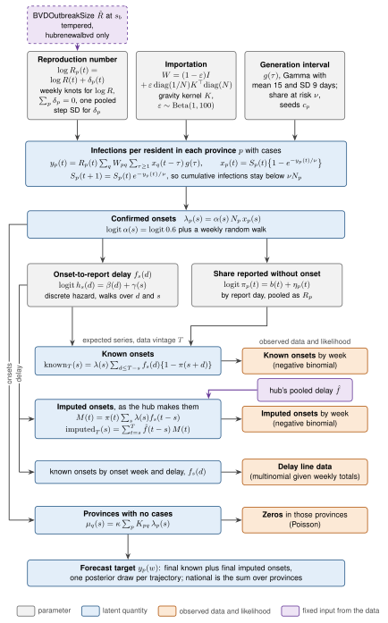

# Model

The renewal model and the persistence baseline, with the maths of each.
{ .page-subtitle }

The data and notation are on the [Data methods page](data.md#target-and-notation).
Submissions go to the hub as `epiforecasts-seabbsrenewal`, whichever model produced them.
`epiforecasts-renewal` is a different hub model, from [BVDOutbreakSize](https://github.com/epiforecasts/BVDOutbreakSize).

## Structure

The figure shows the main variant, `renewal`.
Grey boxes are parameters, blue boxes latent quantities and orange boxes the data with their likelihoods.
The hub's pooled delay $\hat f$ is taken from the data of each vintage, not estimated.
The dashed box is the BVDOutbreakSize term, in `renewalbvd` only.
The source is `docs/diagrams/model_dag.tex`, built by `scripts/build_diagrams.sh`.

## Components

The model extends [PyRenew](https://github.com/CDCgov/PyRenew), pinned to a commit.
Its code is in `bdbv_hub_renewal.pyrenew`.
Every time-varying part has a smoothness prior, so it stays near constant when the data show no change and stays stable when data are sparse.

| Component | PyRenew piece | Built here, and why |
|---|---|---|
| Pooled $R_p(t)$ | `SubpopulationInfections`, `WeeklyTemporalProcess` | `KnotWalk` and `NonCentredRandomWalk`: PyRenew's `RandomWalk` samples its steps one site at a time, a funnel. |
| Renewal with importation and depletion | `SubpopulationInfections`, subclassed | `coupled_renewal`: PyRenew runs each province on its own and cannot carry cumulative depletion. |
| Ascertainment $\alpha(s)$ | `IndependentAscertainment` with a temporal process | None. |
| Onset-to-report delay $f_s(d)$ | None | `HazardDelay`: PyRenew has no time-varying or nonparametric delay. |
| Missing onsets $\pi_p(t)$ | None | `MissingOnsetFraction`, built from the same pooled walk as $R_p$. |
| Known and imputed onsets | `BaseObservationProcess`, `NegativeBinomialNoise` | `OnsetStreams`: PyRenew's count observation takes one fixed delay and no back-sampled imputation. |
| Provinces with no cases | None | An importation-only component. |

Fitting uses PyRenew's `PyrenewBuilder`, `MultiSignalModel` and NumPyro's NUTS.

## Transmission

Days $s$ and $t$ lie on one daily axis, with epi weeks from Sunday to Saturday.
Provinces $p$ with cases in the vintage have a full renewal process.
Provinces $q$ with none have the importation-only component below.

### Reproduction number

$$
\log R_p(t) = \log R(t) + \delta_p(t).
$$

The pooled trend $\log R(t)$ is the unweighted mean of $\log R_p(t)$ over the provinces with cases.
It is not the national Rt, which would weight provinces by their infections.
It is a weekly random walk, sampled as its weekly values (knots) $k_j$:

$$
k_0 \sim \mathcal{N}(0, 0.5^2), \qquad k_j - k_{j-1} \sim \mathcal{N}(0, \sigma_R^2), \qquad \sigma_R \sim \mathcal{N}^+(0, 0.4^2).
$$

Sampling the knots rather than a level and its steps removes the direction in which the level and every step move together.
The prior is the same.

The province deviations sum to zero.
They are $\delta_p(t) = \sum_j Q_{pj}\, \eta_j(t)$, with $Q$ an orthonormal basis of the sum-to-zero subspace and $P - 1$ weekly random walks $\eta_j$.
The walks share one step SD $\sigma_\delta \sim \mathcal{N}^+(0, 0.3^2)$, which pools the provinces.
Their starting values are $Q$ times standard normal draws scaled by $\mathcal{N}^+(0, 0.3^2)$.
All walks are flat over the 6 seeding weeks before the data start.

### Renewal with importation and depletion

The renewal runs on infections per resident, dated by onset:

$$
y_p(t) = R_p(t) \sum_q W_{pq} \sum_{\tau \ge 1} x_q(t - \tau)\, g(\tau),
\qquad
x_p(t) = S_p(t)\big\{1 - e^{-y_p(t)/\nu}\big\},
\qquad
S_p(t + 1) = S_p(t)\, e^{-y_p(t)/\nu}.
$$

- $g$ is a Gamma generation interval with mean 15 and SD 9 days, double interval censored on lags 1 to 42. Each infection day is uniform within its day and the pmf is $G(d + 1) - 2G(d) + G(d - 1)$, with $G$ the Gamma's integrated cdf, as in the R package primarycensored. Lag 0 is dropped and the rest renormalised.
- $W = (1 - \varepsilon) I + \varepsilon\, \mathrm{diag}(1/N) K^\top \mathrm{diag}(N)$ mixes transmission between provinces, with $\varepsilon \sim \text{Beta}(1, 100)$.
- $K$ is a row-normalised gravity kernel, $K_{qp} \propto N_p e^{-D_{qp}/300\,\text{km}}$, with $D$ the great-circle distance between population-weighted province centres and $N_p$ the province population.
- With `coupling="learnt"` the kernel's decay and destination weights are estimated, $\log K_{qp} = \log N_p - D_{qp}/(300\,\text{km} \cdot e^{\kappa_K}) + w_p + c_q$, with $\kappa_K \sim \mathcal{N}(0, 1)$, sum-to-zero weights $w$ with scale $\mathcal{N}^+(0, 0.5^2)$, and $c_q$ normalising each row. With $\kappa_K = 0$ and $w = 0$ it is the fixed gravity kernel.
- $\nu \sim \text{LogNormal}(\log 0.05, 0.75^2)$ is the share of each province at risk.
  $S_p$ starts at $\nu$, so cumulative infections never exceed $\nu N_p$.

The exponential form agrees with linear depletion, $x = S y$, to first order, and cannot overshoot the pool.
It is computed with `expm1` and on $\log S$, which keeps the log density smooth in single precision.

Seeding is set on the scale of confirmed onsets.
Each province's expected confirmed onsets per day at the start are $c_p \sim \text{LogNormal}(0, 1.5^2)$.
They become $x_p = c_p / (\alpha_0 N_p)$ and grow back over the seeding weeks at the initial growth rate implied by $R_p$ and $g$.
That rate is clipped to $[-0.05, 0.3]$ per day, so a steep early decline cannot project an implausibly large seed.

A NumPy reference with linear depletion is in [`latent.renewal`][bdbv_hub_renewal.latent.renewal].

## Observation

### Ascertainment

Expected confirmed onsets are

$$
\lambda_p(s) = \alpha(s)\, N_p\, x_p(s),
\qquad
\operatorname{logit} \alpha(s) = \operatorname{logit} \alpha_0 + a(s),
$$

with $\alpha_0 = 0.6$ fixed and $a$ a national weekly random walk from zero with step SD $\mathcal{N}^+(0, 0.03^2)$.
The level is fixed because the data only identify ascertainment together with $\nu$ and the seeds.

### Delays

The onset-to-report delay $f_s(d)$, on days $d$ from 0 to 60, comes from a discrete hazard:

$$
\operatorname{logit} h_s(d) = \beta(d) + \gamma(s),
\qquad
f_s(d) = h_s(d) \prod_{j < d}\{1 - h_s(j)\},
\qquad h_s(60) = 1.
$$

- $\beta$ is a random walk over delay with $\beta(0) \sim \mathcal{N}(-2, 1)$ and step SD $\mathcal{N}^+(0, 0.1^2)$.
  This makes the shape smooth but not parametric.
- $\gamma$ is a weekly random walk over onset day from zero, with step SD $\mathcal{N}^+(0, 0.15^2)$.
  It shifts all hazards together.

The delay is pooled over provinces.

### Missing onsets

Cases reported on day $t$ without an onset are a share $\pi_p(t)$ of reports, with

$$
\operatorname{logit} \pi_p(t) = b(t) + \eta_p(t),
$$

built as $\log R_p$ is: a pooled weekly random walk $b$ plus sum-to-zero province deviations $\eta_p$.
The starting national value is $\mathcal{N}(-2, 1)$ with province spread $\mathcal{N}^+(0, 0.5^2)$.
The step SDs are $\mathcal{N}^+(0, 0.6^2)$ for $b$ and $\mathcal{N}^+(0, 0.2^2)$ for $\eta$.
$\pi_p$ is informed by the ratio of imputed to known onsets, through the imputation below.

### Known onsets

With $T$ the vintage cut-off, the cases with onset $s$ reported by $T$ with an onset recorded are expected to be

$$
\mathrm{known}_{p,T}(s) = \lambda_p(s) \sum_{d \le T - s} f_s(d)\, \{1 - \pi_p(s + d)\}.
$$

This is right truncation by vintage.

### Hub imputation

The hub's imputed counts are a deterministic function of latent quantities, plus the noise of its draws.
It gives each case reported without an onset an onset by subtracting a delay drawn from "the full delay distribution as available from the data on the site", from a defined vintage ([hub issue 61](https://github.com/InsightNet-US/BDBV-Modeling-Hub/issues/61)).
We model that procedure, including its bias, rather than correcting it.

$$
M_p(t) = \pi_p(t) \sum_s \lambda_p(s)\, f_s(t - s),
\qquad
\mathrm{imputed}_{p,T}(s) = \sum_{t = s}^{T} \hat f_T(t - s)\, M_p(t).
$$

$M_p(t)$ are the cases reported on day $t$ without an onset.
$\hat f_T$ is the hub's delay at vintage $T$.
It is the empirical pmf of all published delays of that vintage, pooled over provinces and onset weeks, with negative delays and delays over 60 days dropped.
It is data, not a parameter, and it is not corrected for truncation.
Both sums are written as banded matrix products.

The forecast target is the eventual known plus imputed onsets, with future imputation using the latest $\hat f_T$.
So the forecast carries the imputation's bias at turning points, which is what the hub scores.
A NumPy reference is in [`observation`][bdbv_hub_renewal.observation].

**Uncertain.**
The hub has not published its code.
We assume it pools over provinces and onset weeks, draws from the vintage being published, and drops nothing.
How it treats negative and very long delays, and whether it re-imputes earlier cases at each vintage, are not stated.
The non-monotone revisions in imputed counts suggest it re-imputes each time.

### Likelihood

- Weekly sums of $\mathrm{known}_{p,T}$ and $\mathrm{imputed}_{p,T}$ are negative binomial, each stream with its own dispersion, $\phi \sim \text{LogNormal}(\log 20, 1)$.
- The delays of known-onset cases in the hub's delay file are tabulated by onset week and delay, pooled over provinces.
  Given each week's total they are multinomial, with probabilities from $\lambda$, $f$ and $\pi$ truncated at $T$.
  This is the conditional part of the reporting triangle, so the known stream is not counted twice.
- Provinces with no cases have expected onsets $\mu_q(s) = \kappa \sum_p K_{pq}\, \lambda_p(s)$, with one scale $\kappa \sim \text{LogNormal}(\log 10^{-3}, 2^2)$.
  Their weekly zeros are Poisson.
- Leaving a province out switches off its terms in the first two.
  It stays in the latent process, so it still transmits and is still forecast.

### Forecasts

The model axis runs to the end of the forecast horizon, so the random walks carry $R_p$, $\alpha$, $f$ and $\pi$ forward.
Each of the 100 trajectories uses one posterior draw for every province and week.
It is the final known plus final imputed counts, drawn from the two negative binomials once every report is in.
In provinces with no cases, importations are drawn and, from the cut-off, seed local spread at the pooled trend $R(t)$.
For `renewal` and `renewalbvd`, the national trajectory is the sum of the province trajectories plus an unassigned component.
The unassigned component holds any provinces the model does not report, and the national cases in the data that no province has.
In weeks with data, that gap is the vintage's $g(w) = \max\{0, Y_{CD}(w) - \sum_p Y_p(w)\}$ in every trajectory.
In later weeks it is $g_k(w) = \rho \sum_p \tilde y_{p,k}(w)$, with $\rho$ the gap over the provinces' total in the last 4 data weeks and $\tilde y_{p,k}$ trajectory $k$ of province $p$.

### Identifiability

| Quantity | Informed by | Identified? |
|---|---|---|
| $R_p(t)$ | Growth of onsets in each province | Well where cases are many; pooled where few |
| $\pi_p(t)$ | Imputed against known onsets | Well in recent weeks; prior-driven in early weeks with few cases |
| $f_s(d)$ | The delay file and the shape of right truncation | Well |
| $\hat f_T$ | Published delays | Known |
| $\alpha(s)$ level | Only with $\nu$ and the seeds | Fixed at $\alpha_0$ |
| $\alpha(s)$ change | Trades off against $R_p(t)$ | Weakly; its small step SD keeps it near constant |
| $\nu$ | Depletion only | Mostly prior; it bounds forecasts rather than explaining the data |
| $\varepsilon$ | Timing of spread between provinces, against the seeds | Weakly; Beta prior |
| $\kappa$ | Zeros in provinces with no cases | Bounded above only; it does not affect provinces with cases |

### Sparse data

Provinces with a handful of cases borrow strength through the pooled walks of $\delta_p$ and $\eta_p$, and share the delay and ascertainment.
Recent weeks lean on the random walk priors.
Provinces with no cases get the importation-only component, so their forecasts allow for introductions.

## Variants

### Model choice

The variant to submit is chosen on the development backtest, by WIS and log WIS relative to persistence, by horizon and province.
The choice and its date are logged in `results/model-choice.yml`.
Every later vintage is held out (see [Evaluation](evaluation.md#rolling-held-out-evaluation)).

### Renewal variants

The renewal variants run in the backtest, the held-out evaluation and the plots, next to persistence.

| Variant | What it is |
|---|---|
| `renewal` | The model in the figure: provinces with pooled $R_p(t)$, gravity importation and depletion. |
| `renewalsp` | Single patch: the renewal model fitted to each location's series on its own, the nation included. |
| `renewalbvd` | The spatial model informed by the latest posterior estimates of the main [BVDOutbreakSize](https://github.com/epiforecasts/BVDOutbreakSize) model, taken from the newest release published before the data cut-off. |
| `fallback` | The CI's fallback: no coupling, with the delays and $\pi$ fixed from the data. It is a fit configuration, not a backtest variant. |

The model code is in `bdbv_hub_renewal.pyrenew` and the variants in [`models.renewal`][bdbv_hub_renewal.models.renewal].

### Single patch

`renewalsp` fits the renewal model to each location's series on its own, the nation included, with no pooling and no coupling.
Each province with cases and the nation get the same single-patch model: one $R(t)$ walk, ascertainment, the delays and the missing-onset share, all fitted to that location's known and imputed onsets alone.
The national forecast is the national fit, not the sum of the province forecasts.
So the hub file's national value need not equal the sum of its provinces.
The submission's national check reports that difference, sample by sample, and does not fail or change it.
The single patch has no shared likelihood, so it does not take part in the leave-one-province-out check.

### BVDOutbreakSize-informed

`renewalbvd` adds the latest reproduction number estimates of the main [BVDOutbreakSize](https://github.com/epiforecasts/BVDOutbreakSize) model as a tempered pseudo-observation on $R_p$.
They come from its public `results-<run>` releases (`bdbv_hub_renewal.bvd`).
A forecast uses the newest release published by the forecast's cut-off whose data end on or before the vintage.
The cut-off is the end of the Sunday that opens the submission window, in Kinshasa time.
So a release republished later on old data is never used, and the backtest sees each release as it was published.

Let $a_b$ be the release's data cut-off and $s_b = a_b + 6$ days, since BVDOutbreakSize's Rt is on infection time and ours on onset time (incubation mean about 6 days).
For a group $G$ of provinces, the nation or one BVDOutbreakSize patch, the model's Rt is onset weighted over the week of $s_b$:

$$
R_G(s_b) = \frac{\sum_{p \in G} I_p\, R_p(s_b)}{\sum_{p \in G} I_p}.
$$

The release gives the national log Rt mean $\mu_N$ and SD $\sigma_N$ from its posterior draws.
Each patch $k$ gives a log median $m_k$ and SD $\sigma_k$ from its 90% interval, against the national row $m_N$, $\sigma_N'$ of the same table.
With tempering $\alpha = 0.5$,

$$
\mu_N \sim \mathcal{N}\big(\log R_N(s_b),\, \sigma_N^2/\alpha\big),
\qquad
m_k - m_N \sim \mathcal{N}\big(\log R_k(s_b) - \log R_N(s_b),\, \tau_k^2/\alpha\big),
\qquad
\tau_k^2 = \max(\sigma_k^2 - \sigma_N'^2,\, 0.05^2).
$$

This is a power prior on the published summaries, and adds no parameters.
With $\alpha = 0$ the model is `renewal`.
Releases before 23 October have no patch estimates, so only the national term enters.
Early releases publish the growth rate $r$ only, and $R = (1 + r\theta)^k$ with BVDOutbreakSize's Gamma generation interval prior (mean 15.3, SD 9.3 days).
Leaving a province out drops the national term and that province's patch, since both carry its data.
BVDOutbreakSize and the hub count the same confirmed cases, so the two Rt estimates are not independent, which is why the term is tempered.
The variant is fitted weekly as a shadow candidate and is not submitted unless it is chosen.

### Persistence baseline

`persistence` is the baseline every other model is compared against.
Let $c$ be the last week judged complete.
Week $w$ is complete if its midpoint (its Wednesday) is at least $L$ days before $T_v$.
$L$ is the 90th centile of the delays published with the vintage, or 10 days if none were published.
For the current vintages $L$ is 14 days, so $c$ is two weeks before the vintage's epi week, about horizon $-3$.

Weeks up to $c$ are copied from the vintage, with no uncertainty:

$$
\tilde y_p(w) = Y_{p,v}(w), \qquad w \le c.
$$

Later weeks carry $Y_{p,v}(c)$ forward as a random walk on the log scale, with Poisson noise.
For $w = c + h$ with $h \ge 1$,

$$
\log(1 + \lambda_{p}(c + h)) = \max\Big(0,\ \log(1 + Y_{p,v}(c)) + \sum_{j=1}^{h} \epsilon_{p,j}\Big),
\qquad \epsilon_{p,j} \sim \mathcal{N}(0, \sigma_p^2),
$$

$$
\tilde y_p(c + h) \sim \text{Poisson}(\lambda_p(c + h)).
$$

$\sigma_p$ is the sample standard deviation of the 7 weekly changes in $\log(1 + Y_{p,v})$ over the last 8 complete weeks, floored at 0.1.
Each sample is one joint trajectory across weeks.
The national value is the sum of the province samples, sample by sample.

Two things follow.
The median of $\lambda_p$ stays at $Y_{p,v}(c)$, so it has no growth.
And weeks up to $c$ are point masses at counts that are still revised upwards after the vintage.
So persistence underpredicts while the epidemic grows and recent weeks fill in (see [Backtest](../backtest.md#persistence-bias)).
