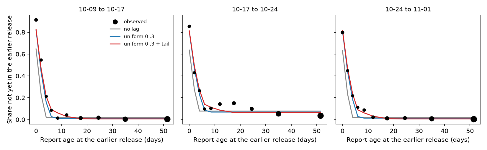
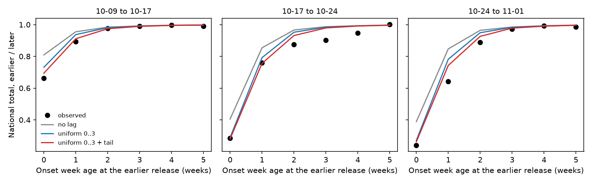
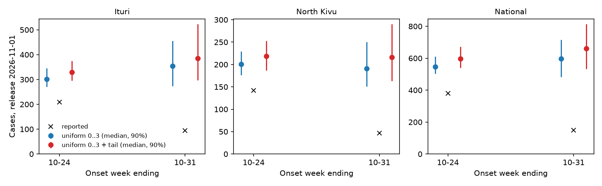

# Publication lag

How the renewal models handle the lag between a case's report and its publication in a hub release, what supports it, and the smallest change the release data motivate.
{ .page-subtitle }

## Question

The renewal models fit one release and thin its newest report days by a fixed report-to-publication lag, uniform on 0 to 3 days.
Removing the lag lowers the newest weeks a lot (Ituri, week ending 10-31, median 344 to 225, against 302 from seabbs-rwnowcast).
This page asks what supports the lag and how to model reporting in the spirit of epinowcast while staying daily and keeping the hub's imputation in the model.
It also checks the coverage of the newest weeks, which look too precise, and where that comes from.

## The current model

Each part was added for a reason.

- **Delay hazard** (`model/delays.py`, `HazardDelay`).
  The onset-to-report delay is a discrete hazard, $\operatorname{logit} h_s(d) = \beta(d) + \gamma(s)$, with $\beta$ a random walk over delay and $\gamma$ a weekly random walk over onset day.
  This is the epinowcast hazard model with a non-parametric baseline and a reference-date effect, which lets the delay change over the outbreak (#34).
- **Missing onsets and the hub's imputation** (`model/observation.py`, `onset_expectations` and `backsample`).
  A share $\pi_p(t)$ of cases reported on day $t$ have no onset, and the hub gives each one an onset by subtracting a delay drawn from its published delays.
  The model reproduces that procedure in expectation, so the imputed counts inform $\pi$ and $\lambda$ without being treated as true onsets.
  This needs the daily axis, because the hub works by day.
  epinowcast's missing-reference model (Lison et al.) sees missing cases by report day.
  Here only their imputed onsets are published, so the imputation itself has to be modelled ([hub issue 61](https://github.com/InsightNet-US/BDBV-Modeling-Hub/issues/61)).
  Re-imputation is real: the national imputed total fell from 1575 to 1418 between the 10-17 and 10-24 releases.
- **Publication lag** (`model/observation.py`, `published_by`; `model/model.py`, `build_model` with `publication_lag="fixed"`).
  A case reported on day $t$ is in the release at $T$ with probability $c(t) = F_\ell(T - t)$.
  $c$ thins the known stream, the missing-onset reports the hub imputes, and the delay triangle alike.
  The release pairs below support it.
- **Likelihood** (`OnsetStreams._score` and `_score_delays`).
  Weekly known and imputed onsets at the latest release are negative binomial.
  The delay file is Dirichlet-multinomial over delays given each onset week's total.
  Together these factor epinowcast's reporting-triangle likelihood into weekly totals and conditional delay shares.
  The Dirichlet-multinomial keeps the pooled delays of thousands of cases (8811 rows at 11-01) from making the delay overconfident.
- **Final counts** (`_nowcast` and `_recentred`).
  Known final counts add the draws still to come to the published counts, as epinowcast does.
  Imputed final counts are centred on the current imputed count, because the hub re-imputes at each release and a week's imputed count can fall.

## Against epinowcast

In epinowcast the report date is the day a count enters a snapshot, so its triangle needs no publication lag.
Here the delay file's report date is the line list's, and a case can enter a release days after it.
Two delays therefore chain: onset to report ($f$, daily and learnt) and report to publication ($F_\ell$).
The lag depends on $T - t$, not on covariates of the report date, so epinowcast's report-date effect cannot express it.

Within one release, $c(t)$ and the short-delay hazard of the newest onsets both thin the newest report days.
The two are confounded, which is why removing the lag moves the newest weeks so far.
The only data that separate them are the earlier releases: which delay-file rows were already published at each one.
The model does not use them.

Report-date day-of-week effects are not proposed.
Onsets are published by week and releases are weekly, so a day-of-week effect on report would rest on the prior.

## Evidence from the releases

### The missing likelihood term

If releases are nested, so that each row of release $k$ is also in release $k + 1$, their joint likelihood factors as

$$
P(V_1, \dots, V_N) = P(V_N) \prod_{k < N} P(V_k \mid V_{k+1}).
$$

The model fits $P(V_N)$.
The pair term is the probability that each row at $V_{k+1}$ was already in $V_k$,

$$
P(\text{in } V_k \mid \text{in } V_{k+1}, t) = (1 - b_k)\, \frac{\sum_u F_\ell(T_k - t_u)}{\sum_u F_\ell(T_{k+1} - t_u)},
$$

averaged over the onset day $u$ within the published onset week, so $t_u$ is that onset plus the row's delay.
$b_k$ is a background share of rows that appear late whatever their report age.
Some are onsets recorded later for cases already counted as imputed, and some are late cases (see the check against the totals).
Without $b_k$ those rows read as a long lag, which is why the empirical lag (`data/releases.py`, `publication_lag_pmf`) made old weeks grow and was dropped.
Releases are nested except for 8 to 15 rows removed per pair, which the fits leave out.

`scripts/publication_lag.py` fits this term alone by maximum likelihood on the four delay files, with $T_k$ the release date as in the model.

| Lag | Negative log likelihood | Tail weight | $b_k$ (10-09, 10-17, 10-24) |
|---|---|---|---|
| None | 2264.2 | | 0.018, 0.078, 0.020 |
| Uniform 0..2 | 2081.5 | | 0.012, 0.071, 0.015 |
| Uniform 0..3 (current) | 2035.2 | | 0.010, 0.069, 0.013 |
| Uniform 0..4 | 2018.4 | | 0.009, 0.068, 0.011 |
| Uniform 0..2, tail on 3..14 | 2000.4 | 0.152 | 0.006, 0.063, 0.006 |
| Uniform 0..3, tail on 4..14 | 1986.7 | 0.105 | 0.006, 0.063, 0.006 |
| Uniform 0..4, tail on 5..14 | 1989.7 | 0.072 | 0.006, 0.063, 0.006 |

The current lag beats no lag by 229 log-likelihood units.
Single lag days are not identified from weekly onsets, so only uniform bodies are compared.
Without a tail, 0..4 fits a little better than 0..3, but with a tail 0..3 is best, and with the data cut-off below 0..3 is best without a tail.
A tail weight on 4 to 14 days gains 48.5 units over the current lag for one parameter, with a binomial 95% profile interval of 0.08 to 0.13.
That interval is too narrow, because the rows are overdispersed (the bump at 10 to 25 days in the middle panel).
The weight is stable across pairs: 0.100, 0.085 and 0.119 fitted to each pair alone, and 0.094 to 0.111 with any one pair left out.
$b_k$ is near 0.6% for two pairs and 6.3% for 10-17 to 10-24.

Part of the lag is the gap between the release date and its data cut-off, 0 to 1 days for these releases.
With $T_k$ set to each release's latest onset or report day instead, a lag is still needed (no lag 2154.9 against 2031.6 for uniform 0..3), so the lag is not only that gap.
The model keeps the release date.

### Check against the totals

The empirical lag was dropped because it predicted growth in old weeks that the totals do not show.
The figure compares, for each pair of releases, the national total of each onset week at the earlier release over the later, with the ratio each lag predicts from a fixed delay pmf (the latest delay file, onset weeks at least 8 weeks old).
None of the lags overstates the growth of old weeks.
The tail moves the predictions towards the data at 0 to 2 weeks and leaves weeks 3 or more weeks old near complete.
The same holds with $f$ from onset weeks 3 to 6 weeks old instead (`total-check-recent-delay.csv`), so a drifting delay does not reverse it.
In the last two pairs the totals 1 to 4 weeks old grew more than any lag predicts.
The excess growth of weeks 3 to 5 weeks old over the no-lag prediction is about 0.4%, 4.6% and 0.8% for the three pairs, close to $b_k$.
So part of the background is late cases, arriving in batches, not only onsets recorded later.

## Coverage of the newest weeks

The backtest stores each origin's nowcasts of what each later release reported (`results/nowcast-quantiles.csv`, origins 10-17 and 10-24, all on the current lag).
For Ituri, North Kivu and national, weeks 0 to 3 back, there are 9 nowcasts per week back and model.

| renewal, weeks back | 0 | 1 | 2 | 3 |
|---|---|---|---|---|
| 50% coverage | 0.00 | 0.11 | 0.22 | 0.33 |
| 90% coverage | 0.44 | 0.33 | 0.22 | 0.44 |
| Above the 95% quantile | 0.44 | 0.56 | 0.78 | 0.56 |
| 90% width over median | 0.51 | 0.17 | 0.08 | 0.07 |
| Cases added, observed over predicted median | 1.19 | 1.56 | 2.31 | 3.24 |

renewalbvd is close to this and renewalsp covers 50% at 90% (`coverage.csv`), while seabbs-rwnowcast covers 42% at 90% on the same rows.
The nowcasts are overconfident, and almost every miss is low: later releases added more cases than predicted.
For weeks 1 to 3 back, the added cases exceed even the 95% quantile of the predicted additions in total.
At origin 10-17, for example, the national week ending 09-26 had 379 cases, the model expected 8 more, and the 10-24 release added 41.

The overconfidence comes from how the final count is built.
The published count is taken as known and only the count still to come is uncertain.
That count is the expected remainder under $f$ and $c$, with negative binomial noise around it.
On these rows the model expected 6.5% more for weeks 2 back and 2.6% for weeks 3 back, and the releases added 15% and 8.6%.
A narrow expected remainder gives a narrow interval, so the misses come mainly from the expected remainder being too small.

The national counts show two sources.

- Late batches. From 10-17 to 10-24, known counts of weeks 2 to 4 back rose by 75, 59 and 42 while their imputed counts fell by 15, 18 and 16.
  Part is onsets recorded for cases already counted, and the rest, about 10 to 45 cases a week, is late cases.
  This is the pair with $b_k$ = 6.3%, and the model has no term for it.
- Slower reporting of recent onsets (#34). From 10-24 to 11-01 the known count of the week 2 back rose by 35 (9%), from cases with long delays rather than late publication (only 1.9% of delay-file rows reported 7 to 13 days before 10-24 were missing from that release).
  Only $\gamma(s)$ can carry this, and it has to learn it from the truncated triangle of the newest weeks.

seabbs-rwnowcast, with a different delay model, misses the same way, so the cause is in the releases rather than in the renewal structure.

The tail alone changes little here.
Rescaling the stored quantiles by the share each lag leaves unpublished, an approximation to refitting, leaves 90% coverage over weeks 0 to 3 at 36% (`coverage.csv`).
The tail adds a few percent to weeks 0 to 2, while the shortfall is a factor of 1.2 to 3.

## Proposed change

Keep the delay hazard, the generative imputation, the Dirichlet-multinomial and the 0 to 3 day lag body.
Add the release-pair term, and use what it learns in two places.

1. The lag becomes uniform on 0 to 3 days with weight $w$ spread uniformly over 4 to 14 days, $w \sim \text{Beta}(1, 4)$, a prior with mean 0.2 not tuned to the estimate.
2. The pair term enters the model as a beta-binomial on the delay-file rows of each earlier release, sharing $F_\ell$ with the onset streams.
   Its background is a per-release share, $b_k \sim \text{Beta}(\mu \kappa, (1 - \mu) \kappa)$, so the model learns both the typical share of late rows and how much it varies between releases.
   The beta-binomial does for the release rows what the Dirichlet-multinomial does for the delays.
3. Forecasts of what a later release will report draw a new $b$ for each release to come and add that share to the expected remainder of rows up to 60 days old, the same window the pair term uses.

Rows 4 to 14 days old at the earlier release identify $w$, rows older than 14 days identify $b_k$, and the latest release keeps identifying $f$, $\pi$ and $\lambda$ as now.
Step 3 is the one aimed at the overconfidence.
With $b_k$ of 0.6%, 6.3% and 0.6%, it widens the intervals of weeks up to 8 weeks old by a few percent of their count, upwards, which is the direction of the misses.
It addresses the late batches, not the slower reporting, which stays with $\gamma(s)$.
It cannot be checked well yet: three pairs give $\mu$ and $\kappa$ little data, so their priors matter.
The term conditions on each row being in the later release, so it adds information on $F_\ell$ only and does not count the latest release twice.
Its inputs are small: per pair, each row cell's report ages at both releases and its kept and new counts (`release_pairs` in the script).

The imputed stream is not fitted to its increments between releases.
The hub redraws every imputed onset at each release, so changes between releases are not counts of new cases and can be negative.
The latest-release negative binomial, centred as now, already handles that.

## Prototype at the 2026-11-01 release

The main renewal model was fitted twice to the 11-01 release, once with the current lag and once with the tail fixed at 0.105.
The tail fit plugs the estimate in through the `empirical` path (`scripts/publication_lag_fit.py`), so it is a plug-in, not the joint model proposed above.
Both use the submission sampler, 2 chains of 500 warm-up and 500 draws at target acceptance 0.9, on main at 44fd569.

| Place | Week ending | Reported at 11-01 | Uniform 0..3 | Uniform 0..3 + tail |
|---|---|---|---|---|
| Ituri | 10-24 | 209 | 301 (270 to 346) | 329 (296 to 375) |
| Ituri | 10-31 | 94 | 354 (274 to 455) | 385 (297 to 523) |
| North Kivu | 10-24 | 142 | 201 (176 to 229) | 219 (187 to 253) |
| North Kivu | 10-31 | 47 | 191 (151 to 250) | 216 (163 to 290) |
| National | 10-24 | 381 | 546 (504 to 610) | 598 (540 to 672) |
| National | 10-31 | 150 | 597 (482 to 715) | 662 (532 to 814) |

Medians with 90% intervals of final counts.

| Diagnostic | Uniform 0..3 | Uniform 0..3 + tail |
|---|---|---|
| Worst R-hat (site) | 1.054 (`rt_sd`) | 1.080 (`rt_sd`) |
| Lowest bulk / tail ESS (10 worst sites) | 96 / 163 | 63 / 140 |
| Divergences | 4 of 1000 | 3 of 1000 |

The tail raises the two newest weeks by 8 to 13%, the opposite direction to removing the lag.
Neither 10-31 nowcast can be scored until later releases.
The worst-mixing site is `rt_sd` in both fits.
The tail fit mixes a little worse there, which two chains cannot separate from noise.

## Next steps

- Implement the pair term in `OnsetStreams` with $w$, $\mu$ and $\kappa$ as above, and test that it recovers them in simulated releases.
- Score the change at origins 10-17 and 10-24 against the later releases, with coverage of weeks 0 to 3 back as the main check, before adopting it.
- Check whether the step prior of $\gamma$ lets the delay of the newest onsets lengthen fast enough, since that drives the misses of weeks 0 to 1 back.
