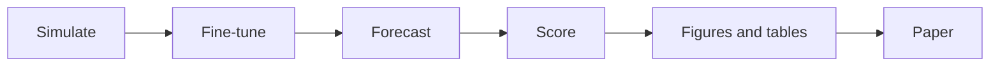

# Paper

A paper on fine-tuning Chronos-2 on simulated outbreaks for nowcasting, planned in [#206](https://github.com/seabbs/BDBVHubRenewal/issues/206).

- [Main text](paper/main.html) and [supporting information](paper/si.html), with their PDFs.
- [Reproducing the paper](https://github.com/seabbs/BDBVHubRenewal/blob/main/paper/README.md): the workflow, its targets and how the held-out data are protected.



??? note "Reproduce it"
    From `paper/`:

    ```sh
    task pipeline:dev      # the development run, without the held-out data
    task pipeline:paper    # the paper run, with the held-out data
    task render            # the paper as HTML and PDF from the last run
    ```

    This site shows the development run.
    Figures from a study without its real data yet are marked as illustrative, dummy data.
