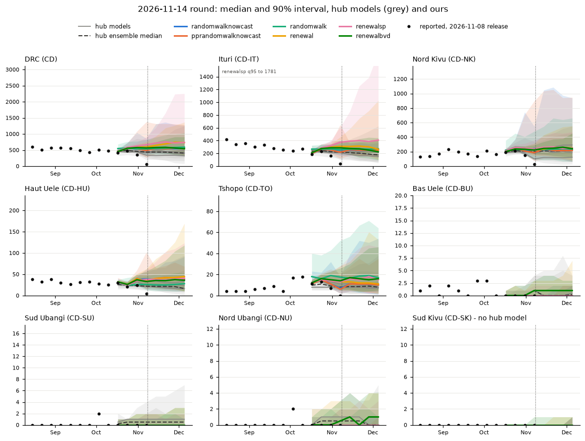

# Our 2026-11-14 forecasts beside the hub's

A check of our six models against the forecasts other teams have submitted to the BDBV hub for the 2026-11-14 round.
We are not trying to match them, so differences are expected.
This branch is not for merging.
Data are as of the 2026-11-08 release (latest week 11-07), the newest release in the hub's `target-data` at the time.

## Hub submissions read

Read from a shallow clone of the hub's `main` at 42b30a9a (2026-11-09 21:08 -05:00) and, for UQPSU, the open hub PR #114 (fetched read-only, nothing posted), on 2026-11-10.
All six are sample forecasts of `wk inc confirmed cases`, licensed CC-BY-4.0 or CC0-1.0.
The raw files stay out of this branch; `hub_quantiles.csv` holds their quantiles.

| model | team | committed (author time) | in hub main | places |
|---|---|---|---|---|
| MOBS-GLEAM_BDBV | MOBS Lab, Northeastern | 2026-11-09 15:53 -05:00 | merged #110, 11-09 21:21 UTC | CD, HU, IT, NK |
| BDBVHub-baseline | hub | 2026-11-09 22:15 UTC | merged #111, 11-10 02:08 UTC | 546 (nation, provinces, zones) |
| OHTJHU-BM | One Health Trust / JHU | 2026-11-09 20:45 -05:00 | merged #113, 11-10 02:07 UTC | 63 (nation, 7 provinces, 55 zones) |
| pedro-zonemix | Pedro Pinto | 2026-11-10 00:51 UTC | merged #112, 11-10 02:08 UTC | 63 (as OHTJHU-BM) |
| UQPSU-SEIHRD | UQ and Penn State | 2026-11-10 19:53 +10:00 | open PR #114, opened 11-10 09:54 UTC | CD, HU, IT, NK, TO |
| UQPSU-SEIHRD_CTMC | UQ and Penn State | 2026-11-10 19:53 +10:00 | open PR #114 | CD, HU, IT, NK, TO (93 samples) |

ACCIDDA-Chromantis and CEPH-Rtrend_BDBV, which submitted on 10-31, had nothing for 11-14 on main or in an open PR.
The UQPSU files write dates day first; `hub_quantiles.py` reads them so.

## Our forecasts

- randomwalknowcast and randomwalk: the quantiles from the plausibility evidence (`evidence/plausibility-2026-11-14` at dc400fe2, run on main 96ac128d).
  The `src` diff from 96ac128d to main af48b070 touches only `digest.py` and `pprandomwalk.py`, so these are what main gives.
  Neither `config/`, `data/`, `pyproject.toml` nor `uv.lock` changed between 96ac128d and af48b070, or between fa04ff08 and af48b070.
- pprandomwalknowcast: run here on main af48b070, `nowcast --model pprandomwalknowcast --vintage 2026-11-08 --reference-date 2026-11-14`.
  It passed the new convergence check (#155) and wrote its file.
- renewal, renewalsp and renewalbvd: the 11-08 fits on `fit-store` at b12df214 (the branch head when written up), fitted at fa04ff08, which is on main.
  The `src` diff from fa04ff08 to main touches none of their code.
  Zones come from `store_zones.py` (`zones_for_model`, no refit), copied from the plausibility evidence.
  The seed-floor fix for #161 (78fcb122) is not on main, so these zone splits are main's current behaviour.

## Rules

Fixed before looking at the numbers (also in `compare.py`'s docstring):

- The hub ensemble is the median, quantile by quantile, of the five non-baseline models where two or more give the place and week.
  At zones that is only OHTJHU-BM and pedro-zonemix.
- The hub range is [lowest hub q05, highest hub q95] over the same five models.
- Flags per place and week: median outside the hub range; no overlap of our 90% interval with the hub range; our q95 more than twice the highest hub q95 (`tail_x2`); place not given by any hub model.
- Data check: medians against the counts in the 11-08 release only for weeks up to 10-24 (two or more weeks before the last week). Later weeks are still filling.

## DRC, Ituri and Nord Kivu

Median [5%, 95%] at the first and last forecast weeks (`summary.md`; every week and place is in `table.csv`).

| model | DRC 11-14 | DRC 12-05 | Ituri 11-14 | Ituri 12-05 | Nord Kivu 11-14 | Nord Kivu 12-05 |
|---|---|---|---|---|---|---|
| hub-ensemble | 437 [266, 507] | 407 [254, 538] | 211 [140, 293] | 177 [79, 275] | 208 [151, 250] | 214 [170, 296] |
| MOBS-GLEAM_BDBV | 435 [266, 670] | 420 [254, 749] | 182 [111, 293] | 150 [65, 275] | 245 [151, 359] | 292 [170, 456] |
| OHTJHU-BM | 331 [204, 507] | 318 [76, 538] | 232 [140, 324] | 249 [48, 421] | 120 [45, 224] | 123 [27, 296] |
| UQPSU-SEIHRD | 437 [402, 477] | 388 [341, 439] | 205 [186, 234] | 175 [148, 208] | 204 [183, 234] | 214 [183, 251] |
| UQPSU-SEIHRD_CTMC | 450 [406, 499] | 407 [343, 462] | 211 [181, 242] | 177 [146, 230] | 208 [182, 250] | 219 [181, 261] |
| pedro-zonemix | 496 [217, 927] | 480 [161, 1242] | 244 [96, 419] | 214 [79, 626] | 214 [80, 426] | 188 [60, 551] |
| BDBVHub-baseline | 482 [314, 618] | 482 [282, 664] | 234 [115, 369] | 234 [122, 429] | 214 [152, 286] | 214 [121, 284] |
| randomwalknowcast | 542 [401, 1308] | 552 [339, 1262] | 253 [167, 360] | 260 [154, 367] | 234 [98, 1047] | 226 [63, 939] |
| pprandomwalknowcast | 546 [390, 1316] | 558 [336, 1285] | 258 [170, 364] | 250 [151, 416] | 236 [97, 1035] | 216 [62, 948] |
| randomwalk | 551 [366, 891] | 590 [360, 1041] | 268 [195, 393] | 272 [170, 399] | 230 [85, 545] | 236 [66, 661] |
| renewal | 644 [443, 927] | 732 [346, 1365] | 308 [188, 584] | 265 [105, 1028] | 236 [145, 429] | 252 [80, 552] |
| renewalsp | 717 [482, 1192] | 738 [360, 2252] | 392 [208, 854] | 407 [135, 1781] | 260 [155, 408] | 250 [132, 473] |
| renewalbvd | 578 [436, 750] | 542 [315, 908] | 277 [184, 382] | 224 [95, 443] | 244 [163, 336] | 242 [120, 452] |



`zones.png` has the 55 zones the hub models give.

## Main differences

1. **DRC level: all six of ours sit above every hub median.**
   At 11-14 our medians are 542 to 717 against hub medians of 331 to 496 (ensemble 437).
   None is outside the hub range, because pedro-zonemix's 90% interval reaches 927 to 1242.
   The gap starts in the nowcast.
   For week 10-24 (482 reported, two weeks back) our medians are 557 to 580 and the hub ensemble's 484.
   In past releases a week two back grew by 3% (10-17), 15% (10-10) and 20% (10-03) by 11-08, so the final count is likely about 500 to 580.
   We sit at the top of that and the hub at the bottom.
   For 10-31 (349 reported, one week back) ours are 528 to 626 and the hub ensemble's 462.
   The hub models then carry the slow fall seen since August (about 600 a week in August, 470 to 500 in early October) forward. Ours stay flat (random walks) or rise (renewal, renewalsp).
   This bears on how much our nowcasts expect recent weeks to fill.
   The nearest issue is #34, which is closed and was about the opposite (under-predicting Nord Kivu). #160 covers the tails, not the level.
   renewal also climbs at DRC (median 644 to 732, q95 1365 by 12-05). #52 is about renewalsp in Ituri.
2. **Ituri: hub models fall, ours stay flat or rise.**
   Reported counts fell from about 420 in mid-August to 240 to 270 in October.
   The hub ensemble goes from 211 at 11-14 to 177 at 12-05. Only OHTJHU-BM stays flat.
   Our random walks stay at 250 to 270. renewal and renewalbvd fall slowly.
   renewalsp is the outlier: median 392 to 407 (above all hub medians from 11-14 on), q95 1781 at 12-05, 2.8 times the highest hub q95 (626). This is #52.
   renewal's Ituri q95 also reaches 1028.
3. **Nord Kivu: our medians agree, our random walk tails do not.**
   Our medians (216 to 260) sit within the hub medians (120 to 292).
   The randomwalknowcast and pprandomwalknowcast q95 is about 940 to 1050, twice the highest hub q95 (426 to 551). This is #160.
   OHTJHU-BM is the low outlier here (median 120), dropping from its own nowcast of 176 at 10-31.
4. **DRC upper tails.**
   Our random walk nowcasts' q95 (1262 to 1316) is level with pedro-zonemix's (927 to 1242) and 2 to 3 times the other hub models'.
   renewalsp's DRC q95 reaches 2252 by 12-05, 1.8 times the highest hub q95.
   Both bear on #160 and #52.
5. **Zones.**
   Over the four forecast weeks, our q95 is more than twice the highest hub q95 in 53 place-weeks for each random walk, 23 for renewalsp, 11 for pprandomwalknowcast, 4 for renewal and none for renewalbvd (`flags.csv`).
   Most are zones in Nord Kivu (Biena, Butembo, Kalunguta, Kyondo, Masereka, Musienene, Lubero) and Ituri (Damas, Kilo, Fataki, Aru).
   The random walk ones bear on #160 and #159 (Kilo and other stale starts).
   renewalsp's are Ituri zones (Bunia, Lita, Mandima, Mangala, Nia Nia, Nizi, Rimba), which is #52 split to zones.
   randomwalk puts Tshopo zones (Mangobo, Tshopo, Wanierukula) and Musienene above every hub median.
6. **Never-seeded zones.**
   Only BDBVHub-baseline gives the 453 hub zones with no case in the release, and it gives 0 in every one.
   OHTJHU-BM and pedro-zonemix give only zones with cases. So the other teams do not forecast these zones at all.
   Ours put q95 of 1 or more in some forecast week in 46 (randomwalknowcast), 48 (randomwalk), 16 (pprandomwalknowcast), 31 (renewal), 18 (renewalsp) and 35 (renewalbvd) of them; no median is 1 or more (`never_seeded.csv`).
   This is #161. The renewal counts are before the seed-floor fix.
7. **Places no hub model gives.** Sud Kivu (3 cases to date) and the 11 zones with a case that OHTJHU-BM and pedro-zonemix leave out. We give them; the hub does not.

## Do the hub models agree with the data as reported?

On the settled weeks (up to 10-24), yes, broadly.
Their medians for DRC 10-17 (420 reported) are 430 to 492, and for 10-24 (482) 430 to 588.
In Nord Kivu they are within about 12% of the reported counts on both weeks (pedro-zonemix 24% high on 10-24).
In Ituri they are within about 10% on 10-24 (234 reported; pedro-zonemix 20% high).
Ituri's 10-17 (190 reported) is a dip between 268 and 234. OHTJHU-BM (194) and pedro-zonemix (211) follow it, while MOBS-GLEAM_BDBV and UQPSU (231 to 252) smooth over it.
At zones, the 90% intervals of OHTJHU-BM and pedro-zonemix hold 99% and 100% of the reported counts on those weeks; ours hold 95% (renewalsp) to 99% (randomwalknowcast) (`data_check.csv`).
On those weeks the hub models are closer to the reported counts than ours, which expect more filling.
Whether the hub or we have the filling right for 10-24 and 10-31 will show in the next releases.

The tails, renewalsp in Ituri, stale zone starts and never-seeded zones are covered by #52, #159, #160 and #161.
Two differences are not clearly covered: the DRC level and nowcast-filling gap (point 1; #34 is the nearest and is closed) and renewal's DRC rise.
No issue was filed for them. Our 10-24 uplift is inside past revision growth, so whether it is a fault is a judgement call.

## Files

- `hub_quantiles.py` reads the hub sample files (from the scratch clone `S/hubclone` and `S/pr114`) and writes `hub_quantiles.csv`.
- `store_zones.py` splits a stored fit to zones (from the plausibility evidence).
- `compare.py` writes `quantiles.csv`, `table.csv`, `flags.csv`, `data_check.csv` and `never_seeded.csv`. It states its rules.
- `plot.py` draws `provinces.png` and `zones.png`.
- `summary.py` writes `summary.md`.

Run, from the repo root with a scratch dir `S` holding the inputs listed in `compare.py`:

```sh
uv run python -I evidence/hub-compare-2026-11-14/hub_quantiles.py $S evidence/hub-compare-2026-11-14/hub_quantiles.csv
uv run python -I evidence/hub-compare-2026-11-14/compare.py $S evidence/hub-compare-2026-11-14
uv run python -I evidence/hub-compare-2026-11-14/plot.py evidence/hub-compare-2026-11-14
uv run python -I evidence/hub-compare-2026-11-14/summary.py evidence/hub-compare-2026-11-14
```

## Credit

Forecasts: the teams above, under the licences in their hub `model-metadata` files (CC-BY-4.0, CC0-1.0 for OHTJHU-BM).

Surveillance data: Institut National de Santé Publique (INSP) and the Incident Management Support Team (IMST), Democratic Republic of the Congo. Processed by the Atlantic Coast Center for Infectious Disease Dynamics and Analytics (ACCIDDA) and the Kinshasa School of Public Health, University of Kinshasa, and distributed through the BDBV Modeling Hub, https://github.com/InsightNet-US/BDBV-Modeling-Hub, accessed 2026-11-10.
