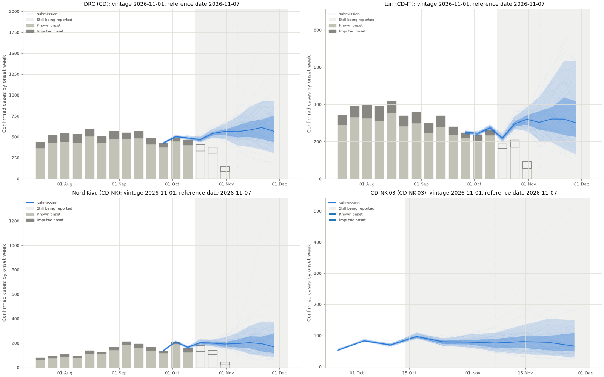
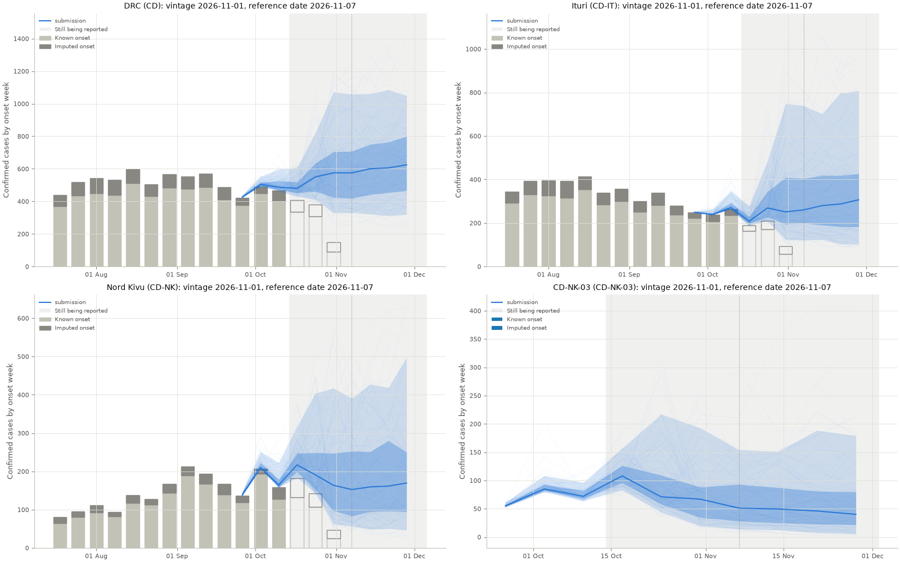

# Round 2026-11-07

Nowcasts and forecasts submitted to the BDBV Modeling Hub for the round with reference date 2026-11-07.
{ .page-subtitle }

Data vintage (`as_of`): 2026-11-01.

=== "seabbs-renewal"

    | | |
    | --- | --- |
    | Status | submitted |
    | Produced by | BVDOutbreakSize-informed renewal model |
    | Model | renewalbvd (`bvd`) |
    | Gate status | warn |
    | Hub pull request | [link](https://github.com/InsightNet-US/BDBV-Modeling-Hub/pull/95) |
    | Workflow run | [link](https://github.com/seabbs/BDBVHubRenewal/actions/runs/41691221605) |
    | Commit | [`16340ee`](https://github.com/seabbs/BDBVHubRenewal/commit/16340ee3556f578b7482d79f98657e7611b60b7a) |

    The BVDOutbreakSize-informed renewal model cleared every check, with warnings.

    

    Bars are the published counts by onset week in the data used. Lines and bands are the submitted median, sample trajectories and 50% and 90% intervals.

    **National**

    | week ending | median | 50% interval | 90% interval |
    | --- | --- | --- | --- |
    | 2026-09-26 | 427 | 421 to 434 | 414 to 439 |
    | 2026-10-03 | 504 | 498 to 509 | 491 to 522 |
    | 2026-10-10 | 488 | 479 to 492 | 467 to 511 |
    | 2026-10-17 | 467 | 454 to 478 | 440 to 504 |
    | 2026-10-24 | 541 | 520 to 560 | 495 to 598 |
    | 2026-10-31 | 565 | 522 to 590 | 477 to 663 |
    | 2026-11-07 | 562 | 496 to 637 | 403 to 744 |
    | 2026-11-14 | 582 | 500 to 686 | 383 to 861 |
    | 2026-11-21 | 612 | 474 to 712 | 352 to 925 |
    | 2026-11-28 | 566 | 439 to 755 | 308 to 936 |

    **Checks**

    | check | status | summary |
    | --- | --- | --- |
    | schema | pass | format matches the hub's round |
    | values | pass | all values finite and non-negative |
    | samples | pass | 100 full trajectories per location |
    | coverage | pass | 187 locations, weeks 2026-10-17 to 2026-11-28 |
    | zones | pass | 178 zones in 8 provinces |
    | national_sum | pass | CD is the exact sum (national.json: 8 modelled provinces) |
    | bounds | pass | trajectories within the bounds |
    | plausible | pass | within range of the recent data |
    | growth | pass | forecast growth within the cap |
    | observed | pass | close to observed (2026-11-01) |
    | baseline | warn | CD-IT-05: median 28.5 against random walk baseline 1 over 2026-11-14 to 2026-11-28 (ratio 5.58) (and 4 more) |
    | previous | skip | no last week's submission to compare with |

    **Candidates**

    | step | outcome | why |
    | --- | --- | --- |
    | BVDOutbreakSize-informed renewal model | submitted |  |
=== "seabbs-rwnowcast"

    | | |
    | --- | --- |
    | Status | submitted |
    | Produced by | random walk on a nowcast |
    | Model | randomwalknowcast (`randomwalknowcast`) |
    | Gate status | warn |
    | Hub pull request | [link](https://github.com/InsightNet-US/BDBV-Modeling-Hub/pull/94) |
    | Workflow run | [link](https://github.com/seabbs/BDBVHubRenewal/actions/runs/41691221605) |
    | Commit | [`16340ee`](https://github.com/seabbs/BDBVHubRenewal/commit/16340ee3556f578b7482d79f98657e7611b60b7a) |

    The random walk on a nowcast cleared every check, with warnings.

    

    Bars are the published counts by onset week in the data used. Lines and bands are the submitted median, sample trajectories and 50% and 90% intervals.

    **National**

    | week ending | median | 50% interval | 90% interval |
    | --- | --- | --- | --- |
    | 2026-09-26 | 426 | 424 to 429 | 422 to 433 |
    | 2026-10-03 | 504 | 497 to 516 | 493 to 552 |
    | 2026-10-10 | 487 | 473 to 525 | 464 to 597 |
    | 2026-10-17 | 480 | 453 to 518 | 432 to 607 |
    | 2026-10-24 | 550 | 462 to 634 | 412 to 821 |
    | 2026-10-31 | 576 | 424 to 704 | 329 to 1071 |
    | 2026-11-07 | 575 | 419 to 708 | 331 to 1059 |
    | 2026-11-14 | 600 | 442 to 750 | 321 to 1061 |
    | 2026-11-21 | 606 | 454 to 764 | 312 to 1086 |
    | 2026-11-28 | 624 | 466 to 800 | 319 to 1049 |

    **Checks**

    | check | status | summary |
    | --- | --- | --- |
    | schema | pass | format matches the hub's round |
    | values | pass | all values finite and non-negative |
    | samples | pass | 100 full trajectories per location |
    | coverage | pass | 187 locations, weeks 2026-10-17 to 2026-11-28 |
    | zones | pass | 178 zones in 8 provinces |
    | national_sum | pass | CD is the exact sum (national.json: 8 modelled provinces) |
    | bounds | warn | CD-HU-02: 95th centile 172 is 8.61 times the bound base 20 (and 3 more) |
    | plausible | pass | within range of the recent data |
    | growth | pass | forecast growth within the cap |
    | observed | pass | close to observed (2026-11-01) |
    | baseline | skip | this is the baseline |
    | previous | skip | no last week's submission to compare with |

    **Candidates**

    | step | outcome | why |
    | --- | --- | --- |
    | random walk on a nowcast | submitted |  |
