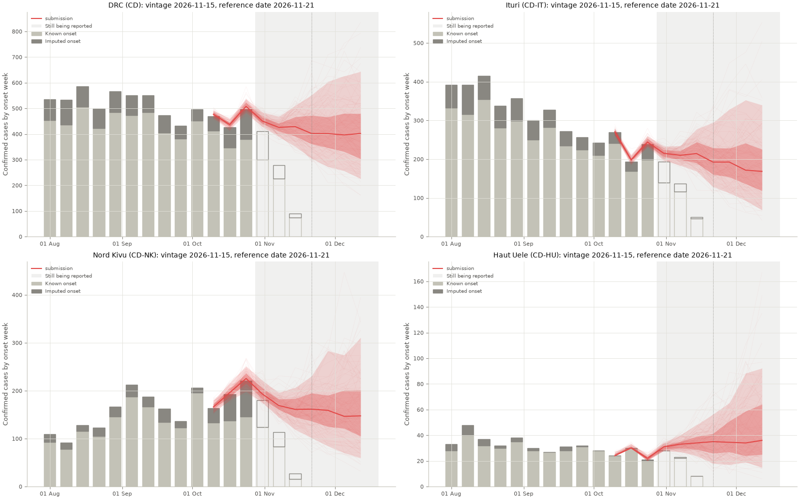
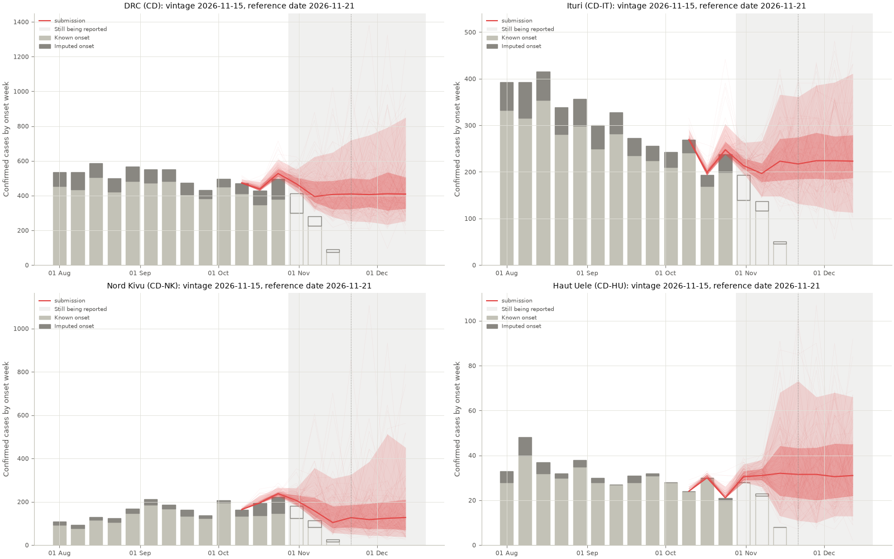

# Round 2026-11-21

Nowcasts and forecasts submitted to the BDBV Modeling Hub for the round with reference date 2026-11-21.
{ .page-subtitle }

Data vintage (`as_of`): 2026-11-15.

=== "seabbs-renewal"

    | | |
    | --- | --- |
    | Status | submitted |
    | Produced by | BVDOutbreakSize-informed renewal model |
    | Model | renewalbvd (`bvd`) |
    | Gate status | warn |
    | Hub pull request | [link](https://github.com/InsightNet-US/BDBV-Modeling-Hub/pull/136) |
    | Workflow run | [link](https://github.com/seabbs/BDBVHubRenewal/actions/runs/44169712191) |
    | Commit | [`6632d96`](https://github.com/seabbs/BDBVHubRenewal/commit/6632d962ebefb48571eda53845834024b1fdc382) |

    The BVDOutbreakSize-informed renewal model cleared every check, with warnings.

    

    Bars are the published counts by onset week in the data used. Lines and bands are the submitted median, sample trajectories and 50% and 90% intervals.

    **National**

    | week ending | median | 50% interval | 90% interval |
    | --- | --- | --- | --- |
    | 2026-10-10 | 477 | 470 to 484 | 461 to 492 |
    | 2026-10-17 | 437 | 430 to 445 | 415 to 459 |
    | 2026-10-24 | 508 | 497 to 521 | 483 to 536 |
    | 2026-10-31 | 450 | 441 to 466 | 428 to 485 |
    | 2026-11-07 | 426 | 410 to 441 | 390 to 468 |
    | 2026-11-14 | 429 | 392 to 467 | 352 to 510 |
    | 2026-11-21 | 402 | 361 to 472 | 305 to 552 |
    | 2026-11-28 | 402 | 347 to 466 | 273 to 603 |
    | 2026-12-05 | 396 | 331 to 480 | 256 to 626 |
    | 2026-12-12 | 402 | 304 to 480 | 226 to 644 |

    **Checks**

    | check | status | summary |
    | --- | --- | --- |
    | schema | pass | format matches the hub's round |
    | values | pass | all values finite and non-negative |
    | samples | pass | 100 full trajectories per location |
    | coverage | pass | 546 locations, weeks 2026-10-31 to 2026-12-12 |
    | zones | pass | 519 zones in 26 provinces |
    | national_sum | pass | CD is the exact sum (national.json: 26 modelled provinces) |
    | bounds | pass | trajectories within the bounds |
    | plausible | pass | within range of the recent data |
    | growth | pass | forecast growth within the cap |
    | observed | pass | close to observed (2026-11-15) |
    | baseline | warn | CD-IT-26: median 17.5 against random walk baseline 198 over 2026-11-28 to 2026-12-12 (ratio 0.111) |
    | previous | warn | CD-IT-17: median 15 against last week's submission 2 over 2026-10-10 to 2026-12-05 (ratio 2.86) (and 1 more) |

    **Candidates**

    | step | outcome | why |
    | --- | --- | --- |
    | BVDOutbreakSize-informed renewal model | submitted |  |
=== "seabbs-rwnowcast"

    | | |
    | --- | --- |
    | Status | submitted |
    | Produced by | random walk on a nowcast |
    | Model | randomwalknowcast (`randomwalknowcast`) |
    | Gate status | warn |
    | Hub pull request | [link](https://github.com/InsightNet-US/BDBV-Modeling-Hub/pull/133) |
    | Workflow run | [link](https://github.com/seabbs/BDBVHubRenewal/actions/runs/44169712191) |
    | Commit | [`6632d96`](https://github.com/seabbs/BDBVHubRenewal/commit/6632d962ebefb48571eda53845834024b1fdc382) |

    The random walk on a nowcast cleared every check, with warnings.

    

    Bars are the published counts by onset week in the data used. Lines and bands are the submitted median, sample trajectories and 50% and 90% intervals.

    **National**

    | week ending | median | 50% interval | 90% interval |
    | --- | --- | --- | --- |
    | 2026-10-10 | 473 | 470 to 476 | 470 to 494 |
    | 2026-10-17 | 438 | 432 to 452 | 428 to 478 |
    | 2026-10-24 | 527 | 512 to 556 | 501 to 608 |
    | 2026-10-31 | 468 | 449 to 503 | 428 to 551 |
    | 2026-11-07 | 394 | 361 to 482 | 324 to 624 |
    | 2026-11-14 | 406 | 322 to 485 | 275 to 649 |
    | 2026-11-21 | 409 | 322 to 500 | 252 to 720 |
    | 2026-11-28 | 406 | 335 to 494 | 249 to 747 |
    | 2026-12-05 | 410 | 315 to 534 | 234 to 792 |
    | 2026-12-12 | 408 | 325 to 506 | 253 to 850 |

    **Checks**

    | check | status | summary |
    | --- | --- | --- |
    | schema | pass | format matches the hub's round |
    | values | pass | all values finite and non-negative |
    | samples | pass | 100 full trajectories per location |
    | coverage | pass | 546 locations, weeks 2026-10-31 to 2026-12-12 |
    | zones | warn | 519 zones; 6115 province sample-weeks differ from the sum of their zones |
    | national_sum | pass | CD is the exact sum (national.json: 26 modelled provinces) |
    | bounds | warn | CD-IT-21: 95th centile 146 is 5.41 times the bound base 27 (and 1 more) |
    | plausible | pass | within range of the recent data |
    | growth | pass | forecast growth within the cap |
    | observed | pass | close to observed (2026-11-15) |
    | baseline | skip | this is the baseline |
    | previous | warn | CD-HU-12: median 46 against last week's submission 101 over 2026-10-10 to 2026-12-05 (ratio 0.481) (and 6 more) |

    **Candidates**

    | step | outcome | why |
    | --- | --- | --- |
    | random walk on a nowcast | submitted |  |
