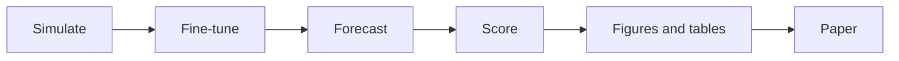

# Paper

The manuscript and supporting information for the paper planned in [#206](https://github.com/seabbs/BDBVHubRenewal/issues/206), on fine-tuning Chronos-2 on simulated outbreaks for nowcasting.
One Snakemake workflow runs its evaluation, from each study's data to the figures, tables and numbers the paper quotes, and then renders the paper.

## Reproducing the paper

From the repository root, with [uv](https://docs.astral.sh/uv/), [Task](https://taskfile.dev), [Quarto](https://quarto.org), git and a GitHub token (`GITHUB_TOKEN`, `GH_TOKEN` or a `gh` login):

```sh
task paper                 # the development run, without the held-out data
task paper TARGET=paper    # the paper run, with the held-out data
```

This is the command CI runs ([`scripts/paper.sh`](../scripts/paper.sh)).
It fetches the fit store, runs the target's missing steps, renders the paper as HTML and PDF and copies it into `docs/paper/`.
`CORES=8 task paper`, or `CORES` in `config/local.env`, sets Snakemake's cores (4 by default).
From `paper/`, `task pipeline:dev`, `task pipeline:paper` and `task render` run the steps one at a time.



Simulation and fine-tuning run locally, not on CI, and publish each checkpoint as a `chronos-ft-<hash>` release (#192).
A round's simulations are made on a CPU host (`task simulate`) and trained on a GPU (`task finetune`) by the Snakemake workflow in [`workflow/`](../workflow/README.md).
Everything from forecasting on runs in this workflow, locally or on CI.

<details>
<summary>The studies</summary>

- **Held-out synthetic outbreaks**: the simulations of each run's seeds ([`paperdata/synthetic.py`](paperdata/synthetic.py)) and the models' forecasts of them, which the synthetic runner of #192 writes.
  Sample forecasts are scored by CRPS relative to `randomwalknowcast`, with D each outbreak's 98% delay.
- **German nowcast hub**: the benchmark of Wolffram et al. (2023), run with `bdbvhubrenewal germany-backtest`, `germany-teams` and `germany-paper` ([`config/germany.toml`](../config/germany.toml), [German benchmark page](../docs/germany.md)).
  Quantiles are scored by WIS relative to `KIT-frozen_baseline` and to `randomwalknowcast`, with D 40 days.
- **Ebola**: the release backtest's samples from every past release, with the stored fits' ([`paperdata/ebola.py`](paperdata/ebola.py)).
  The truth and D are the backtest's (`config/backtest.toml`).
  Samples are scored by CRPS relative to `randomwalknowcast` until the hub's baseline has a forecast with known truth.
  From then the hub teams' forecasts join from a clone of the BDBV Modeling Hub, and scores are relative to `BDBVHub-baseline`.

In a development run, a study without its real data runs on dummy data and says so on every figure and caption.
A paper run fails instead, naming the study and what is missing ([`paperpipe/studies.py`](paperpipe/studies.py)).
The long table every study writes is in [`schema.md`](schema.md).

</details>

<details>
<summary>The targets</summary>

- `development`: the development synthetic seeds and the German first half.
  It never reads the held-out data.
- `paper`: the held-out synthetic seeds and both German halves, split at `heldout.germany_from`.
- `render`: renders `main.qmd` and `si.qmd` from the run set by `render` in [`workflow/config.yaml`](workflow/config.yaml), `development` by default, running it first if it has not been published.
  After a paper run, use `task render -- --config render=paper`.

Each run writes to `results/<mode>/` and copies its figures, tables and `results.yml` to `build/`, which the paper reads.
Settings, data paths and the held-out sets are in [`workflow/config.yaml`](workflow/config.yaml).

</details>

<details>
<summary>How the held-out data are protected</summary>

- The held-out synthetic seeds and the first held-out German date are the `heldout` block of the config.
  A development run gets neither ([`paperpipe/config.py`](paperpipe/config.py)).
- The German held-out benchmark rule runs only for the `paper` target.
- The `table` rule fails if a development forecast table holds a held-out seed or German date.
- Development German data stop at the split, with releases up to D days after it for the truth of the last dates.
- CI runs the development target.
  The `paper` target runs only when the Pages workflow is dispatched with `paper_target: paper`.
  That build is never deployed to the site or attached to a release.
- No held-out data or results are committed.
  `results/` and `build/` are ignored.
  The SI note on the held-out set is generated with the grid tables ([`papertables/synthetic_grid.py`](papertables/synthetic_grid.py)).

</details>

<details>
<summary>CI</summary>

- The Pages workflow (`.github/workflows/pages.yml`) runs the backtests for the site and then this workflow with `--rerun-triggers mtime`, so the paper reuses their forecasts rather than running them again.
  It renders the paper into the site at `/paper/`.
- It runs on changes to `paper/`, the package, `config/` and the data, and when the hub data change.
- The Paper tests workflow runs ruff, the tests, a dry run of both targets and a development run on dummy data.

</details>

<details>
<summary>Hardware and timings</summary>

- Any machine with Python 3.12 and uv.
  `--cores N` runs independent steps in parallel.
- A development run on dummy data takes about a minute.
- The German benchmark's development half takes about an hour on a laptop, and its held-out half as long again.
  CI runs each half in parallel blocks of dates, the held-out half only for a dispatched `paper` run and never cached.
- Cloning the Ebola hub takes about a minute.
- Fine-tuning uses CUDA, MPS or the CPU, whichever is available (#192).

</details>

<details>
<summary>Code layout</summary>

- [`paperfigs/`](paperfigs): schema checks, scores (checked against scoringutils), rolling truth, scenario factors, periods, fine-tuning checkpoints, plots and dummy data.
- [`paperdata/`](paperdata): the German and Ebola loaders.
- [`paperpipe/`](paperpipe) and [`workflow/`](workflow): the steps and the Snakemake workflow.
- [`papertables/`](papertables): the grid tables and the SI notes on the simulator and the held-out set, read from the simulator's code by the `grid_tables` rule.
- [`figures/fig1_pipeline.py`](figures/fig1_pipeline.py): Figure 1.
- [`tests/`](tests): `task test`.

</details>
