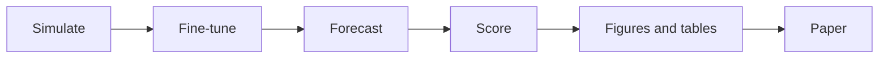

# Paper

The manuscript and supporting information for the paper planned in [#206](https://github.com/seabbs/BDBVHubRenewal/issues/206), on fine-tuning Chronos-2 on simulated outbreaks for nowcasting.
One Snakemake workflow runs its evaluation, from each study's data to the figures, tables and numbers the paper quotes, and then renders the paper.

## Reproducing the paper

From `paper/`, with [uv](https://docs.astral.sh/uv/), [Task](https://taskfile.dev) and [Quarto](https://quarto.org):

```sh
task pipeline:dev      # the development run, without the held-out data
task pipeline:paper    # the paper run, with the held-out data
task render            # the paper as HTML and PDF from the last run
```



Simulation and fine-tuning run locally and publish checkpoints (#192).
Everything from forecasting on runs in this workflow, locally or on CI.

<details>
<summary>The studies</summary>

- **Held-out synthetic outbreaks**: sample forecasts scored by CRPS relative to `randomwalknowcast`, with D each outbreak's 98% delay. They run on dummy data until the fine-tuned models of #192 are merged ([`paperpipe/studies.py`](paperpipe/studies.py)).
- **German nowcast hub**: the benchmark of Wolffram et al. (2023), run with `bdbvhubrenewal germany-backtest`, `germany-teams` and `germany-paper` ([`config/germany.toml`](../config/germany.toml), [German benchmark page](../docs/germany.md)). Quantiles scored by WIS relative to `KIT-frozen_baseline`, with D 40 days.
- **Ebola hub**: every team's samples from a clone of the BDBV Modeling Hub, with our stored forecasts ([`paperdata/ebola.py`](paperdata/ebola.py)). CRPS relative to `BDBVHub-baseline`, with D the hub's 98% reporting delay. It runs on dummy data until the hub's baseline has a forecast with known truth.

A study on dummy data says so on every figure and caption.
The long table every study writes is in [`schema.md`](schema.md).

</details>

<details>
<summary>The targets</summary>

- `development`: the development synthetic seeds and the German first half. It never reads the held-out data.
- `paper`: the held-out synthetic seeds and both German halves, split at `heldout.germany_from`.
- `render`: runs the target set by `render` in [`workflow/config.yaml`](workflow/config.yaml), `development` by default, then renders `main.qmd` and `si.qmd`.

Each run writes to `results/<mode>/` and copies its figures, tables and `results.yml` to `build/`, which the paper reads.
Settings, data paths and the held-out sets are in [`workflow/config.yaml`](workflow/config.yaml).

</details>

<details>
<summary>How the held-out data are protected</summary>

- The held-out synthetic seeds and the first held-out German date are the `heldout` block of the config. A development run gets neither ([`paperpipe/config.py`](paperpipe/config.py)).
- The German held-out benchmark rule runs only for the `paper` target.
- The `table` rule fails if a development forecast table holds a held-out seed or German date.
- Development German data stop at the split, with releases up to D days after it for the truth of the last dates.
- CI runs the development target. The `paper` target runs only when the Pages workflow is dispatched with `paper_target: paper`.
- No held-out data or results are committed. `results/` and `build/` are ignored. See also [`si/heldout-set.md`](si/heldout-set.md).

</details>

<details>
<summary>CI</summary>

- The Pages workflow (`.github/workflows/pages.yml`) runs the German backtest for the site and then this workflow with `--rerun-triggers mtime`, so the paper reuses the benchmark's forecasts rather than running them again. It renders the paper into the site at `/paper/`.
- It runs on changes to `paper/`, the package, `config/` and the data, and when the hub data change.
- The Paper tests workflow runs ruff, the tests, a dry run of both targets and a development run on dummy data.

</details>

<details>
<summary>Hardware and timings</summary>

- Any machine with Python 3.12 and uv. `--cores N` runs independent steps in parallel.
- A development run on dummy data takes about a minute.
- The German benchmark's development half takes about an hour on a laptop, and its held-out half as long again. CI runs each half in parallel blocks of dates, the held-out half only for a dispatched `paper` run and never cached.
- Cloning the Ebola hub takes about a minute.
- Fine-tuning uses CUDA, MPS or the CPU, whichever is available (#192).

</details>

<details>
<summary>Code layout</summary>

- [`paperfigs/`](paperfigs): schema checks, scores (checked against scoringutils), rolling truth, scenario factors, periods, fine-tuning checkpoints, plots and dummy data.
- [`paperdata/`](paperdata): the German and Ebola loaders.
- [`paperpipe/`](paperpipe) and [`workflow/`](workflow): the steps and the Snakemake workflow.
- [`papertables/`](papertables) and [`tables/`](tables): the synthetic scenario grid tables.
- [`si/`](si): SI notes on the epinowcast model and the held-out set.
- [`figures/fig1_pipeline.py`](figures/fig1_pipeline.py): Figure 1.
- [`tests/`](tests): `task test`.

</details>
