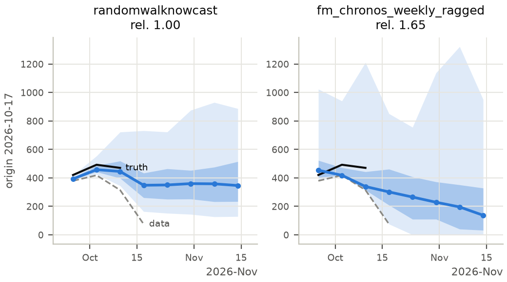
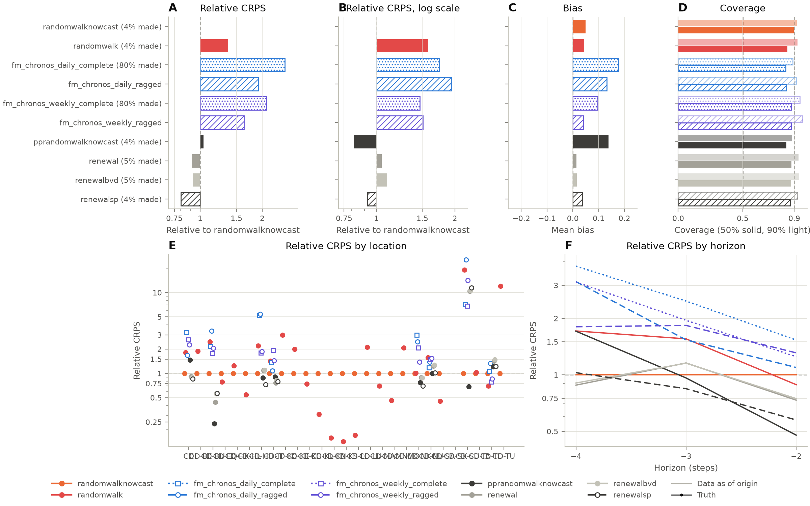

<!--
Plan from #206.
Each top-level bullet is one paragraph, with 2–3 supporting points.
-->

## Introduction

::: {.callout-note title="Plan"}
- **The gap.**
  - Real-time case counts are incomplete because of reporting delays.
  - Generic forecasting models do not use the reporting structure.
  - Key references: [@hohle; @Johnson2025; @reichCollaborativeHubsMaking2022].
- **Context.**
  - Nowcasting methods model reporting delays directly.
  - Time series foundation models forecast well with no training on the target data.
  - Training on domain-specific synthetic data has precedent: KernelSynth for Chronos [@Ansari2024], ForecastPFN [@Dooley2023], prior-fitted networks [@Muller2022; @Hollmann2025], and Mantis for outbreaks [@Dudley2026].
  - Key references: [@mcgough2020nowcasting; @gunther2021nowcasting; @Wolffram2023; @Ansari2024; @Das2024a; @Woo2024; @Rasul2023; @Garza2023; @Aksu2024; @Shchur2025; @Kalahasti2026; @Dudley2025].
- **What we did.**
  - We fine-tuned a foundation model on synthetic outbreak data, following that precedent but fine-tuning a general model rather than training from scratch.
  - We evaluated it retrospectively and prospectively.
  - Key references: [@Ansari2025; @Johnson2025].
:::

## Methods

### Data

::: {.callout-note title="Plan"}
- The German COVID-19 hospitalisation nowcast hub.
- The Ebola forecasting hub target and its releases.
- Key references: [@Wolffram2023; @hospitalization_nowcast_hub_2025; @bdbv_modeling_hub_2026; @MacNeil2010].
:::

### Baselines

::: {.callout-note title="Plan"}
- `randomwalk`, a random walk with no delay adjustment, and `randomwalknowcast`, a random walk nowcast.
- Both in full in the SI.
- Key references: [@Johnson2025].
:::

### Foundation model setup and fine-tuning

::: {.callout-note title="Plan"}
- Chronos-2, given the reporting triangle as series: one series per place and reporting delay, each missing until reported. Introduced alongside the reporting triangle, with Figure 1B.
- Per-series slots: a learned slot embedding is shared by each place's count series and its lag series, so the model ties each place's covariates to its counts while seeing all places at once. Slots are assigned by random permutation in each training block, start at zero and are trained with the LoRA adapter.
- Fine-tuned on synthetic data on a laptop from the base Chronos-2 weights, with Chronos-2's default LoRA settings and loss, and a prediction length equal to each block's horizon. The learning rate starts at $10^{-5}$ and falls linearly to zero at 8,000 simulations.
- Each simulation gives 10 observation draws. At each of 16 cut-offs, 2 of the 10 draws are sampled, so one simulation gives 32 blocks. Blocks are cut from weekly, daily and 3-day releases, and a fifth of them are single-stratum series from the same simulations, so training sees multivariate and univariate series from one pool.
- Training runs continuously up to 8,000 simulations, with checkpoints at 1,000, 2,000, 4,000 and 8,000.
- Levels: Chronos-2 forecasts the country, provinces and health zones as separate series in one joint block, so each level is forecast directly and not summed. The copula only pairs draws across weeks and places, for joint scores and sums, and leaves every marginal forecast unchanged.
- SI, aggregation options: the joint block against each level in its own block, and against the lowest level summed up with its draws paired at random or by the copula.
- SI, lag cap: the lag series stop at 4 weeks or 28 days, compared with lags run to the truth delay.
- SI, checkpoint curve: scores of each checkpoint against the number of simulations it was trained on.
- SI, real data: Chronos-2 fine-tuned on real data, compared with the model fine-tuned on simulations on the German held-out half and the scored BDBV rounds.
- Compared with Chronos-2 given only complete data points, to show what the ragged structure and fine-tuning add.
- Figure 1, a multi-panel schematic of our pipeline: (A) the assumptions in the epinowcast simulations, (B) the reporting triangle laid out as ragged series for Chronos-2, (C) training blocks and LoRA fine-tuning, and why it is fast, and (D) forecasting with the fine-tuned model.
- Key references: [@Ansari2025; @Ansari2024; @Hu2021; @Das2024b].
:::

![The fine-tuning pipeline.
(A) The assumptions in the epinowcast simulations: a latent process gives expected onsets by stratum, which a reporting delay that may drift or step, report-day effects and count noise turn into a reporting triangle.
(B) The reporting triangle laid out as ragged series for Chronos-2: each place has a target complete up to E and one series per lag, missing until reported (daily lag series fill only on release days), and counts reported after E enter as known-future inputs.
A place's target and its lag series share one learned slot, so the model ties those lags to that place while every place's series sit in one group.
(C) Training blocks and LoRA fine-tuning, and why it is fast: blocks cut from simulated release histories at random cut-offs are scored against the final counts, and only rank-8 adapters, about 1% of the weights, and the slot embedding are trained.
(D) Forecasting with the fine-tuned model: one forward pass gives quantiles for each step, and each draw reads them at a uniform level u and is at least the count reported so far.](figures/fig1-pipeline.svg){#fig-pipeline}

### Synthetic data generation

::: {.callout-note title="Plan"}
- Simulated with epinowcast over a crossed factorial grid: epidemic process (growth-rate based, or renewal at several generation times), trajectory, delay family and form, delay over time, reporting, observation model and strata.
- Ranges reflect realistic infectious diseases, checked against published values for several diseases, with the case studies among them.
- A table in the main text gives the grid of synthetic scenarios.
- The full process and an overview of the epinowcast model used are in the SI.
- Key references: [@abbottepinowcast; @lison2024; @Park2024; @Ansari2024; @Dooley2023; @Muller2022; @Hollmann2025].
:::

::: {#tbl-synthetic-grid}


The crossed factors of the simulation grid and their levels, each balanced within every block of simulations, read from the simulator's code.
The full settings are in the SI.
:::

### Correlated trajectories

Chronos-2 and `randomwalknowcast` draw each place and week on its own.
Paired at random, their draws give sums over weeks or places that are too narrow.
We pair them into trajectories with a Gaussian copula over weeks and places.
Each trajectory draws a vector $z$ from a multivariate normal with correlation matrix $\Sigma$.
Each place-week's draws are then reordered across trajectories so that they rank as $z$ does.
This is an empirical copula reordering in the style of the Schaake shuffle [@Clark2004] and ensemble copula coupling [@Schefzik2013].
Each place-week keeps its own draws, so every marginal forecast and every per-week score is unchanged.
$\Sigma$ is a place correlation times a week correlation.
Two steps $\delta$ days apart have correlation $\rho_t^{\delta/7}$.
Two provinces have correlation $\rho_p$, and the country and a province have correlation $\rho_n$.
The daily models also pair the days of a week, with correlation $\rho_d^{|d - d'|}$ between days $d$ and $d'$.
$\rho_d = 0.985$ is fixed rather than estimated, as each matured error is of a week's sum. It gives the best weekly WIS, median bias and coverage of the daily models on the Ebola release backtest.
Where the country is the sum of its provinces, as for `randomwalknowcast`, it is summed again from the paired provinces.
Copulas have been used before to give joint forecasts of seasonal influenza [@Ray2018; @Brooks2018].

At each forecast origin we estimate the three correlations from the model's own matured errors.
For each forecast made at an earlier origin whose truth had been released by this origin, we take the randomised probability integral transform (PIT) of the truth in the forecast's draws and map it to a normal score.
We use the scores of the 8 latest matured weeks.
Each correlation is the Pearson correlation of pairs of scores from the same forecast.
We shrink it towards a fixed prior, $(\rho_t, \rho_p, \rho_n) = (0.9, 0.7, 0.7)$, with the prior worth 100 pairs, and keep it between 0 and 0.95.
An origin with no matured errors takes the prior.
We score the paired trajectories with the energy score [@Gneiting2008] and the variogram score of order 0.5 [@Scheuerer2015] on $\log(x + 1)$ counts.
Both are proper scores for joint forecasts [@gneitingStrictlyProperScoring2007], and the energy score has been used for epidemic trajectories from forecast hubs [@Bay2026].
We also report the coverage of sums over weeks and over places.
The SI gives the copula in full, its estimator and window, and the scores of paired against unpaired trajectories.

### Evaluation on held-out synthetic data

::: {.callout-note title="Plan"}
- A held-out set of simulations was not used during development.
- SI, held-out set: its seeds, size and grid.
- Sample forecasts scored with CRPS and log-scale CRPS, bias, and coverage, relative to `randomwalknowcast`.
- Scored against a rolling evaluation set of the data as reported D days later, with D each outbreak's 98% delay.
- Key references: [@bracherEvaluatingEpidemicForecasts2021; @Bosse2023-sx; @gneitingStrictlyProperScoring2007; @gneitingProbabilisticForecastsCalibration2007; @sherrattPredictivePerformanceMultimodel2023].
:::

### Case study 1: German nowcast hub

::: {.callout-note title="Plan"}
- Compared with the hub's models, relative to the hub's own baseline, and evaluated as the hub did.
- Quantile forecasts scored with WIS and log-scale WIS, bias, and coverage, against a rolling evaluation set of the data as reported D days later [@Wolffram2023].
- Each model is scored on its own quantiles at the hub's levels, interpolated linearly where it lacks a level. Models that give samples are scored on the quantiles of 1,000 draws with common random numbers, as are sums over days.
- Daily and weekly versions may not both make sense here.
- The nowcast dates are split in half. We developed our setup on the first half only, and the second half is held out for the results.
- Key references: [@Wolffram2023; @Johnson2025; @amaralPostprocessingWeightedCombination2025].
:::

### Case study 2: prospective submission to the Ebola forecasting hub

::: {.callout-note title="Plan"}
- Compared with the other submissions, relative to the hub's own baseline.
- The hub's rounds from 21 November 2026 are scored. Earlier rounds, and the release backtest from releases before that date, were used for development and are shown in the SI.
- Sample forecasts scored with CRPS and log-scale CRPS, bias, and coverage, with D the empirical 98% point of the hub data's reporting delay. Our models are scored on 1,000 draws with common random numbers, and hub submissions on their submitted trajectories.
- Our submitted models are scored on their submissions. Each other model of ours forecasts each scored round from the last data release before the round closed, as the release backtest runs it, so it uses only data available at the time. The fine-tuned models use the final run's newest checkpoint (``), which was trained on simulations only.
- Key references: [@bdbv_modeling_hub_2026; @Viboud2018; @funkAssessingPerformanceRealtime2019].
:::

### Implementation

::: {.callout-note title="Plan"}
- The tools we used, each cited: Python, PyTorch on the laptop GPU, chronos-forecasting, PEFT for LoRA, R and epinowcast for simulation, and scoringrules for scoring, checked against scoringutils.
- The evaluation runs as a Snakemake workflow, so every result can be reproduced from the raw data.
:::

## Results

::: {.callout-note title="Plan"}
Each section has a figure panel.
Each panel shows:

- nowcasts over time (ribbons);
- scores relative to the baseline (`randomwalknowcast` for synthetic data, the hub's baseline for each case study), with natural- and log-scale WIS (or CRPS, MAE where they make sense);
- bias;
- 50% and 90% coverage;
- score variation by location and horizon, supported by SI plots.
- for Germany and Ebola, a dotted line marking the split between the development and scored parts, with scores split by part.

The plots in primarycensored-paper are a model for these.
Each section has two paragraphs, one on visual performance and one summarising scores.

Key references: the Methods references, with [@bracherEvaluatingEpidemicForecasts2021; @Bosse2023-sx] for the natural- and log-scale panels.
:::

### Held-out synthetic data

::: {.callout-note title="Plan"}
- Visual performance of the candidate models against `randomwalk` and `randomwalknowcast`.
- A summary of score performance.
- How scores change with the amount of fine-tuning data (doublings from 1,000 outbreaks), as an SI figure.
:::

::: {#fig-synthetic-nowcasts}

Held-out synthetic data: nowcasts of one held-out outbreak, drawn with the workflow's seed, one column per model and one row per origin. Black is the rolling truth, grey dashed the data as of the origin, and blue the model's median with its 50% and 95% intervals; each column gives the model's score relative to `randomwalknowcast`.  
:::

::: {#fig-synthetic}

Held-out synthetic data. (A, B) CRPS relative to `randomwalknowcast` on the natural and log scales; (C) bias; (D) 50% and 90% coverage; (E) relative CRPS by scenario factor; (F) relative CRPS by horizon.  
:::

On the , the best model was , with a relative score of  and  on the log scale, against .

::: {#tbl-synthetic-scores}


Held-out synthetic data: mean scores, coverage and number of forecasts of each model, with scores relative to .  
:::

::: {#tbl-synthetic-joint}


Held-out synthetic data: mean energy and variogram scores of each model's trajectories on log(x + 1) counts, and their ratio to  on the forecasts both made.  
:::

### German nowcast hub

::: {.callout-note title="Plan"}
- Visual performance against the other models.
- A summary of score performance.
- Key references: [@Wolffram2023; @amaralPostprocessingWeightedCombination2025].
:::

::: {#fig-germany-nowcasts}

German nowcast hub: national nowcasts, one column per model and one row per origin. Black is the rolling truth, grey dashed the data as of the origin, and blue the model's median with its 50% and 95% intervals; each column gives the model's WIS relative to `randomwalknowcast`.  
:::

::: {#fig-germany}

German nowcast hub. (A, B) WIS relative to `KIT-frozen_baseline` on the natural and log scales; (C) bias; (D) 50% and 95% coverage; (E) relative WIS by location; (F) by age group; (G) by horizon.  
:::

On the , the best model was , with a relative score of  and  on the log scale, against , and  against `randomwalknowcast`, as the hub's baseline is a point forecast with no coverage.

::: {#tbl-germany-scores}


German nowcast hub: mean scores, coverage and number of forecasts of each model, with scores relative to .  
:::

### Ebola hub submissions

::: {.callout-note title="Plan"}
- Visual performance against the other submissions.
- A summary of score performance.
:::

::: {#fig-ebola-nowcasts}

Ebola: national nowcasts, one column per model and one row per origin. Black is the rolling truth, grey dashed the data as of the origin, and blue the model's median with its 50% and 95% intervals; each column gives the model's CRPS relative to `randomwalknowcast`.  
:::

::: {#fig-ebola}

Ebola: sample forecasts of the hub's rounds from 21 November 2026 (scored), after the release backtest from earlier releases (development), split by a dotted line. (A, B) CRPS relative to  on the natural and log scales, on the forecasts each model shares with it, with the share of forecasts a model made in its label where it missed some; (C) bias; (D) 50% and 90% coverage; (E) relative CRPS by location; (F) by horizon.  
:::

 On the , the best model was , with a relative score of  and  on the log scale, against .

::: {#tbl-ebola-scores}


Ebola hub submissions: mean scores, coverage and number of forecasts of each model, with scores relative to .  
:::

::: {#tbl-ebola-joint}


Ebola hub submissions: mean energy and variogram scores of each model's trajectories on log(x + 1) counts, and their ratio to  on the forecasts both made.  
:::

## Discussion

We used one foundation model, Chronos-2, because it forecasts a group of related series in one block and takes known-future covariates, which the reporting triangle laid out as ragged series needs.
In the SI we compare fine-tuning on simulations with fine-tuning on real data, on the German held-out half and on the scored BDBV rounds.
BDBV is scored from the 21 November 2026 round onward, from data released before each round closed.
The fine-tuned model is trained on simulations only, so it never sees the BDBV truth it is scored against.

::: {.callout-note title="Plan"}
- **Summary** of what we did.
- **Strengths and weaknesses.**
  - Weaknesses: only one foundation model, only one source of synthetic data, and limited case studies.
  - Weakness: we did not compare against epinowcast, or, for the synthetic study, against the data-generating model itself.
  - Strengths: both retrospective and real-time case studies, and synthetic data that are easy to tune to a setting.
  - Strength: fine-tuning ran locally on consumer hardware (a laptop), so it is accessible.
  - Weakness: fine-tuning used the laptop's GPU, which made it several times faster, and not everyone has one. On a laptop CPU alone it would still run in hours.
  - Key references: [@Kalahasti2026; @Meyer2025].
- **Domain knowledge through synthetic data.**
  - Domain knowledge enters through the synthetic data source.
  - Fingers crossed it improves results; to fill in from the results.
  - Key references: [@Dudley2026; @Dudley2025; @Dooley2023; @Hollmann2025; @Ansari2025].
- **Against the literature.**
  - Other uses of foundation models in infectious disease modelling.
    Key references: [@Kalahasti2026; @Cai2026; @Wang2025; @Jafari2026; @Du2025; @Li2025; @Aygun2025; @Martinson2026].
  - Fine-tuning in other domains.
    Key references: [@Laglil2026; @Das2024b; @Hu2021].
  - Other nowcasting approaches.
    Key references: [@bastos; @Seaman2022; @Bergstrom2022; @Gressani2024; @Schneble2021; @vandeKassteele2019; @Overton2023-dk; @Mellor2025; @Tang2025; @stonerPowerfulModellingFramework2020; @Kamarthi2021; @Koemen2025; @Wilsens2025].
- **A possible emulator.**
  - Fine-tuning on epinowcast simulations may give a fast emulator of that package.
  - We did not compare against epinowcast, so we cannot say how close it is.
  - This could be useful for other slow, long-running packages.
- **Further work.**
  - Other foundation models.
  - More case studies.
  - A comparison with custom neural networks.
  - Testing the fine-tuned model as an emulator of epinowcast.
  - Fine-tuning with other epidemiological features as covariates, such as distances between locations or mobility.
  - Key references: [@Das2024a; @Woo2024; @Rasul2023; @Kamarthi2021; @Koemen2025; @respinow_hub_2025].
- **Conclusions.**
  - Reuse state-of-the-art generic forecasting models with domain-specific insight.
  - Fine-tuning on a package's simulations could give a fast emulator of that package, which may help other long-running packages.
  - It shows promise, and more work is needed.
:::

## Funding {.appendix}

## Acknowledgements {.appendix}

## Data and software availability {.appendix}

## AI disclosure {.appendix}

## References {.unnumbered}
