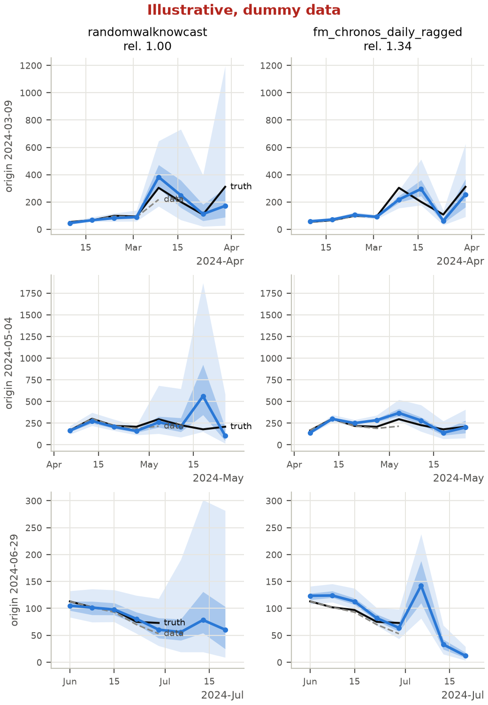
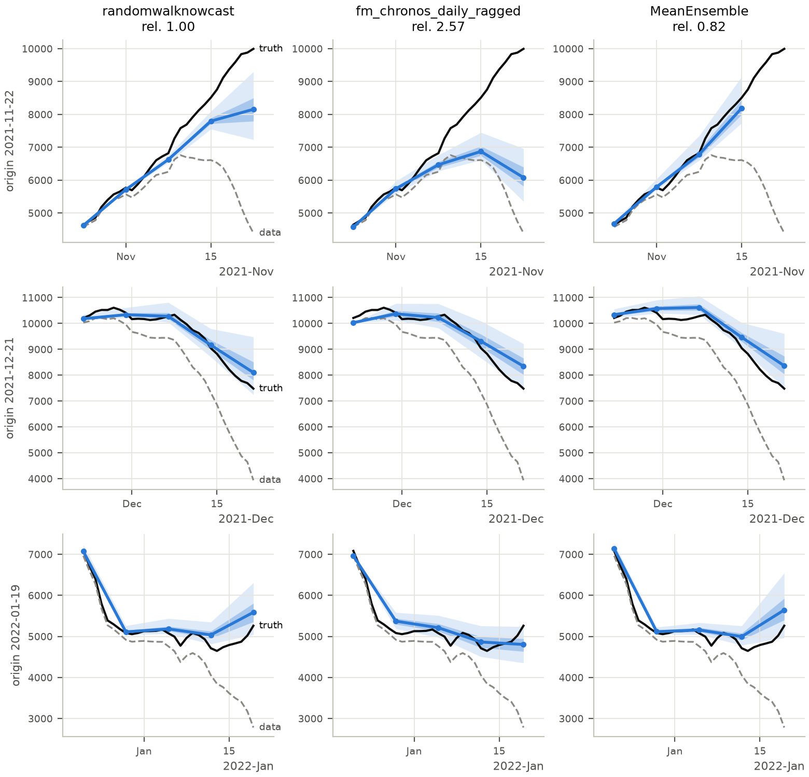

<!--
Plan from #206.
Each top-level bullet is one paragraph, with 2–3 supporting points.
-->

## Introduction

::: {.callout-note title="Plan"}
- **The gap.**
  - Real-time case counts are incomplete because of reporting delays.
  - Generic forecasting models do not use the reporting structure, so they treat incomplete recent counts as final.
  - Key references: [@hohle; @Johnson2025; @reichCollaborativeHubsMaking2022].
- **Context.**
  - Nowcasting methods model reporting delays directly.
  - Time series foundation models forecast new series with no training on them.
  - Training on domain-specific synthetic data has precedent: KernelSynth for Chronos [@Ansari2024], ForecastPFN [@Dooley2023], prior-fitted networks [@Muller2022; @Hollmann2025], and Mantis for outbreaks [@Dudley2026].
  - Key references: [@mcgough2020nowcasting; @gunther2021nowcasting; @Wolffram2023; @Ansari2024; @Das2024a; @Woo2024; @Rasul2023; @Garza2023; @Aksu2024; @Shchur2025; @Kalahasti2026; @Dudley2025].
- **What we did.**
  - We fine-tuned Chronos-2, a general time series foundation model, on simulated outbreaks rather than training a model from scratch.
  - We evaluated it on held-out simulations, on the German COVID-19 hospitalisation nowcast hub, and prospectively on the Ebola forecasting hub.
  - Key references: [@Ansari2025; @Johnson2025].
:::

## Methods

### Data

::: {.callout-note title="Plan"}
- We used the German COVID-19 hospitalisation nowcast hub's reporting triangle, nationally, by state and by age group.
- We used the Ebola forecasting hub's weekly confirmed cases by symptom onset, with every release, by country, province and health zone.
- Key references: [@Wolffram2023; @hospitalization_nowcast_hub_2025; @bdbv_modeling_hub_2026; @MacNeil2010].
:::

### Baselines

::: {.callout-note title="Plan"}
- We compare with `randomwalk`, a random walk with no delay adjustment, and `randomwalknowcast`, a random walk nowcast.
- The SI describes both in full.
- Key references: [@Johnson2025].
:::

### Foundation model setup and fine-tuning

::: {.callout-note title="Plan"}
- We give Chronos-2 the reporting triangle as series, one per place and reporting delay, each missing until reported (Figure 1B).
- Chronos-2 is built from attention layers, in which each series updates what it has learned as a weighted mix of the other series, with more weight on those it finds relevant.
- Without more information, the model has no marker of which delay series belong to which place's count.
- We add learned attention biases that nudge these weights by how two series are related (the same series, the same place, or a place and its parent or child), building on Moirai's any-variate attention and TableFormer's relation biases [@Woo2024; @Yang2022] (SI).
- A third each of the training blocks with places have a country equal to, above or later than the sum of its places.
- We fine-tune base Chronos-2 on synthetic data on a laptop, with its default LoRA recipe.
- LoRA trains a small update to about 1% of the model's weights rather than retraining them all, so fine-tuning starts from the original model (SI).
- The learning rate falls linearly to zero over the 8,400 simulations.
- Each simulation gives up to 32 training blocks.
- A block is daily, 3-day or weekly, or daily with one weekly or 3-day total row, or rolling 7-day or 3-day sum row, per place.
- Most blocks are multivariate, and one in five blocks from outbreaks with more than one place is univariate.
- We save checkpoints at 250, 500, 750, 1,000, 2,000, 4,000 and 8,400 simulations.
- We report the final checkpoint, at 8,400 simulations, where the learning rate reaches zero, and select no checkpoint on real data.
- The simulations come in balanced blocks of 840, so the final model has seen ten whole blocks and the checkpoints before 840 only part of the grid.
- Chronos-2 forecasts the country, provinces and health zones as separate series in one joint block.
- We compare the joint block with forecasting each level alone and with summing the lowest level (SI).
- We compare lags capped at 4 weeks or 28 days with lags run to the truth delay (SI).
- We compare the model with attention biases with one fine-tuned without them (SI).
- We fine-tune Chronos-2 on complete counts only, without delay series, and compare it with the ragged model (SI).
- We fine-tune Chronos-2 on real data and compare it with the model fine-tuned on simulations (SI).
- We compare the fine-tuned model with zero-shot Chronos-2 and with Chronos-2 given only complete data.
- We plot each checkpoint's scores, with both as reference lines (SI).
- Figure 1 shows the simulation, the ragged series, training and forecasting.
- TODO: replace the SI's dashboard screenshot with a static render of the finished run from the workflow.
- Key references: [@Ansari2025; @Ansari2024; @Hu2021; @Das2024b].
:::

![The fine-tuning pipeline.
(A) The assumptions in the epinowcast simulations: a latent process gives expected onsets by stratum, which a reporting delay that may drift or step, report-day effects and count noise turn into a reporting triangle.
(B) The reporting triangle laid out as ragged series for Chronos-2: each place has a target complete up to E and one series per lag, missing until reported (daily lag series fill only on release days), and counts reported after E enter as known-future inputs.
Group attention has learned biases for a series attending to itself and to the other series of its place, its count and lags, and between a place and its parent or children, as in Moirai's any-variate attention [@Woo2024], while every place's series sit in one group.
The grid shows group attention at one step for a country C and places A and B, each with a count and two lag series, with each cell shaded by its relation.
Beside it, one place's daily rows carry a weekly total row, missing until the last day of each week.
(C) Training blocks and LoRA fine-tuning, and why it is fast: blocks cut from simulated release histories at random cut-offs are scored against the final counts, and only rank-8 adapters, about 1% of the weights, and the attention biases are trained.
(D) Forecasting with the fine-tuned model: one forward pass gives quantiles for each step, and each draw reads them at a uniform level u and is at least the count reported so far.](figures/fig1-pipeline.svg){#fig-pipeline}

### Synthetic data generation

::: {.callout-note title="Plan"}
- We simulate outbreaks of up to 52 weeks with epinowcast over a crossed grid of epidemic process, trajectory, places and age groups, reporting delays and their changes, report days, reporting shocks and observation noise (SI).
- The outbreaks range from one wave to several, with cases spread over many places or concentrated in a few, delays that drift, step, bunch or slow down, and NB1 or Poisson noise.
- We checked the grid's ranges against published values for several diseases, the case studies among them.
- Key references: [@abbottepinowcast; @lison2024; @Park2024; @Ansari2024; @Dooley2023; @Muller2022; @Hollmann2025].
:::

### Correlated trajectories

- We pair the province draws of `randomwalk` and `randomwalknowcast` within each week with a rolling Gaussian copula, so their national forecast, the per-sample sum of the provinces, is not too narrow, while each cell keeps its own draws (SI).
- The hub does not require coherence across levels, so this is our choice for the walks.
  Chronos-2 submits its joint block's own national forecast.

We score the national sum and the provinces by the CRPS and 90% coverage.
We also report the energy score [@Gneiting2008], which is proper for joint forecasts [@gneitingStrictlyProperScoring2007] and has been used for epidemic trajectories from forecast hubs [@Bay2026], but discriminates poorly between dependence structures [@Pinson2013].

### Evaluation on held-out synthetic data

::: {.callout-note title="Plan"}
- We held out a set of simulations from development.
- The fine-tune never trained on the held-out set's seeds (SI).
- We set each tuned choice on development data, apart from every scored set (SI).
- We score each model's quantiles with WIS and log-scale WIS, bias, and 50% and 90% coverage, relative to `randomwalknowcast`, and split WIS into dispersion, overprediction and underprediction [@bracherEvaluatingEpidemicForecasts2021].
- In the SI we also score samples with the fair CRPS and the fair energy score, which correct for the number of samples, so forecasts with different numbers of samples, ours and the hub teams', compare fairly [@Ferro2014; @Zamo2018; @zanetta_scoringrules_2024].
- We score against the data as reported $D$ days later, with $D$ each outbreak's 98% reporting delay.
- Key references: [@bracherEvaluatingEpidemicForecasts2021; @Bosse2023-sx; @gneitingStrictlyProperScoring2007; @gneitingProbabilisticForecastsCalibration2007; @sherrattPredictivePerformanceMultimodel2023].
:::

### Case study 1: German nowcast hub

::: {.callout-note title="Plan"}
- We compare with the hub's models, relative to the hub's baseline, and evaluate as the hub did.
- We score quantile forecasts with WIS, split into its three components [@bracherEvaluatingEpidemicForecasts2021], and log-scale WIS, bias, and coverage, against the data as reported 40 days later [@Wolffram2023].
- We score each model on its own quantiles at the hub's seven levels, interpolated linearly where it lacks one.
- We score models that give samples, and sums over days, on the quantiles of 1,000 draws with common random numbers.
- One fine-tuned Chronos-2 model forecasts daily, 3-day and weekly data.
- For both case studies, we also score our models' daily counts directly from the daily rows, against `randomwalknowcast` (SI).
- We split the nowcast dates in half at 10 February 2022.
- We developed the setup on the first half and score the second half.
- Key references: [@Wolffram2023; @Johnson2025; @amaralPostprocessingWeightedCombination2025].
:::

### Case study 2: prospective submission to the Ebola forecasting hub

::: {.callout-note title="Plan"}
- We compare with the other submissions, relative to the hub's baseline.
- We score the hub's rounds from 21 November 2026.
- We used earlier rounds and the release backtest from earlier releases for development (SI).
- We score quantile forecasts with WIS, split into its three components [@bracherEvaluatingEpidemicForecasts2021], and log-scale WIS, bias, and coverage, with $D$ the 98% point of the hub data's reporting delay, taking the hub teams' quantiles from their samples.
- The SI compares the samples directly with the fair CRPS.
- We score our models on 1,000 draws with common random numbers, and hub submissions on their 100 submitted trajectories.
- We score our submitted models on their submissions.
- Each other model of ours forecasts a round from the last release before the round closed.
- The fine-tuned models use the final run's newest checkpoint (``), trained on simulations only.
- Key references: [@bdbv_modeling_hub_2026; @Viboud2018; @funkAssessingPerformanceRealtime2019].
:::

### Implementation

::: {.callout-note title="Plan"}
- We used Python, PyTorch, chronos-forecasting, PEFT for LoRA, R and epinowcast for simulation, and scoringrules for scoring, checked against scoringutils.
- A Snakemake workflow runs the evaluation from the raw data to every figure and table.
:::

## Results

::: {.callout-note title="Plan"}
Each section has a figure panel.
Every panel shows the same four models, named Random walk nowcast, Zero-shot (complete data only), Zero-shot (delays) and Fine-tuned (delays) in every figure and table.
All three Chronos-2 models use one layout, daily counts and daily lag series with each place's weekly totals as a target row.
Every other comparison, and the hub teams beyond the hub's baseline, is in the SI.
Each panel shows:

- nowcasts over time at the national level (one outbreak for synthetic data), several origins overlaid, each over its horizons against the truth (ribbons) [@Wolffram2023];
- scores relative to the baseline (the random walk nowcast for synthetic data, the hub's baseline for each case study), with natural- and log-scale WIS stacked by its decomposition (fair CRPS of samples in the SI);
- bias;
- 50% and 90% coverage;
- score variation by location and horizon, supported by SI plots.
- for Germany, a dotted line marking the split between the development and scored parts, with scores split by part, each part a row on the score axis.

The plots in primarycensored-paper are a model for these.
Each section has two paragraphs, one on visual performance and one summarising scores.

Key references: the Methods references, with [@bracherEvaluatingEpidemicForecasts2021; @Bosse2023-sx] for the natural- and log-scale panels.
:::

::: {#tbl-live-summary}


Zero-shot Chronos-2 and the newest scored checkpoint of the fine-tuned model: national WIS on the German first half and WIS and log WIS on the BDBV release backtest, relative to `randomwalknowcast` (daily / weekly model), and the trainer's held-out loss, with each cell's simulations in brackets. The SI gives every checkpoint (Checkpoint curve).  Development data only.
:::

### Held-out synthetic data

::: {.callout-note title="Plan"}
- We show nowcasts of the candidate models against `randomwalk` and `randomwalknowcast`.
- We summarise their scores.
- The SI gives each checkpoint's scores by the number of simulations it was trained on (Checkpoint curve).
- The SI describes the held-out set (Synthetic data generation).
- The SI compares the model with attention biases with one fine-tuned without them (Attention biases for place and parent against none).
- The SI compares the ragged model with one fine-tuned without delay series (Delays against no delays).
- The SI shows the dashboard we used to review fine-tuning (Monitoring fine-tuning).
:::

::: {#fig-synthetic-nowcasts}

Held-out synthetic data: nowcasts of one held-out outbreak, drawn with the workflow's seed, one column per model and one row per origin. Black is the rolling truth, grey dashed the data as of the origin, and blue the model's median with its 50% and 95% intervals; each column gives the model's score relative to `randomwalknowcast`.  
:::

::: {#fig-synthetic}

Held-out synthetic data. (A, B) WIS relative to `randomwalknowcast` on the natural and log scales, as stacked dispersion, overprediction and underprediction; (C) bias; (D) 50% and 90% coverage; (E) relative WIS by scenario factor; (F) relative WIS by horizon.  
:::

On the , the best model was , with a relative score of  and  on the log scale, against .

::: {#tbl-synthetic-scores}


Held-out synthetic data: mean scores, coverage and number of forecasts of each model, with scores relative to .  
:::

### German nowcast hub

::: {.callout-note title="Plan"}
- We show national nowcasts against the other models.
- We summarise the scores.
- The SI compares the model fine-tuned on real data with the one fine-tuned on simulations (Real-data fine-tune against synthetic).
- The SI compares capped lags with lags run to the truth delay (Foundation model setup).
- The SI gives daily nowcasts for both case studies against `randomwalknowcast` (Daily nowcasts).
- Key references: [@Wolffram2023; @amaralPostprocessingWeightedCombination2025].
:::

::: {#fig-germany-nowcasts}

German nowcast hub: national nowcasts, one column per model and one row per origin. Black is the rolling truth, grey dashed the data as of the origin, and blue the model's median with its 50% and 95% intervals; each column gives the model's WIS relative to `randomwalknowcast`.  
:::

::: {#fig-germany}

German nowcast hub. (A, B) WIS relative to `KIT-frozen_baseline` on the natural and log scales, as stacked dispersion, overprediction and underprediction; (C) bias; (D) 50% and 95% coverage; (E) relative WIS by location; (F) by age group; (G) by horizon.  
:::

On the , the best model was , with a relative score of  and  on the log scale, against , and  against `randomwalknowcast`, as the hub's baseline is a point forecast with no coverage.

::: {#tbl-germany-scores}


German nowcast hub: mean scores, coverage and number of forecasts of each model, with scores relative to .  
:::

### Ebola hub submissions

::: {.callout-note title="Plan"}
- We show national nowcasts against the other submissions.
- We summarise the scores.
- The SI compares the joint block with each level alone and with the lowest level summed (Joint block or aggregation).
- The SI compares the walks with the rolling copula and with no pairing (Impact of correlated trajectories).
:::

::::: {.content-visible when-meta="results.ebola.shown"}

::: {#fig-ebola-nowcasts}

Ebola: national nowcasts, one column per model and one row per origin. Black is the rolling truth, grey dashed the data as of the origin, and blue the model's median with its 50% and 95% intervals; each column gives the model's WIS relative to `randomwalknowcast`.  
:::

::: {#fig-ebola}

Ebola: forecasts of every hub round, all held out, each from the last release before the round closed. (A, B) WIS relative to  on the natural and log scales, as stacked dispersion, overprediction and underprediction, on the forecasts each model shares with it, with the share of forecasts a model made in its label where it missed some; (C) bias; (D) 50% and 90% coverage; (E) relative WIS by location; (F) by horizon.  
:::

 On the , the best model was , with a relative score of  and  on the log scale, against .

::: {#tbl-ebola-scores}


Ebola hub submissions: mean scores, coverage and number of forecasts of each model, with scores relative to .  
:::

:::::

## Discussion

We used one foundation model, Chronos-2, because it forecasts a group of related series in one block and takes known-future covariates, which the reporting triangle laid out as ragged series needs.
In the SI we compare fine-tuning on simulations with fine-tuning on real data, on the German held-out half and on the scored BDBV rounds.
BDBV is scored from the 21 November 2026 round onward, from data released before each round closed.
The fine-tuned model is trained on simulations only, so it never sees the BDBV truth it is scored against.

::: {.callout-note title="Plan"}
- **Summary** of what we did.
- **Strengths and weaknesses.**
  - We used one foundation model, one source of synthetic data and two case studies.
  - We did not compare with epinowcast, or, for the synthetic study, with the model that generated the data.
  - We did not compare directly with a custom neural network trained for this task.
    The Chromantis hub submission is one such model, and appears in the Ebola case study only as one of the hub teams' forecasts [@bdbv_modeling_hub_2026].
  - The Ebola case study is held out from model development but not blind.
    We knew the structure of the data and its challenges from submitting other models to the hub, and this shaped the simulation design.
    A few Ebola checkpoint scores were produced in error during development and were not used to choose models or settings.
  - We evaluated on a retrospective and a real-time case study, with synthetic data that can be tuned to a setting.
  - Fine-tuning ran on a laptop, so it needs no shared compute.
  - The BDBV hub imputes missing onset dates from reporting delays, which can over-smooth its data (Methods, Data) [@bdbv_modeling_hub_2026].
  - Smoothed release histories mismatch the epinowcast reporting structure our simulations assume, which may disadvantage the fine-tuned Chronos-2.
  - We used one layout, daily counts and daily lag series with weekly totals as a target row, and could also have included weekly lag series in the block.
  - We fine-tuned on blocks of at most 364 steps of history but forecast with all available data.
  - We did not test whether this affects Chronos-2's handling of longer histories, which matters most for long series such as the German daily data.
  - Fine-tuning used the laptop's GPU, which made it several times faster than its CPU.
  - On a laptop CPU alone it would run in hours.
  - Key references: [@Kalahasti2026; @Meyer2025].
- **Domain knowledge through synthetic data.**
  - Domain knowledge enters through the simulations.
  - Whether this improves the forecasts is to be filled in from the results.
  - Key references: [@Dudley2026; @Dudley2025; @Dooley2023; @Hollmann2025; @Ansari2025].
- **Against the literature.**
  - Other uses of foundation models in infectious disease modelling.
    Key references: [@Kalahasti2026; @Cai2026; @Wang2025; @Jafari2026; @Du2025; @Li2025; @Aygun2025; @Martinson2026].
  - Fine-tuning in other domains.
    Key references: [@Laglil2026; @Das2024b; @Hu2021].
  - Other nowcasting approaches.
    Key references: [@bastos; @Seaman2022; @Bergstrom2022; @Gressani2024; @Schneble2021; @vandeKassteele2019; @Overton2023-dk; @Mellor2025; @Tang2025; @stonerPowerfulModellingFramework2020; @Kamarthi2021; @Koemen2025; @Wilsens2025].
- **A possible emulator.**
  - A model fine-tuned on epinowcast simulations may emulate epinowcast in a fraction of its run time.
  - We did not compare with epinowcast, so we cannot say how close it is.
  - The same approach could emulate other slow packages.
- **Further work.**
  - Other foundation models.
  - More case studies.
  - A comparison with custom neural networks.
  - Testing the fine-tuned model as an emulator of epinowcast.
  - Fine-tuning with other epidemiological features as covariates, such as distances between locations or mobility.
  - Training on the count not yet reported instead of the total count.
    The reported count would then be a lower bound by construction.
    This needs signed remainders where counts are revised down.
  - Key references: [@Das2024a; @Woo2024; @Rasul2023; @Kamarthi2021; @Koemen2025; @respinow_hub_2025].
- **Conclusions.**
  - Generic forecasting models can be reused, with domain knowledge added through simulated data.
  - More case studies are needed before routine use.
:::

## Funding {.appendix}

## Acknowledgements {.appendix}

## Data and software availability {.appendix}

## AI disclosure {.appendix}

## References {.unnumbered}
