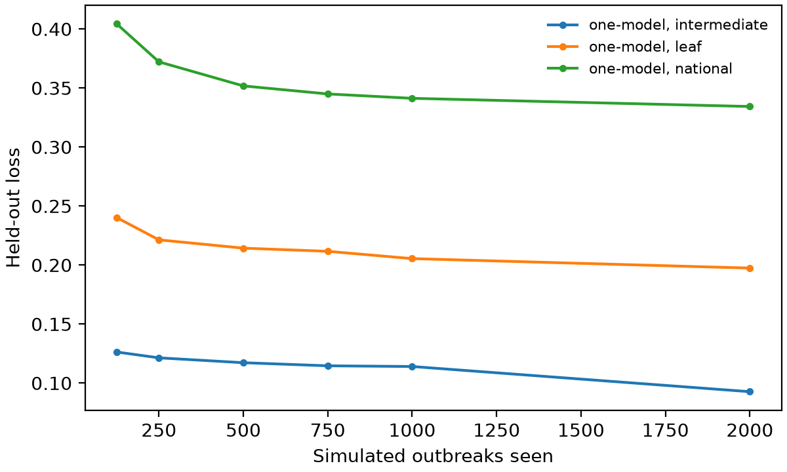
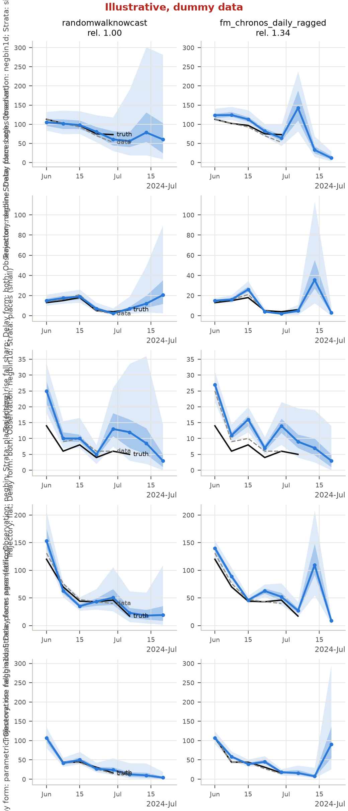
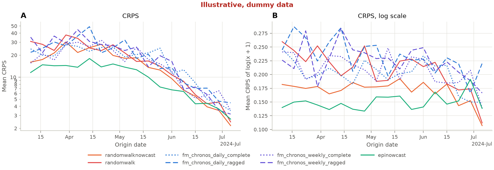
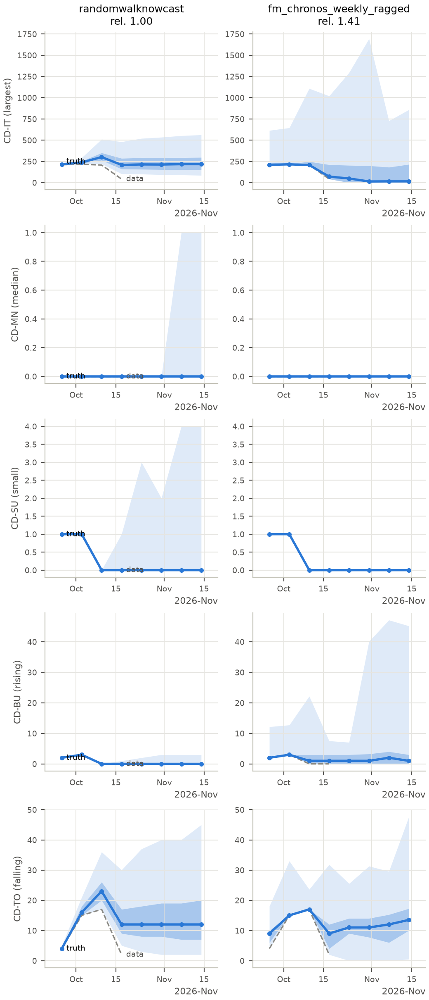
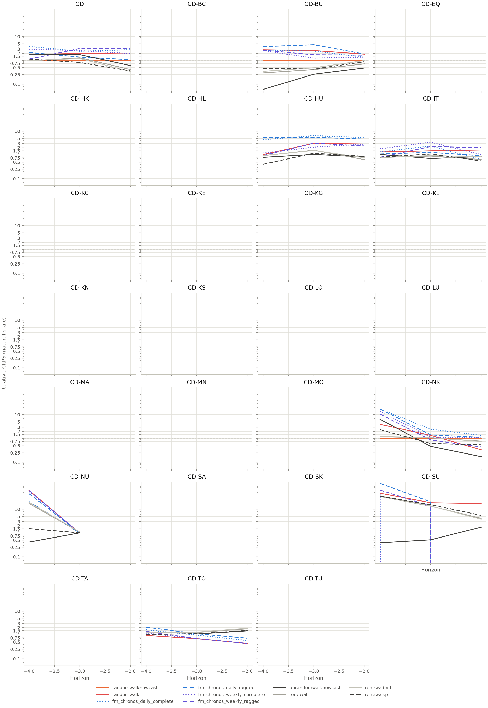

<!--
Plan from #206.
One SI section per paper section.
-->

## Methods

### Baselines

::: {.callout-note title="Plan"}
- `randomwalk` and `randomwalknowcast` in full.
- Key references: [@Johnson2025].
:::

### Foundation model setup and fine-tuning

::: {.callout-note title="Plan"}
- How Chronos-2 and LoRA work, in brief, with schematics.
- Foundation model setup and fine-tuning settings.
- Key references: [@Ansari2025; @Hu2021].
:::

We tested the ragged layout's lag horizon.
Running the lags to the truth delay, rather than 4 weeks or 28 days, hurt with short release histories.
On the German development half, the national WIS relative to `randomwalknowcast` went from  to  for the daily zero-shot model and from  to  for the weekly one.
On the BDBV release backtest it went from  to  for the daily zero-shot model and from  to  for the weekly one.
BDBV's zones have few weekly releases, so with the longer horizon no recent lag of a zone falls in the model's context.

### Synthetic data generation

::: {.callout-note title="Plan"}
- Synthetic data generation in full, with an overview of the epinowcast model used.
- The full factor table and the realism comparison against published disease parameters.
- Key references: [@abbottepinowcast; @lison2024; @Park2024; @abbottprimarycensored].
:::



::: {#tbl-synthetic-grid-si}


Every setting of the simulation grid: the crossed factors and their levels, the settings derived from a cell, and the values drawn within it, with the R expression that draws them and the epinowcast function each enters through, read from the simulator's code. Realised values are over the run's simulations where they exist.
:::

The grid has two limitations.
Simulated strata are less sparse than BDBV's provinces: the share of stratum-weeks with no cases reaches  at the 95% point of the simulations, against  for BDBV.
Simulated delays are shorter than the German data's, whose 99% point is  days against  at the 95% point of the simulations.

{#fig-sim-realism}

::: {#tbl-sim-diseases}


The simulated outbreaks' ranges against published values for several diseases, the case studies among them.
:::

{#fig-finetune-heldout}

![WIS relative to `randomwalknowcast` of the ragged Chronos-2 models against the number of simulated outbreaks each r3 checkpoint was fine-tuned on, with the zero-shot model at the left, on the case studies by level. Each panel gives n, the fewest matched cells of its points, and the forecast origins they come from, and panels with fewer than 5 are grey. On BDBV's provinces (n =  cells from  origin) the daily model goes from  zero-shot to  at 1,000 and  at 2,000 outbreaks, then worsens to  at 4,000; the weekly model worsens throughout, from  to . BDBV's national panel has n = , so it is grey. German checkpoints join as they are scored.](build/figures/si/checkpoint-curve.png){#fig-checkpoint-curve}



### Correlated trajectories

The copula pairs the draws of models that give each place and week only its own draws.
These are the Chronos-2 models and `randomwalknowcast`.
Hub teams' samples are joint across weeks within a place, so their pairing across places is left as submitted.

**The copula.**
With $P$ places and steps on days $d_1, \dots, d_S$, each trajectory draws $z \sim \mathrm{N}(0, \Sigma)$ with $\Sigma = \Sigma_p \otimes \Sigma_t$.
The week correlation is $(\Sigma_t)_{jk} = \rho_t^{|d_j - d_k| / 7}$.
The place correlation is $\rho_p$ between two provinces and $\rho_n$ between the country and a province.
Where $\rho_p$ and $\rho_n$ give no valid correlation matrix, we set its negative eigenvalues to zero and rescale it to unit diagonal.
For each place-week, the $m$ draws are sorted and the $k$th trajectory takes the draw whose rank matches the rank of $z_k$ in that cell.
Each cell keeps exactly its own draws [@Clark2004; @Schefzik2013].
A country forecast as its own series, as by Chronos-2, is paired as one more place.
A country that is the sum of its provinces is not paired but summed again from the paired provinces, so its forecast widens.

**The estimator.**
For a forecast with $m$ draws, $b$ of them below the truth and $e$ equal to it, the randomised PIT is $u = (b + U(e + 1)) / (m + 1)$ with $U \sim \mathrm{U}(0, 1)$.
Its normal score is $\Phi^{-1}(u)$.
A forecast whose draws are all equal gives no score.
Truth is the count as reported $D$ days after the week, so a week's error matures only once that release exists.
At an origin, we use forecasts made at earlier origins whose truth was released by the origin, from the 8 latest such weeks.
$\rho_t$ is estimated from pairs of consecutive weeks of one place in one forecast.
$\rho_p$ is estimated from pairs of provinces in the same week of one forecast, and $\rho_n$ from the country and a province.
With $n$ pairs whose Pearson correlation is $r$, the estimate is $(n r + w \rho_0) / (n + w)$, with $w = 100$ and $\rho_0$ the prior.
It is then kept within $[0, 0.95]$.
Where the pairs give no correlation, the estimate is the prior.
The prior $(\rho_t, \rho_p, \rho_n) = (0.9, 0.7, 0.7)$ was chosen by the energy score of the Chronos-2 models on the Ebola release backtest, so it is tuned in sample.
As a sensitivity analysis we give the prior less weight, $w = 25$.

**Scores.**
We score the trajectories with the energy score [@Gneiting2008] and the variogram score of order $p = 0.5$ [@Scheuerer2015], both on $\log(x + 1)$ counts.
We also report the 50% and 90% coverage of each place's sum over weeks and of the sum over provinces in each week.
WIS of each place and week is unchanged by pairing, except for a country summed from its provinces.
We compare three versions of each model.
Unpaired forecasts keep the sample indices the model gave.
Fixed forecasts are paired with the prior at every origin.
Rolling forecasts are paired with the copula estimated at each origin.

### Aggregation options

Chronos-2 can forecast every level of a place hierarchy in one block, or each level on its own.
We compare four options for the zero-shot and fine-tuned models, daily and weekly (#222):
(a) all levels in one joint block;
(b) each level in its own block;
(c) the lowest level only, summed up to the others with draws paired at random;
(d) the lowest level only, summed up after pairing its draws with the rolling copula.
Option (d) tests whether the copula rescues aggregation.

### Scoring

::: {.callout-note title="Plan"}
- Scoring, and its check against scoringutils.
- Key references: [@bosse2022scoringutils; @jordanEvaluatingProbabilisticForecasts2019; @zanetta_scoringrules_2024].
:::

### Implementation

::: {.callout-note title="Plan"}
- The tools we used, each cited: Python, PyTorch on the laptop GPU, chronos-forecasting, PEFT for LoRA, R and epinowcast for simulation, and scoringrules for scoring, checked against scoringutils.
- The evaluation runs as a Snakemake workflow, so every result can be reproduced from the raw data.
:::

## Results

::: {.callout-note title="Plan"}
- Score breakdowns by location and horizon for each case study.
- WIS over time for each case study.
- Held-out synthetic scores by number of fine-tuning outbreaks.
:::

### Impact of correlated trajectories

Pairing changes no marginal forecast, so it shows in the joint scores and in the coverage of sums over weeks and over places.
@tbl-copula-ebola and @tbl-copula-germany compare unpaired forecasts with the fixed and rolling copula for every model that uses it.
The rolling estimates have median $\rho_t$  and $\rho_p$  by German state, and $\rho_t$  and $\rho_p$  by age group, for `randomwalknowcast`.

::: {#tbl-copula-ebola}


Ebola release backtest: energy score (ES) and variogram score (VS) on the log scale, 50% and 90% coverage of each place's sum over weeks and of the sum over provinces, and WIS of the provinces and the country, for each model unpaired and paired by the fixed or rolling copula.
:::

::: {#tbl-copula-germany}


German nowcast hub, development half: as @tbl-copula-ebola, by state and by age group, with the sum over places taken over states or age groups.
:::

### Joint block or aggregation

The submission uses the joint block.
On BDBV it is best or tied at provinces and zones for every model, and at the national level for the zero-shot models.
At the national level, level by level is better for the daily fine-tuned models and the weekly model fine-tuned on 1,000 outbreaks, with relative WIS  against  for round 1.
On the German development half, the joint block is best at the national level with the daily checkpoint fine-tuned on 1,000 outbreaks ( against  level by level).
Level by level is competitive on Germany for the daily zero-shot and round-1 models ( against  for zero-shot at the national level) and for age groups.
Summing the lowest level loses at every level above it, with or without the copula: at BDBV's national level the daily zero-shot model scores  summed and  summed after pairing, against  for the joint block.
All WIS are relative to `randomwalknowcast` on the same targets.
@tbl-aggregation-ebola and @tbl-aggregation-germany give every model and level, and @tbl-aggregation-cost what each option costs.

::: {#tbl-aggregation-ebola}


Ebola release backtest: WIS of each option relative to `randomwalknowcast` on the same targets (log scale in brackets), 50% and 95% coverage and the number of targets, by level (national, provinces, zones).
:::

::: {#tbl-aggregation-germany}


German nowcast hub, development half: as @tbl-aggregation-ebola, by level (national, states, age groups).
:::

::: {#tbl-aggregation-cost}


The cost of each option: series per block, memory and time.
:::

### Held-out synthetic data

::: {#tbl-synthetic-evaluated}


The share of evaluated outbreaks in each level of each grid factor, as each simulation recorded its cell.  
:::

::: {#fig-synthetic-si-nowcasts}

Held-out synthetic data: nowcasts of outbreaks drawn to cover the levels of the trajectory, delay form, observation model and strata, each titled by its cell, at origins drawn with the workflow's seed (dotted lines). Black is the rolling truth, grey the data as of each origin, and ribbons the 50% and 90% intervals of `randomwalknowcast` and Chronos-2 zero-shot and fine-tuned.  
:::

::: {#fig-synthetic-si-factors}

Held-out synthetic data: relative CRPS by level of each scenario factor.  
:::

::: {#fig-synthetic-si-factors-log}

Held-out synthetic data: relative CRPS on the log scale by level of each scenario factor.  
:::

::: {#fig-synthetic-si-wis-over-time}

Held-out synthetic data: CRPS over time.  
:::

::: {#fig-synthetic-si-finetune-size}

Held-out synthetic data: relative CRPS of each fine-tuning checkpoint, at doublings from 1,000 outbreaks, against the number of simulated outbreaks it was trained on (log scale).  
:::

::: {#tbl-synthetic-horizon}


Held-out synthetic data scores by horizon.  
:::

::: {#tbl-synthetic-location}


Held-out synthetic data scores by location and stratum.  
:::

### German nowcast hub

::: {#fig-germany-si-nowcasts}

German nowcast hub: nowcasts for each state and age group at origins drawn with the workflow's seed (dotted lines). Black is the rolling truth, grey the data as of each origin, and ribbons the 50% and 90% intervals of `randomwalknowcast`, Chronos-2 zero-shot and fine-tuned, and the hub ensemble.  
:::

::: {#fig-germany-si-location-horizon}

German nowcast hub: relative WIS by location and horizon.  
:::

::: {#fig-germany-si-location-horizon-log}

German nowcast hub: relative WIS on the log scale by location and horizon.  
:::

::: {#fig-germany-si-wis-over-time}

German nowcast hub: WIS over time, with a dotted line at the split.  
:::

::: {#tbl-germany-horizon}


German nowcast hub scores by horizon.  
:::

::: {#tbl-germany-location}


German nowcast hub scores by location and stratum.  
:::

### Ebola hub submissions

::: {#fig-ebola-si-nowcasts}

Ebola hub submissions: nowcasts for each province at origins drawn with the workflow's seed (dotted lines). Black is the rolling truth, grey the data as of each origin, and ribbons the 50% and 90% intervals of `randomwalknowcast` and Chronos-2 zero-shot and fine-tuned.  
:::

::: {#fig-ebola-si-location-horizon}

Ebola: relative CRPS by location and horizon.  
:::

::: {#fig-ebola-si-location-horizon-log}

Ebola: relative CRPS on the log scale by location and horizon.  
:::

::: {#fig-ebola-si-wis-over-time}

Ebola: CRPS over time.  
:::

::: {#tbl-ebola-horizon}


Ebola hub submissions scores by horizon.  
:::

::: {#tbl-ebola-location}


Ebola hub submissions scores by location and stratum.  
:::

## References {.unnumbered}
