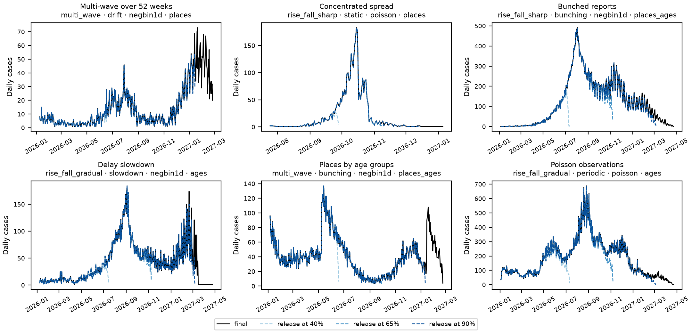
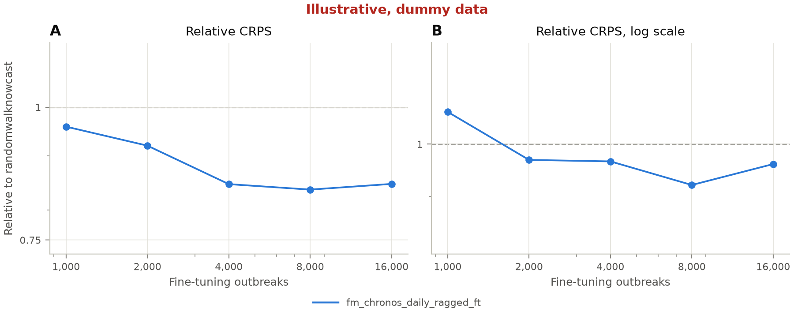
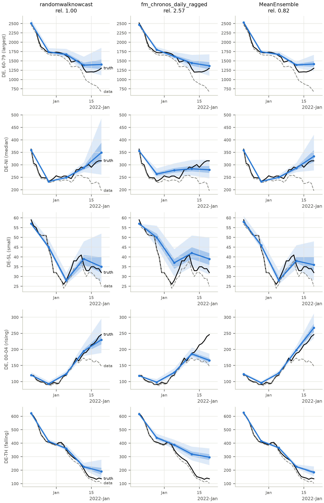
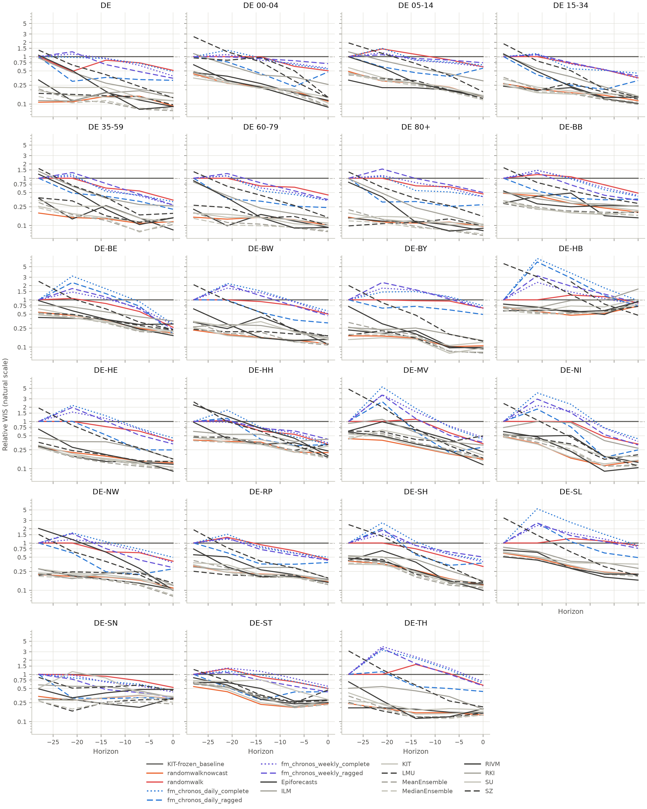
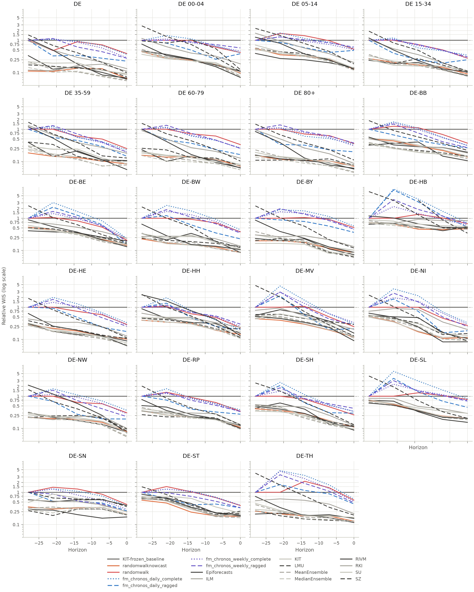

<!--
Plan from #206.
One SI section per paper section.
-->

## Methods

### Baselines

::: {.callout-note title="Plan"}
- We describe `randomwalk` and `randomwalknowcast` in full.
- Key references: [@Johnson2025].
:::

### Foundation model setup and fine-tuning

::: {.callout-note title="Plan"}
- We describe how Chronos-2 and LoRA work, with schematics.
- We give every setting of the model and the fine-tune.
- Key references: [@Ansari2025; @Hu2021].
:::

**Attention biases.**
Chronos-2's group attention has no notion of which series is which, so on its own it can link a lag series to its place's counts only by matching their values.

- We add four learned biases to Chronos-2's group-attention scores (@tbl-attention-biases).
- They start at zero, so fine-tuning starts from base Chronos-2, as for the relation biases TableFormer adds to a pretrained model [@Yang2022].
- The biases train at a learning rate of $10^{-3}$ and the LoRA adapter at $10^{-5}$, both falling linearly to zero at 8,000 outbreaks.
- We identify places by name within each block, with no limit on the number of places.
- A place's parent is the nearest prefix of its name in the block, else the country.
- Training blocks include countries equal to, above or later than the sum of their places, so a place belongs to its parent without summing to it.
- The biases follow Moirai's any-variate attention bias [@Woo2024], and the relative position biases of T5 [@Raffel2020] and the structural biases of Graphormer [@Ying2021].
- In Moirai's ablation, additive learned variate embeddings gave a normalised MAE of 0.904 on the Monash benchmark, against 0.655 with the attention bias [@Woo2024].

::: {#tbl-attention-biases}
| Relation | Pairs of series | Parameters |
|---|---|---|
| Self | A series attending to itself | One scalar per layer and head, starting at zero |
| Same place | A series attending to another series of its place, its count or a lag | One scalar per layer and head, starting at zero |
| Up | A child place's series attending to its parent's series | One scalar per layer and head, starting at zero |
| Down | A parent place's series attending to its children's series | One scalar per layer and head, starting at zero |

The learned biases added to Chronos-2's group-attention scores.
:::

#### Group attention

- In attention, each series updates its representation as a weighted mix of the others, with weights from how well its query matches their keys.
- Chronos-2 attends over time within each series, then over the series of a block at each time step, which is group attention [@Ansari2025].
- At one time step, row $i$ of a block (a place's count or one of its lag series) attends to row $j$ with weight
$$
a_{ij} = \operatorname{softmax}_j\!\left(q_i^\top k_j + M_{ij}\right),
$$
where $q_i$ and $k_j$ are the query and key vectors of one head in one layer, and $M_{ij}$ is the group mask, $0$ when rows $i$ and $j$ are in the same block and $-\infty$ otherwise.
- Chronos-2 does not divide the scores by the square root of the key dimension.

#### Attention biases

- Our change adds a learned nudge to those weights for each pair of rows, by their relation (same row, same place, child to parent, parent to child), so the model can tell which lags belong to which count.
- Each row $i$ belongs to a place $P(i)$, and each place $p$ has a parent $\pi(p)$ in the block, or none.
- We add a learned bias for each relation $r$ to the scores:
$$
a_{ij} = \operatorname{softmax}_j\!\left(q_i^\top k_j + M_{ij} + \sum_{r} b_r^{(l,h)}\,\mathbb{1}\!\left[(i,j) \in R_r\right]\right),
$$
with one scalar $b_r^{(l,h)}$ per relation $r$, layer $l$ and head $h$, and $b_r^{(l,h)} = 0$ at the start.
- The relations are the pairs of rows in @tbl-attention-biases:
$$
\begin{aligned}
R_\text{self} &= \{(i, j) : i = j\},\\
R_\text{same} &= \{(i, j) : i \neq j,\ P(i) = P(j)\},\\
R_\text{up} &= \{(i, j) : P(j) = \pi(P(i))\},\\
R_\text{down} &= \{(i, j) : P(i) = \pi(P(j))\}.
\end{aligned}
$$
- A pair in no relation gets no bias, as in Moirai's any-variate attention [@Woo2024] and TableFormer's relation biases [@Yang2022].

#### Mixed-frequency blocks

- One fine-tuned Chronos-2 model forecasts daily, 3-day and weekly data.
- A training block is daily, 3-day or weekly, or daily with one aggregate row per place (@tbl-block-layouts).
- A place's aggregate row holds its 3-day or weekly totals,
$$
y^{(k)}_{p,t} = \begin{cases} \sum_{s=t-k+1}^{t} y_{p,s} & \text{if day } t \text{ ends a period of } k \text{ days},\\ \text{missing} & \text{otherwise,} \end{cases}
$$
where $y_{p,s}$ is place $p$'s daily count on day $s$ and $k = 7$ for weekly or $k = 3$ for 3-day totals.
- The aggregate row has no lag series of its own.
- It belongs to its place, so it is in that place's same-place relation.
- The loss counts the aggregate row only on period-end days, where $m_{n,t} = 1$, and its missing days have $m_{n,t} = 0$.

#### LoRA

- Instead of retraining all the weights, LoRA trains a small low-rank update to some of them, about 1% of the weights, which leaves the base model unchanged at the start.
- LoRA replaces a weight matrix $W \in \mathbb{R}^{d_\text{out} \times d_\text{in}}$ with
$$
W' = W + \frac{\alpha}{r} B A,
$$
where $A \in \mathbb{R}^{r \times d_\text{in}}$ and $B \in \mathbb{R}^{d_\text{out} \times r}$ are trained and $W$ is frozen [@Hu2021].
- We use rank $r = 8$ and $\alpha = 16$.
- We apply it to the query, key, value and output projections of the time and group attention of all 12 layers, and to the output layer.
- $B$ starts at zero, so $W' = W$ at the start.

#### Loss

- Chronos-2 scales each row by the mean $\mu_n$ and standard deviation $\sigma_n$ of its context, then applies $\operatorname{arcsinh}$, so a target $y_{n,t}$ becomes $\tilde y_{n,t} = \operatorname{arcsinh}\!\left((y_{n,t} - \mu_n)/\sigma_n\right)$.
- The model gives a quantile $\hat q_{n,t,k}$ at each of 21 levels $\tau_k \in \{0.01, 0.05, 0.10, \dots, 0.95, 0.99\}$.
- The loss is the quantile (pinball) loss [@Koenker1978], averaged over the $H$ steps and the $N$ rows of a batch and summed over levels:
$$
L = \frac{1}{N} \sum_{n=1}^{N} \frac{1}{H} \sum_{t=1}^{H} m_{n,t} \sum_{k=1}^{21} 2 \left| \left(\tilde y_{n,t} - \hat q_{n,t,k}\right) \left(\mathbb{1}\!\left[\tilde y_{n,t} \le \hat q_{n,t,k}\right] - \tau_k\right) \right|,
$$
where $m_{n,t}$ is 1 for a target step to forecast and 0 for a missing target or a lag series' known future value.

#### Learning rates

- The learning rate at step $t$ falls linearly from $\eta_0$ to zero [@Devlin2019]:
$$
\eta_t = \eta_0 \left(1 - \frac{t}{T}\right),
$$
with $T = 36{,}500$ steps, which is reached at 8,000 simulations.
- $\eta_0 = 10^{-5}$ for the LoRA adapter, as in Chronos-2 [@Ansari2025], and $\eta_0 = 10^{-3}$ for the attention biases.
- We train with AdamW [@Loshchilov2019] and clip the gradient norm at 1 [@Pascanu2013].
- Neither has weight decay or warmup, as in Chronos-2's fine-tuning [@Ansari2025], and the biases follow Moirai and TableFormer in having no weight decay [@Woo2024; @Yang2022].

**Training blocks.**
A simulation gives daily counts by onset and report date, and a release counts every case reported by its cut-off, one cut-off a week.
Each simulation gives one observation draw, cut at 32 cut-offs, one drawn at random within each of 32 equal stretches of its weekly cut-offs, so one simulation gives 32 blocks.
Each block has up to 364 steps of context, and its prediction length is its horizon.
We train on 8,000 simulations, with checkpoints at 250, 500, 750, 1,000, 2,000, 4,000 and 8,000.

::: {#tbl-block-layouts}
| Layout | Share of blocks |
|---|---|
| Daily | 25% |
| Weekly | 25% |
| 3-day | 15% |
| Daily with a weekly row per place | 25% |
| Daily with a 3-day row per place | 10% |

The layouts of the training blocks and their shares.
:::

- We apply further options on top of the layout, each drawn independently.
- 20% of the blocks hold a single series, the country or one place.
- The other blocks hold a random set of places, with or without the country.
- Where a block holds the country and some of its places, a third each have a country equal to the sum of its places, above it (with cases not assigned to a place), or later than it (its own stream).
- The options combine, so a block can be, for example, daily with a weekly row and non-summing.
- Non-summing parents apply only where a block holds both the country and its places.
- @tbl-block-combinations gives the realised share of each combination.

::: {#tbl-block-combinations}


The realised shares of the combinations of layout and options in the training blocks.
:::

**Order of the training data.**
The grid is a crossed factorial design balanced in every block of 120 simulations, with each factor's levels shuffled independently, as in a Latin hypercube.
Training takes the simulations in chunks of 250, about two balanced blocks.
A chunk gives about 6,700 training blocks, which are shuffled and packed into about 1,250 steps of up to 256 series each.
So every checkpoint has seen the whole grid, and no factor level comes in a run of its own.

Chronos-2 divides a flat context by a scale of $10^{-5}$, and we apply no floor to that scale at inference.
A floor of one count at inference only hurts small series, of five counts or fewer, on held-out simulations.
At 4,000 outbreaks their median loss is  without it and  with it, and the share of 99% quantiles over 100 times the truth is % and %.
Large series are unchanged, with median loss  and .
On the BDBV release backtest the floor gives a lower relative WIS at every fine-tuned checkpoint,  against  for the weekly model at 4,000 outbreaks on provinces.
Chronos-2's widest interval is from 1% to 99%, as it has no 2.5% or 97.5% quantiles.

The ragged layout's lag series run to 4 weeks or 28 days.
Lags run to the truth delay do worse with short release histories.
On the German development half, the national WIS relative to `randomwalknowcast` is  with the 4-week cap and  with lags to the truth delay for the daily zero-shot model, and  and  for the weekly one.
On the BDBV release backtest it is  and  for the daily zero-shot model, and  and  for the weekly one.
BDBV's zones have few weekly releases, so with the longer horizon no recent lag of a zone falls in the model's context.

To compare training on simulations with training on real data, we also fine-tuned Chronos-2 on real data alone (`fm_chronos_daily_ragged_real` and `fm_chronos_weekly_ragged_real`).
It was trained on the German data and the BDBV data together.
The German part used the data as available on 2022-02-09, the last day of the German development half, and nothing later.
German training blocks were cut at every nowcast date whose truth, four weeks ahead, was at least 40 days old by then, from 2021-04-20 to 2021-12-03.
Each date was laid out as the German nowcast tasks are, with the same block functions as the simulations, from the daily and weekly releases, for Germany alone and with its states or age groups, at release lags of 14 to 49 days (including 40) or 2 to 7 weeks.
The hub file's changes after 80 days hold revisions made up to August 2022, so they were left out.
The BDBV part used every public release up to 2026-11-08 (cut-off 2026-11-05).
Daily blocks were cut at each daily release, and weekly blocks at each week from the hub's public per-case delay table, for the country alone and with its provinces, at every release lag.
Truth was the latest release's counts, left out after 2026-10-01, so every count trained on was at least the BDBV truth delay of 35 days old.
Training followed Chronos-2's recipe as the simulation fine-tune does, from base Chronos-2, for its default 1,000 steps.
The last 14 German nowcast dates were held out to monitor the loss.

### Monitoring fine-tuning

A local dashboard, part of the fine-tuning workflow, was used to review training as it ran (@fig-dashboard).
It showed the training and held-out loss by source, each checkpoint's scores against `randomwalknowcast` with the zero-shot and complete-only references, and the German nowcasts by checkpoint.
Reviewing it led to the complete-only reference in the checkpoint curve (@fig-checkpoint-curve).
The dashboard was built with the help of a large language model.

{#fig-dashboard}

### Synthetic data generation

::: {.callout-note title="Plan"}
- We describe the simulation in full, with the epinowcast model it uses.
- We give the grid in two tables, epidemic and reporting, with six example simulations, and compare the simulations with published disease parameters.
- Key references: [@abbottepinowcast; @lison2024; @Park2024; @abbottprimarycensored].
:::



::: {#tbl-grid-epidemic}


The simulation grid, epidemic and places: each crossed factor's levels and the continuous values drawn within a cell, read from the simulator's code.
:::

::: {#tbl-grid-reporting}


The simulation grid, reporting and observation: as @tbl-grid-epidemic.
:::

{#fig-sim-examples}

The grid has two limitations.
Simulated strata are less sparse than BDBV's provinces: the share of stratum-weeks with no cases reaches  at the 95% point of the simulations, against  for BDBV.
Simulated delays are shorter than the German data's, whose 99% point is  days against  at the 95% point of the simulations.

The simulator works around four limits of epinowcast's simulation mode, each until the linked epinowcast change.
It uses `enw_simulate()` from a feature branch of epinowcast (commit e084b080), until [epinowcast#841](https://github.com/epinowcast/epinowcast/pull/841) is merged.
It reads the posterior predictive counts (`pp_obs`) from the fit directly, as `enw_pp_summary()` is slow, and runs each batch of 25 simulations under a 16 GB memory cap ([epinowcast#841](https://github.com/epinowcast/epinowcast/pull/841)).
Gamma reporting delays have a coefficient of variation of 0.8 to 1.6, as a shape above 2 gives NaN tail hazards ([epinowcast#939](https://github.com/epinowcast/epinowcast/issues/939)).
When the delay walks over weeks, its log spread walks at half the scale of its log location, as a zero scale sits on the parameter's lower bound, where Stan cannot start ([epinowcast#941](https://github.com/epinowcast/epinowcast/issues/941)).

{#fig-sim-realism}

::: {#tbl-sim-diseases}


The simulated outbreaks' ranges against published values for several diseases, the case studies among them.
:::



We cut the held-out simulations into blocks as in training, with the five layouts and non-summing parents (@tbl-block-layouts), using a fixed seed.
A manifest records each held-out block's layout and options.
The paper's test set, 100 simulations outside training, is cut the same way.

### Correlated trajectories

- `randomwalk` and `randomwalknowcast` draw each province on its own, so the country, the per-sample sum of the provinces, is too narrow if the draws are paired at random.
- We pair the province draws within each week with a Gaussian copula, by rank reordering as in the Schaake shuffle [@Clark2004] and ensemble copula coupling [@Schefzik2013].
- Copulas have been used for coherent bottom-up forecasts of hierarchies [@BenTaieb2017] and for joint forecasts of seasonal influenza [@Ray2018; @Brooks2018].
- Provinces are their own forecasts, the country is the per-sample sum of the provinces, and zones are their own forecasts, not summed.
- The hub does not require coherence across levels.
  We choose the sum of the provinces for the walks' national forecast, and Chronos-2 submits its joint block's own national row.
- Pairing happens inside each walk model's forecast, so every score and submission reads the same paired draws.
- Pairing only reorders draws, so each cell keeps its own draws.

**The copula.**
Each week, each trajectory $k$ draws one normal $z_k$ per province, with correlation $\rho_p$ between any two provinces.
Before a province's walk starts, each cell's $m$ draws are sorted and the $k$th trajectory takes the draw whose rank matches the rank of $z_k$ in that cell.
From the walk start, each province's trajectory moves as a whole, ranked by its walk total against the normals of the latest week any province's walk starts, so the walk's own dependence over weeks is kept.

**The estimator.**
$\rho_p$ comes from the model's own matured errors.
For a count $y$ that an earlier release nowcast with negative binomial distribution function $F$, and that the origin release reports, the randomised PIT is $u = F(y - 1) + U\,(F(y) - F(y - 1))$ with $U \sim \mathrm{U}(0, 1)$, and its normal score is $\Phi^{-1}(u)$.
We use pairs of provinces in one week, from the releases of the last 8 weeks.
With $n$ pairs whose Pearson correlation is $r$, the estimate is $(n r + w \rho_0) / (n + w)$ with $w = 10$ and $\rho_0 = 0.7$, kept within $[0, 0.95]$.
The shrinkage only guards thin windows (@tbl-tuned-choices).

**Scores.**
We compare each walk model with no pairing, keeping the sample indices the model gave, and with the rolling $\rho_p$.
We score the country and each province by the CRPS and 90% coverage, and each level's places and weeks as one vector by the energy score [@Gneiting2008] on $\log(x + 1)$ counts.

### Aggregation options

Chronos-2 can forecast every level of a place hierarchy in one block, or each level on its own, and the daily model can give weekly totals in its block or as sums of its days.
We compare five options for the zero-shot and fine-tuned models:
(a) all levels in one joint block;
(b) each level in its own block;
(c) the lowest level only, summed up to the others with draws paired at random;
(d) the lowest level only, summed up after pairing its draws with the rolling copula;
(e) for the daily model, weekly totals from its in-block weekly row, against its days summed to weeks after pairing them with a rolling correlation over days, and at random.
Options (d) and (e) test whether pairing draws with the copula before summing narrows the gap to forecasting the total directly.
Option (e) is inference only, on the final checkpoint.

### Scoring

::: {.callout-note title="Plan"}
- We describe the scores and check them against scoringutils.
- We compute the WIS from scoringrules' `interval_score` and the absolute error of the median, as its `weighted_interval_score` (0.11) adds the median itself ([scoringrules#140](https://github.com/frazane/scoringrules/issues/140)).
- Key references: [@bosse2022scoringutils; @jordanEvaluatingProbabilisticForecasts2019; @zanetta_scoringrules_2024].
:::

For a forecast of $m$ samples $x_1, \dots, x_m$ and an observation $y$, the fair CRPS is
$$
\mathrm{CRPS}_\mathrm{f}(x, y) = \frac{1}{m}\sum_{i=1}^{m} |x_i - y| - \frac{1}{2m(m-1)}\sum_{i \ne j} |x_i - x_j|.
$$
Its expectation does not depend on $m$, whereas the usual sample form, with $2m^2$ in the second denominator, favours forecasts with more samples [@Ferro2014; @Zamo2018].
The fair energy score is the same form for a vector of counts, with the Euclidean norm $\lVert \cdot \rVert$ in place of $|\cdot|$.
We compute both with scoringrules' `fair` estimator, `crps_ensemble` and `es_ensemble`, on counts and on $\log(x + 1)$ counts.
Our models give 1,000 samples and hub teams 100, so the fair form compares them on the same footing.

### Choices tuned on development data

@tbl-tuned-choices lists each choice we tuned and the data it was set on, none of which is in a scored set.

::: {#tbl-tuned-choices}
| Choice | Value | Set on |
|---|---|---|
| Floor on Chronos-2's scale at inference | None | Held-out simulations and the BDBV release backtest |
| Lag cap of the ragged layout | 4 weeks or 28 days | German first half and the BDBV release backtest |
| Copula shrinkage weight $w$ | 10, the weakest of 0, 10, 30 and 100, which scored within 1% of one another | Ebola release backtest |
| Checkpoint of the submitted fine-tuned model | 1,000 simulations | BDBV release backtest, the plausibility check of the 14 November 2026 round, and the German first half |
| Realism checks of the simulation grid | Grid ranges | BDBV releases and German data reported by 2022-02-09 |

Choices tuned on development data, with their values and the data they were set on.
:::

### Implementation

::: {.callout-note title="Plan"}
- We used Python, PyTorch, chronos-forecasting, PEFT for LoRA, R and epinowcast for simulation, and scoringrules for scoring, checked against scoringutils.
- A Snakemake workflow runs the evaluation from the raw data to every figure and table.
:::

## Results

::: {.callout-note title="Plan"}
- We break down each case study's scores by location and horizon.
- We show each case study's WIS over time.
- We show held-out synthetic scores by the number of fine-tuning outbreaks.
:::

### Impact of correlated trajectories

- @fig-copula-impact compares the rolling $\rho_p$ with no pairing on the German first half, the BDBV release backtest and the held-out simulations, at the national level and for provinces.
- The per-province CRPS and coverage are unchanged by construction, so only the national sum and the energy score move.

{#fig-copula-impact}

### Joint block or aggregation

Our Chronos-2 models use the joint block.
On BDBV it is best or tied at provinces, zones and the national level for the zero-shot models.
On the German development half, level by level is competitive for the daily zero-shot model ( against  at the national level) and for age groups.
Summing the lowest level loses at every level above it, with or without the copula: at BDBV's national level the daily zero-shot model scores  summed and  summed after pairing, against  for the joint block.
@fig-aggregation gives every option by study and level, with WIS relative to `randomwalknowcast` on the same targets.

{#fig-aggregation}

### Checkpoint curve

- We compare the final run's checkpoints, fine-tuned on 250, 500, 750, 1,000, 2,000, 4,000 and 8,000 simulations.
- They share the grid, the data order and the recipe, as checkpoints of one run.
- @fig-finetune-heldout gives the trainer's held-out loss by level, for transparency, not to select a checkpoint.
- @fig-checkpoint-curve gives German first-half and BDBV relative scores at each checkpoint, with zero-shot Chronos-2 on the ragged layout and on complete data only as reference lines.
- @tbl-checkpoints gives the headline scores of each checkpoint.
- A later checkpoint has also trained for more steps.
- The learning rate falls linearly to zero at 8,000 simulations, so the earlier checkpoints are taken at 97% (250) to 50% (4,000) of the starting rate, and only the 8,000 checkpoint is annealed.

{#fig-finetune-heldout}

![WIS (Germany, on each model's own quantiles) and CRPS (BDBV, on 1,000 draws with common random numbers) relative to `randomwalknowcast` of the fine-tuned ragged Chronos-2 models against the number of simulated outbreaks each checkpoint was fine-tuned on, by level. Horizontal lines give the models with no fine-tuning: zero-shot Chronos-2 on the ragged layout (dashed) and on complete data only (dotted), each in its source's colour, and `randomwalknowcast` at 1. Each panel gives n, the fewest matched cells of its points, and the forecast origins they come from, and panels with fewer than 5 are grey.  Development data only.](build/figures/si/checkpoint-curve.png){#fig-checkpoint-curve}

::: {#tbl-checkpoints}


Zero-shot Chronos-2, then each checkpoint by the simulations it was fine-tuned on: national WIS on the German first half and CRPS and log CRPS on the BDBV release backtest, relative to `randomwalknowcast` (daily / weekly model), and the trainer's held-out loss. Blank cells are not yet scored.  Development data only.
:::

### Attention biases for place and parent against none

- We compare the run with attention biases with a run without them.
- Both runs share the grid, the data order, the LoRA recipe and the checkpoints.
- @fig-compare-slots shows the trainer's held-out loss and German first-half and BDBV relative scores of both runs by checkpoint and level.
- @tbl-slots-summary gives each run's newest checkpoint.
- The lag-swap test moves whole lag series to another place.
- A ratio above 1 means the model's forecast depends on which place's lags sit with a target.
- Zero-shot Chronos-2 can also match lags to targets by value, so the comparison with the run without biases, not the ratio alone, tests the biases.
- The lag-swap test is not yet scored for this run.

{#fig-compare-slots}

::: {#tbl-slots-summary}


Zero-shot Chronos-2 and the newest checkpoint of the runs with and without attention biases: national WIS on the German first half and CRPS and log CRPS on the BDBV release backtest, relative to `randomwalknowcast` (daily / weekly model), and the trainer's held-out loss, with each cell's simulations in brackets.  Development data only.
:::

### Delays against no delays

- We fine-tune a run on complete counts only, with the attention biases and without lag series, and compare it with the ragged run.
- Both runs share the grid, the data order, the recipe and the checkpoints.
- @fig-compare-delays shows both runs by checkpoint.
- Without lag series the no-delay model has no counts after the last complete step, so its context ends there.

{#fig-compare-delays}

### Real-data fine-tune against synthetic

- We fine-tune a model on the German development half and BDBV releases, and compare it with the model fine-tuned on simulations.
- Its BDBV training data are every release up to , so we score it on BDBV rounds from 21 November 2026 only.
- It saw the German development half, so we score it on the held-out half only.
- Both use the same recipe and the ragged layout.
- @tbl-real-finetune gives the scores, and @fig-compare-realdata shows them.
- We leave the real-data model out of every other table and figure.

{#fig-compare-realdata}

::: {#tbl-real-finetune}


Chronos-2 zero-shot (`_ragged`), fine-tuned on simulations (`_ft`) and fine-tuned on real data (`_real`), by level: WIS on the German held-out half and CRPS on BDBV rounds from 21 November 2026, relative to `randomwalknowcast`. Blank cells have no scores yet.
:::

### Daily nowcasts

- We score our models' daily counts in both case studies directly from the daily rows, not summed.
- The main text scores the hub targets, 7-day counts for Germany and weekly counts for BDBV.
- Hub teams give no daily forecasts, so we compare our models with `randomwalknowcast` only.
- @fig-compare-daily shows both.
- @fig-germany-si-results-daily repeats the German results figure for daily counts.

{#fig-compare-daily}

::: {#fig-germany-si-results-daily}

German nowcast hub, daily counts: the panels of the German results figure, with daily nowcasts against the daily truth and WIS on daily counts, without the hub teams.  
:::

### Held-out synthetic data

::: {#tbl-synthetic-evaluated}


The share of evaluated outbreaks in each level of each grid factor, as each simulation recorded its cell.  
:::

::: {#fig-synthetic-si-nowcasts}

Held-out synthetic data: nowcasts of outbreaks drawn to cover the levels of the trajectory, delay form, observation model and strata, one row per outbreak labelled by its cell, one column per model. Black is the rolling truth, grey dashed the data as of the origin, and blue the model's median with its 50% and 95% intervals.  
:::

::: {#fig-synthetic-si-factors}

Held-out synthetic data: relative CRPS by level of each scenario factor.  
:::

::: {#fig-synthetic-si-factors-log}

Held-out synthetic data: relative CRPS on the log scale by level of each scenario factor.  
:::

::: {#fig-synthetic-si-wis-over-time}

Held-out synthetic data: CRPS over time.  
:::

::: {#fig-synthetic-si-finetune-size}

Held-out synthetic data: relative CRPS of each fine-tuning checkpoint, at doublings from 1,000 outbreaks, against the number of simulated outbreaks it was trained on (log scale).  
:::

::: {#tbl-synthetic-horizon}


Held-out synthetic data scores by horizon.  
:::

::: {#tbl-synthetic-location}


Held-out synthetic data scores by location and stratum.  
:::

### German nowcast hub

::: {#fig-germany-si-nowcasts}

German nowcast hub: nowcasts for places picked by a rule in the workflow config (the largest, median and smallest by recent count, and the most rising and most falling), one row per place labelled with why it was picked, at the last origin shown in the main text, one column per model. Black is the rolling truth, grey dashed the data as of the origin, and blue the model's median with its 50% and 95% intervals.  
:::

::: {#fig-germany-si-places}

German nowcast hub: WIS of every place relative to , one dot per model.  
:::

::: {#fig-germany-si-location-horizon}

German nowcast hub: relative WIS by location and horizon.  
:::

::: {#fig-germany-si-location-horizon-log}

German nowcast hub: relative WIS on the log scale by location and horizon.  
:::

::: {#fig-germany-si-wis-over-time}

German nowcast hub: WIS over time, with a dotted line at the split.  
:::

::: {#tbl-germany-horizon}


German nowcast hub scores by horizon.  
:::

::: {#tbl-germany-location}


German nowcast hub scores by location and stratum.  
:::

### Ebola hub submissions

::: {#fig-ebola-si-nowcasts}

Ebola: nowcasts for places picked by a rule in the workflow config (the largest, median and smallest by recent count, and the most rising and most falling), one row per place labelled with why it was picked, at the last origin shown in the main text, one column per model. Black is the rolling truth, grey dashed the data as of the origin, and blue the model's median with its 50% and 95% intervals.  
:::

::: {#fig-ebola-si-places}

Ebola: CRPS of every place relative to , one dot per model.  
:::

::: {#fig-ebola-si-location-horizon}

Ebola: relative CRPS by location and horizon.  
:::

::: {#fig-ebola-si-location-horizon-log}

Ebola: relative CRPS on the log scale by location and horizon.  
:::

::: {#fig-ebola-si-wis-over-time}

Ebola: CRPS over time.  
:::

::: {#tbl-ebola-horizon}


Ebola hub submissions scores by horizon.  
:::

::: {#tbl-ebola-location}


Ebola hub submissions scores by location and stratum.  
:::

## References {.unnumbered}
