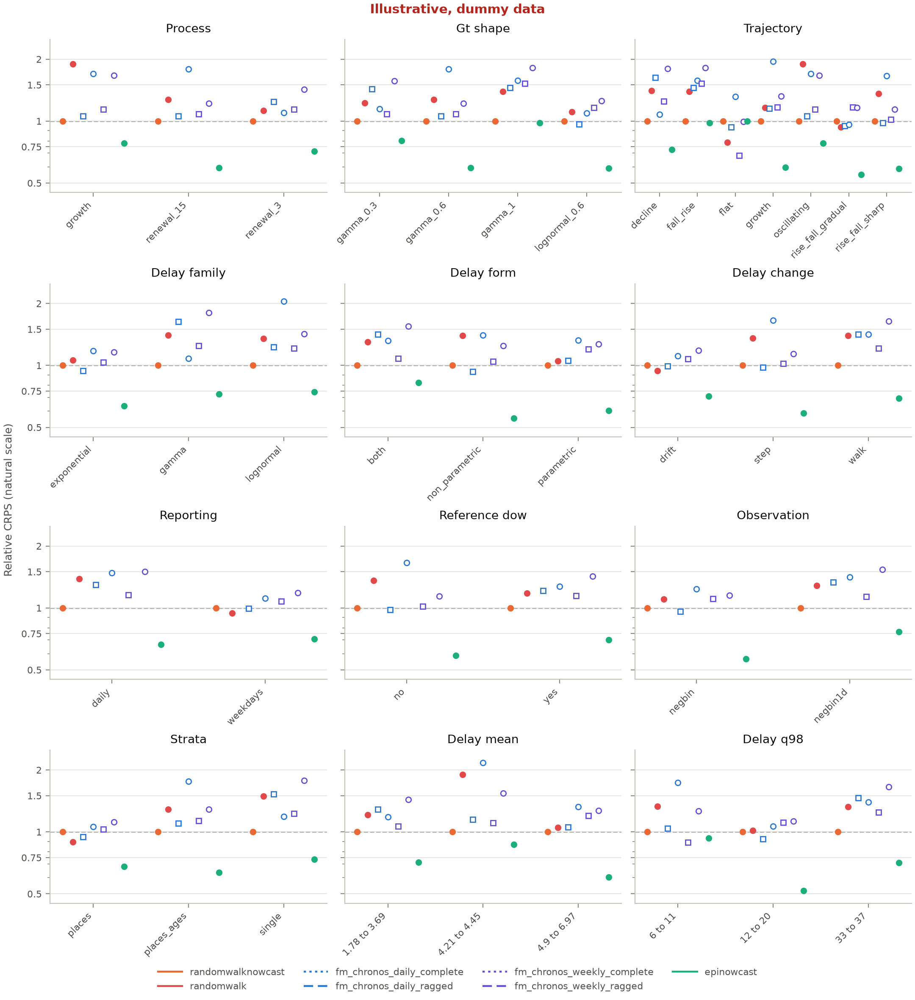
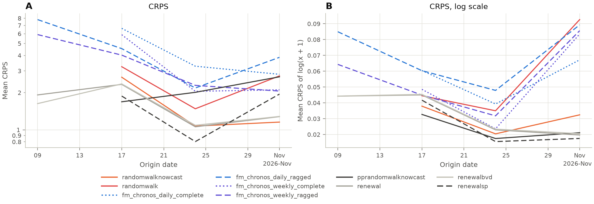

<!--
Plan from #206.
One SI section per paper section.
-->

## Methods

### Baselines

::: {.callout-note title="Plan"}
- `randomwalk` and `randomwalknowcast` in full.
- Key references: [@Johnson2025].
:::

### Foundation model setup and fine-tuning

::: {.callout-note title="Plan"}
- How Chronos-2 and LoRA work, in brief, with schematics.
- Foundation model setup and fine-tuning settings.
- Key references: [@Ansari2025; @Hu2021].
:::

### Synthetic data generation

::: {.callout-note title="Plan"}
- Synthetic data generation in full, with an overview of the epinowcast model used.
- The full factor table and the realism comparison against published disease parameters.
- Key references: [@abbottepinowcast; @lison2024; @Park2024; @abbottprimarycensored].
:::



::: {#tbl-synthetic-grid-si}


The crossed factors of the simulation grid, their levels and the reason for each.
:::

The grid has two limitations.
Simulated strata are less sparse than BDBV's provinces: the share of stratum-weeks with no cases reaches 0.75, against 0.89 for BDBV.
Delays stop at 12 weeks, while the German data are capped at 80 days by their reporting, so their 99% delay point (81 days) is beyond the grid.

{#fig-sim-realism}

::: {.callout-note title="Results to come"}
Slot for the table of grid ranges against published values for several diseases, the case studies among them.
:::



### Correlated trajectories

::: {.callout-note title="Plan"}
- Correlated trajectories: the copula, its rolling-window estimator and the window length.
- Joint block or level by level for the foundation models (#222).
:::

::: {.callout-note title="Results to come"}
Slots for the copula's window length (#221) and for the joint block against level by level (#222).
:::

### Scoring

::: {.callout-note title="Plan"}
- Scoring, and its check against scoringutils.
- Key references: [@bosse2022scoringutils; @jordanEvaluatingProbabilisticForecasts2019; @zanetta_scoringrules_2024].
:::

### Implementation

::: {.callout-note title="Plan"}
- The tools we used, each cited: Python, PyTorch on the laptop GPU, chronos-forecasting, PEFT for LoRA, R and epinowcast for simulation, and scoringrules for scoring, checked against scoringutils.
- The evaluation runs as a Snakemake workflow, so every result can be reproduced from the raw data.
:::

## Results

::: {.callout-note title="Plan"}
- Score breakdowns by location and horizon for each case study.
- WIS over time for each case study.
- Held-out synthetic scores by number of fine-tuning outbreaks.
:::

### Held-out synthetic data

::: {#tbl-synthetic-evaluated}


The share of evaluated outbreaks in each level of each grid factor, as each simulation recorded its cell. 
:::

::: {#fig-synthetic-si-nowcasts}

Held-out synthetic data: nowcasts of outbreaks drawn to cover the levels of the trajectory, delay form, observation model and strata, each titled by its cell, at origins drawn with the workflow's seed (dotted lines). Black is the rolling truth, grey the data as of each origin, and ribbons the 50% and 90% intervals of `randomwalknowcast` and Chronos-2 zero-shot and fine-tuned. 
:::

::: {#fig-synthetic-si-factors}

Held-out synthetic data: relative CRPS by level of each scenario factor. 
:::

::: {#fig-synthetic-si-factors-log}

Held-out synthetic data: relative CRPS on the log scale by level of each scenario factor. 
:::

::: {#fig-synthetic-si-wis-over-time}

Held-out synthetic data: CRPS over time. 
:::

::: {#fig-synthetic-si-finetune-size}

Held-out synthetic data: relative CRPS of each fine-tuning checkpoint, at doublings from 1,000 outbreaks, against the number of simulated outbreaks it was trained on (log scale). 
:::

::: {#tbl-synthetic-horizon}


Held-out synthetic data scores by horizon. 
:::

::: {#tbl-synthetic-location}


Held-out synthetic data scores by location and stratum. 
:::

### German nowcast hub

::: {#fig-germany-si-nowcasts}

German nowcast hub: nowcasts for each state and age group at origins drawn with the workflow's seed (dotted lines). Black is the rolling truth, grey the data as of each origin, and ribbons the 50% and 90% intervals of `randomwalknowcast`, Chronos-2 zero-shot and fine-tuned, and the hub ensemble. 
:::

::: {#fig-germany-si-location-horizon}

German nowcast hub: relative WIS by location and horizon. 
:::

::: {#fig-germany-si-location-horizon-log}

German nowcast hub: relative WIS on the log scale by location and horizon. 
:::

::: {#fig-germany-si-wis-over-time}

German nowcast hub: WIS over time, with a dotted line at the split. 
:::

::: {#tbl-germany-horizon}


German nowcast hub scores by horizon. 
:::

::: {#tbl-germany-location}


German nowcast hub scores by location and stratum. 
:::

### Ebola hub submissions

::: {#fig-ebola-si-nowcasts}

Ebola hub submissions: nowcasts for each province at origins drawn with the workflow's seed (dotted lines). Black is the rolling truth, grey the data as of each origin, and ribbons the 50% and 90% intervals of `randomwalknowcast` and Chronos-2 zero-shot and fine-tuned. 
:::

::: {#fig-ebola-si-location-horizon}

Ebola hub submissions: relative CRPS by location and horizon. 
:::

::: {#fig-ebola-si-location-horizon-log}

Ebola hub submissions: relative CRPS on the log scale by location and horizon. 
:::

::: {#fig-ebola-si-wis-over-time}

Ebola hub submissions: CRPS over time. 
:::

::: {#tbl-ebola-horizon}


Ebola hub submissions scores by horizon. 
:::

::: {#tbl-ebola-location}


Ebola hub submissions scores by location and stratum. 
:::

## References {.unnumbered}
