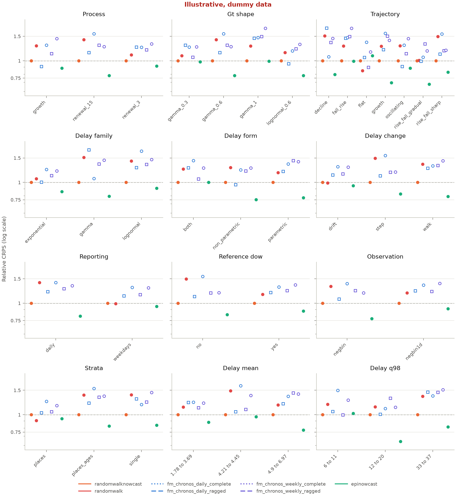
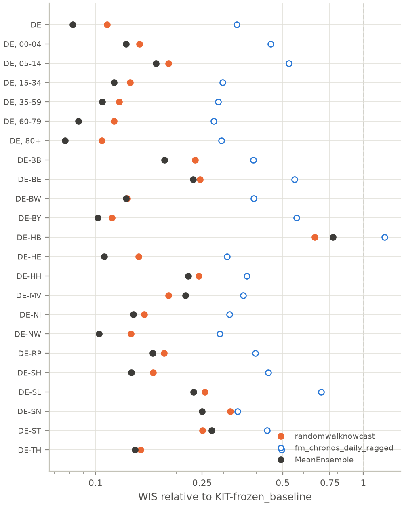
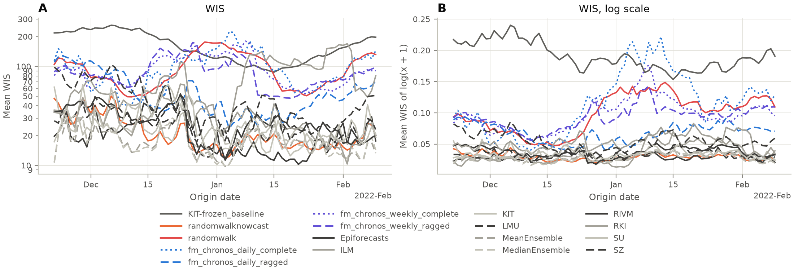
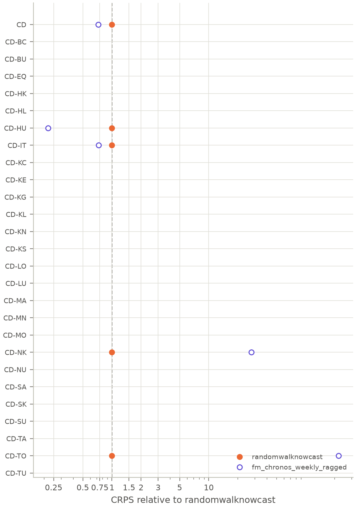
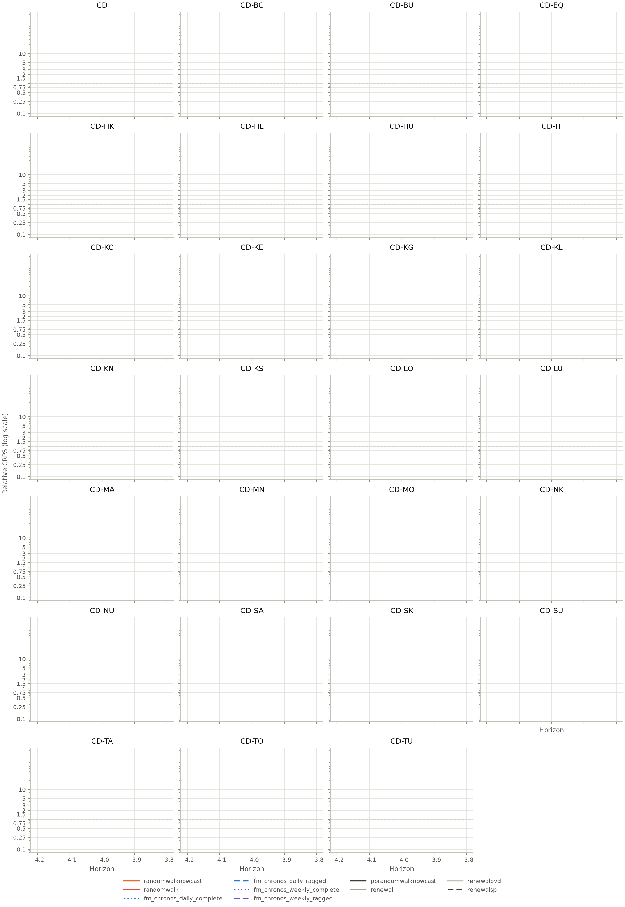

<!--
Plan from #206.
One SI section per paper section.
-->

## Methods

### Baselines

::: {.callout-note title="Plan"}
- We describe `randomwalk` and `randomwalknowcast` in full.
- Key references: [@Johnson2025].
:::

### Foundation model setup and fine-tuning

::: {.callout-note title="Plan"}
- We describe how Chronos-2 and LoRA work, with schematics.
- We give every setting of the model and the fine-tune.
- Key references: [@Ansari2025; @Hu2021].
:::

**Attention biases.**
Chronos-2's group attention has no notion of which series is which, so on its own it can link a lag series to its place's counts only by matching their values.

- We add four learned biases to Chronos-2's group-attention scores (@tbl-attention-biases).
- They start at zero, so fine-tuning starts from base Chronos-2, as for the relation biases TableFormer adds to a pretrained model [@Yang2022].
- The biases train at a learning rate of $10^{-3}$ and the LoRA adapter at $10^{-5}$, both falling linearly to zero at 8,000 outbreaks.
- We identify places by name within each block, with no limit on the number of places.
- A place's parent is the nearest prefix of its name in the block, else the country.
- Training blocks include countries equal to, above or later than the sum of their places, so a place belongs to its parent without summing to it.
- The biases follow Moirai's any-variate attention bias [@Woo2024], and the relative position biases of T5 [@Raffel2020] and the structural biases of Graphormer [@Ying2021].
- In Moirai's ablation, additive learned variate embeddings gave a normalised MAE of 0.904 on the Monash benchmark, against 0.655 with the attention bias [@Woo2024].

::: {#tbl-attention-biases}
| Relation | Pairs of series | Parameters |
|---|---|---|
| Self | A series attending to itself | One scalar per layer and head, starting at zero |
| Same place | A series attending to another series of its place, its count or a lag | One scalar per layer and head, starting at zero |
| Up | A child place's series attending to its parent's series | One scalar per layer and head, starting at zero |
| Down | A parent place's series attending to its children's series | One scalar per layer and head, starting at zero |

The learned biases added to Chronos-2's group-attention scores.
:::

#### Group attention

- Chronos-2 attends over time within each series, then over the series of a block at each time step, which is group attention [@Ansari2025].
- At one time step, row $i$ of a block (a place's count or one of its lag series) attends to row $j$ with weight
$$
a_{ij} = \operatorname{softmax}_j\!\left(q_i^\top k_j + M_{ij}\right),
$$
where $q_i$ and $k_j$ are the query and key vectors of one head in one layer, and $M_{ij}$ is the group mask, $0$ when rows $i$ and $j$ are in the same block and $-\infty$ otherwise.
- Chronos-2 does not divide the scores by the square root of the key dimension.

#### Attention biases

- Each row $i$ belongs to a place $P(i)$, and each place $p$ has a parent $\pi(p)$ in the block, or none.
- We add a learned bias for each relation $r$ to the scores:
$$
a_{ij} = \operatorname{softmax}_j\!\left(q_i^\top k_j + M_{ij} + \sum_{r} b_r^{(l,h)}\,\mathbb{1}\!\left[(i,j) \in R_r\right]\right),
$$
with one scalar $b_r^{(l,h)}$ per relation $r$, layer $l$ and head $h$, and $b_r^{(l,h)} = 0$ at the start.
- The relations are the pairs of rows in @tbl-attention-biases:
$$
\begin{aligned}
R_\text{self} &= \{(i, j) : i = j\},\\
R_\text{same} &= \{(i, j) : i \neq j,\ P(i) = P(j)\},\\
R_\text{up} &= \{(i, j) : P(j) = \pi(P(i))\},\\
R_\text{down} &= \{(i, j) : P(i) = \pi(P(j))\}.
\end{aligned}
$$
- A pair in no relation gets no bias, as in Moirai's any-variate attention [@Woo2024] and TableFormer's relation biases [@Yang2022].

#### Mixed-frequency blocks

- One fine-tuned Chronos-2 model forecasts daily, 3-day and weekly data.
- A training block is daily, 3-day or weekly, or daily with one aggregate row per place (@tbl-block-layouts).
- A place's aggregate row holds its 3-day or weekly totals,
$$
y^{(k)}_{p,t} = \begin{cases} \sum_{s=t-k+1}^{t} y_{p,s} & \text{if day } t \text{ ends a period of } k \text{ days},\\ \text{missing} & \text{otherwise,} \end{cases}
$$
where $y_{p,s}$ is place $p$'s daily count on day $s$ and $k = 7$ for weekly or $k = 3$ for 3-day totals.
- The aggregate row has no lag series of its own.
- It belongs to its place, so it is in that place's same-place relation.
- The loss counts the aggregate row only on period-end days, where $m_{n,t} = 1$, and its missing days have $m_{n,t} = 0$.

#### LoRA

- LoRA replaces a weight matrix $W \in \mathbb{R}^{d_\text{out} \times d_\text{in}}$ with
$$
W' = W + \frac{\alpha}{r} B A,
$$
where $A \in \mathbb{R}^{r \times d_\text{in}}$ and $B \in \mathbb{R}^{d_\text{out} \times r}$ are trained and $W$ is frozen [@Hu2021].
- We use rank $r = 8$ and $\alpha = 16$.
- We apply it to the query, key, value and output projections of the time and group attention of all 12 layers, and to the output layer.
- $B$ starts at zero, so $W' = W$ at the start.

#### Loss

- Chronos-2 scales each row by the mean $\mu_n$ and standard deviation $\sigma_n$ of its context, then applies $\operatorname{arcsinh}$, so a target $y_{n,t}$ becomes $\tilde y_{n,t} = \operatorname{arcsinh}\!\left((y_{n,t} - \mu_n)/\sigma_n\right)$.
- The model gives a quantile $\hat q_{n,t,k}$ at each of 21 levels $\tau_k \in \{0.01, 0.05, 0.10, \dots, 0.95, 0.99\}$.
- The loss is the quantile (pinball) loss, averaged over the $H$ steps and the $N$ rows of a batch and summed over levels:
$$
L = \frac{1}{N} \sum_{n=1}^{N} \frac{1}{H} \sum_{t=1}^{H} m_{n,t} \sum_{k=1}^{21} 2 \left| \left(\tilde y_{n,t} - \hat q_{n,t,k}\right) \left(\mathbb{1}\!\left[\tilde y_{n,t} \le \hat q_{n,t,k}\right] - \tau_k\right) \right|,
$$
where $m_{n,t}$ is 1 for a target step to forecast and 0 for a missing target or a lag series' known future value.

#### Learning rates

- The learning rate at step $t$ falls linearly from $\eta_0$ to zero:
$$
\eta_t = \eta_0 \left(1 - \frac{t}{T}\right),
$$
with $T = 36{,}500$ steps, which is reached at 8,000 simulations.
- $\eta_0 = 10^{-5}$ for the LoRA adapter, as in Chronos-2, and $\eta_0 = 10^{-3}$ for the attention biases.

**Training blocks.**
A simulation gives daily counts by onset and report date, and a release counts every case reported by its cut-off, one cut-off a week.
Each simulation gives 10 observation draws, and at each of 16 cut-offs 2 of the 10 draws are sampled, so one simulation gives 32 blocks.
Each block's prediction length is its horizon, and the LoRA learning rate falls linearly from $10^{-5}$ to zero at 8,000 simulations, with checkpoints at 1,000, 2,000, 4,000 and 8,000.

::: {#tbl-block-layouts}
| Layout | Share of blocks |
|---|---|
| Daily | 25% |
| Weekly | 25% |
| 3-day | 15% |
| Daily with a weekly row per place | 25% |
| Daily with a 3-day row per place | 10% |

The layouts of the training blocks and their shares.
:::

- We apply further options on top of the layout, each drawn independently.
- 10% of the blocks hold every report to one randomly chosen weekday, so reference dates stay daily and reports arrive in weekly batches, as in weekly surveillance reporting.
- 20% of the blocks hold a single series, the country or one place.
- The other blocks hold a random set of places, with or without the country.
- Where a block holds the country and some of its places, a third each have a country equal to the sum of its places, above it (with cases not assigned to a place), or later than it (its own stream).
- The options combine, so a block can be, for example, daily with a weekly row, batched and non-summing.
- Non-summing parents apply only where a block holds both the country and its places.
- @tbl-block-combinations gives the realised share of each combination.

::: {#tbl-block-combinations}


The realised shares of the combinations of layout and options in the training blocks.
:::

**Order of the training data.**
The grid is a crossed factorial design balanced in every block of 120 simulations, with each factor's levels shuffled independently, as in a Latin hypercube.
Training takes the simulations in chunks of 250, about two balanced blocks.
A chunk gives about 6,700 training blocks, which are shuffled and packed into about 1,250 steps of up to 256 series each.
So every checkpoint has seen the whole grid, and no factor level comes in a run of its own.

Chronos-2 divides a flat context by a scale of $10^{-5}$, and we apply no floor to that scale at inference.
A floor of one count at inference only hurts small series, of five counts or fewer, on held-out simulations.
At 4,000 outbreaks their median loss is  without it and  with it, and the share of 99% quantiles over 100 times the truth is % and %.
Large series are unchanged, with median loss  and .
On the BDBV release backtest the floor gives a lower relative WIS at every fine-tuned checkpoint,  against  for the weekly model at 4,000 outbreaks on provinces.
Chronos-2's widest interval is from 1% to 99%, as it has no 2.5% or 97.5% quantiles.

The ragged layout's lag series run to 4 weeks or 28 days.
Lags run to the truth delay do worse with short release histories.
On the German development half, the national WIS relative to `randomwalknowcast` is  with the 4-week cap and  with lags to the truth delay for the daily zero-shot model, and  and  for the weekly one.
On the BDBV release backtest it is  and  for the daily zero-shot model, and  and  for the weekly one.
BDBV's zones have few weekly releases, so with the longer horizon no recent lag of a zone falls in the model's context.

To compare training on simulations with training on real data, we also fine-tuned Chronos-2 on real data alone (`fm_chronos_daily_ragged_real` and `fm_chronos_weekly_ragged_real`).
It was trained on the German data and the BDBV data together.
The German part used the data as available on 2022-02-09, the last day of the German development half, and nothing later.
German training blocks were cut at every nowcast date whose truth, four weeks ahead, was at least 40 days old by then, from 2021-04-20 to 2021-12-03.
Each date was laid out as the German nowcast tasks are, with the same block functions as the simulations, from the daily and weekly releases, for Germany alone and with its states or age groups, at release lags of 14 to 49 days (including 40) or 2 to 7 weeks.
The hub file's changes after 80 days hold revisions made up to August 2022, so they were left out.
The BDBV part used every public release up to 2026-11-08 (cut-off 2026-11-05).
Daily blocks were cut at each daily release, and weekly blocks at each week from the hub's public per-case delay table, for the country alone and with its provinces, at every release lag.
Truth was the latest release's counts, left out after 2026-10-01, so every count trained on was at least the BDBV truth delay of 35 days old.
Training followed Chronos-2's recipe as the simulation fine-tune does, from base Chronos-2, for its default 1,000 steps.
The last 14 German nowcast dates were held out to monitor the loss.

### Monitoring fine-tuning

A local dashboard, part of the fine-tuning workflow, was used to review training as it ran (@fig-dashboard).
It showed the training and held-out loss by source, each checkpoint's scores against `randomwalknowcast` with the zero-shot and complete-only references, and the German nowcasts by checkpoint.
Reviewing it led to the complete-only reference in the checkpoint curve (@fig-checkpoint-curve).
The dashboard was built with the help of a large language model.

{#fig-dashboard}

### Synthetic data generation

::: {.callout-note title="Plan"}
- We describe the simulation in full, with the epinowcast model it uses.
- We give the full factor table and compare the simulations with published disease parameters.
- Key references: [@abbottepinowcast; @lison2024; @Park2024; @abbottprimarycensored].
:::



::: {#tbl-synthetic-grid-si}


Every setting of the simulation grid: the crossed factors and their levels, the settings derived from a cell, and the values drawn within it, with the R expression that draws them and the epinowcast function each enters through, read from the simulator's code. Realised values are over the run's simulations where they exist.
:::

The grid has two limitations.
Simulated strata are less sparse than BDBV's provinces: the share of stratum-weeks with no cases reaches  at the 95% point of the simulations, against  for BDBV.
Simulated delays are shorter than the German data's, whose 99% point is  days against  at the 95% point of the simulations.

{#fig-sim-realism}

::: {#tbl-sim-diseases}


The simulated outbreaks' ranges against published values for several diseases, the case studies among them.
:::



We cut the held-out simulations into blocks as in training, with the five layouts, report batching and non-summing parents (@tbl-block-layouts), using a fixed seed.
A manifest records each held-out block's layout and options.
The paper's test set, 100 simulations outside training, is cut the same way.

### Correlated trajectories

The copula pairs the draws of models that give each place and week only its own draws.
These are the Chronos-2 models and `randomwalknowcast`.
Hub teams' samples are joint across weeks within a place, so their pairing across places is left as submitted.

**The copula.**
With $P$ places and steps on days $d_1, \dots, d_S$, each trajectory draws $z \sim \mathrm{N}(0, \Sigma)$ with $\Sigma = \Sigma_p \otimes \Sigma_t$.
The week correlation is $(\Sigma_t)_{jk} = \rho_t^{|d_j - d_k| / 7}$.
The place correlation is $\rho_p$ between two provinces and $\rho_n$ between the country and a province.
Where $\rho_p$ and $\rho_n$ give no valid correlation matrix, we set its negative eigenvalues to zero and rescale it to unit diagonal.
For each place-week, the $m$ draws are sorted and the $k$th trajectory takes the draw whose rank matches the rank of $z_k$ in that cell.
Each cell keeps exactly its own draws [@Clark2004; @Schefzik2013].
A country forecast as its own series, as by Chronos-2, is paired as one more place.
A country that is the sum of its provinces is not paired but summed again from the paired provinces, so its forecast widens.

**The estimator.**
For a forecast with $m$ draws, $b$ of them below the truth and $e$ equal to it, the randomised PIT is $u = (b + U(e + 1)) / (m + 1)$ with $U \sim \mathrm{U}(0, 1)$.
Its normal score is $\Phi^{-1}(u)$.
A forecast whose draws are all equal gives no score.
Truth is the count as reported $D$ days after the week, so a week's error matures only once that release exists.
At an origin, we use forecasts made at earlier origins whose truth was released by the origin, from the 8 latest such weeks.
$\rho_t$ is estimated from pairs of consecutive weeks of one place in one forecast.
$\rho_p$ is estimated from pairs of provinces in the same week of one forecast, and $\rho_n$ from the country and a province.
With $n$ pairs whose Pearson correlation is $r$, the estimate is $(n r + w \rho_0) / (n + w)$, with $w = 100$ and $\rho_0$ the prior.
It is then kept within $[0, 0.95]$.
Where the pairs give no correlation, the estimate is the prior.
The prior $(\rho_t, \rho_p, \rho_n) = (0.9, 0.7, 0.7)$ is set by the energy score of the Chronos-2 models on the Ebola release backtest, so it is tuned in sample.
As a sensitivity analysis we give the prior less weight, $w = 25$.

**Scores.**
We score the trajectories with the energy score [@Gneiting2008] and the variogram score of order $p = 0.5$ [@Scheuerer2015], both on $\log(x + 1)$ counts.
We also report the 50% and 90% coverage of each place's sum over weeks and of the sum over provinces in each week.
WIS of each place and week is unchanged by pairing, except for a country summed from its provinces.
We compare three versions of each model.
Unpaired forecasts keep the sample indices the model gave.
Fixed forecasts are paired with the prior at every origin.
Rolling forecasts are paired with the copula estimated at each origin.

### Aggregation options

Chronos-2 can forecast every level of a place hierarchy in one block, or each level on its own.
We compare four options for the zero-shot and fine-tuned models, daily and weekly:
(a) all levels in one joint block;
(b) each level in its own block;
(c) the lowest level only, summed up to the others with draws paired at random;
(d) the lowest level only, summed up after pairing its draws with the rolling copula.
Option (d) tests whether pairing the draws with the copula before summing narrows the gap to the joint block.

### Scoring

::: {.callout-note title="Plan"}
- We describe the scores and check them against scoringutils.
- Key references: [@bosse2022scoringutils; @jordanEvaluatingProbabilisticForecasts2019; @zanetta_scoringrules_2024].
:::

### Implementation

::: {.callout-note title="Plan"}
- We used Python, PyTorch, chronos-forecasting, PEFT for LoRA, R and epinowcast for simulation, and scoringrules for scoring, checked against scoringutils.
- A Snakemake workflow runs the evaluation from the raw data to every figure and table.
:::

## Results

::: {.callout-note title="Plan"}
- We break down each case study's scores by location and horizon.
- We show each case study's WIS over time.
- We show held-out synthetic scores by the number of fine-tuning outbreaks.
:::

### Impact of correlated trajectories

Pairing changes no marginal forecast, so it shows in the joint scores and in the coverage of sums over weeks and over places.
@tbl-copula-ebola and @tbl-copula-germany compare unpaired forecasts with the fixed and rolling copula for every model that uses it.
The rolling estimates have median $\rho_t$  and $\rho_p$  by German state, and $\rho_t$  and $\rho_p$  by age group, for `randomwalknowcast`.

::: {#tbl-copula-ebola}


Ebola release backtest: energy score (ES) and variogram score (VS) on the log scale, 50% and 90% coverage of each place's sum over weeks and of the sum over provinces, and WIS of the provinces and the country, for each model unpaired and paired by the fixed or rolling copula.
:::

::: {#tbl-copula-germany}


German nowcast hub, development half: as @tbl-copula-ebola, by state and by age group, with the sum over places taken over states or age groups.
:::

### Joint block or aggregation

Our Chronos-2 models use the joint block.
On BDBV it is best or tied at provinces, zones and the national level for the zero-shot models.
On the German development half, level by level is competitive for the daily zero-shot model ( against  at the national level) and for age groups.
Summing the lowest level loses at every level above it, with or without the copula: at BDBV's national level the daily zero-shot model scores  summed and  summed after pairing, against  for the joint block.
All WIS are relative to `randomwalknowcast` on the same targets.
@tbl-aggregation-ebola and @tbl-aggregation-germany give every model and level, and @tbl-aggregation-cost what each option costs.

::: {#tbl-aggregation-ebola}


Ebola release backtest: WIS of each option relative to `randomwalknowcast` on the same targets (log scale in brackets), 50% and 95% coverage and the number of targets, by level (national, provinces, zones).
:::

::: {#tbl-aggregation-germany}


German nowcast hub, development half: as @tbl-aggregation-ebola, by level (national, states, age groups).
:::

::: {#tbl-aggregation-cost}


The cost of each option: series per block, memory and time.
:::

### Checkpoint curve

- We compare the final run's checkpoints, fine-tuned on 1,000, 2,000, 4,000 and 8,000 simulations.
- They share the grid, the data order and the recipe, as checkpoints of one run.
- @fig-finetune-heldout gives the held-out loss by source.
- @fig-checkpoint-curve gives German first-half and BDBV relative scores at each checkpoint, with zero-shot Chronos-2 on the ragged layout and on complete data only as reference lines.
- A later checkpoint has also trained for more steps, at a learning rate that falls to zero at 8,000 simulations.

{#fig-finetune-heldout}

![WIS (Germany, on each model's own quantiles) and CRPS (BDBV, on 1,000 draws with common random numbers) relative to `randomwalknowcast` of the fine-tuned ragged Chronos-2 models against the number of simulated outbreaks each checkpoint was fine-tuned on, on the case studies by level. Horizontal lines give the models with no fine-tuning: zero-shot Chronos-2 on the ragged layout (dashed) and on complete data only (dotted), each in its source's colour, and `randomwalknowcast` at 1. Each panel gives n, the fewest matched cells of its points, and the forecast origins they come from, and panels with fewer than 5 are grey.](build/figures/si/checkpoint-curve.png){#fig-checkpoint-curve}

### Attention biases for place and parent against none

- We compare the run with attention biases with a run without them.
- Both runs share the grid, the data order, the LoRA recipe and the checkpoints.
- @tbl-slots-loss gives held-out loss by source, and @tbl-slots-scores German first-half and BDBV relative scores at checkpoints of the same size.
- @tbl-slots-swap gives the loss when whole lag series move to another place, relative to the loss as given.
- A ratio of 1 means the model does not tell which place a lag series belongs to.
- @fig-compare-slots shows both runs by checkpoint.
- The run without biases built its 3-day blocks as daily steps, so we compare 3-day blocks with zero-shot only.

{#fig-compare-slots}

::: {#tbl-slots-loss}


Held-out loss of the run with attention biases by source and window (nowcast or forecast steps), against the run without them at the same checkpoint and against zero-shot Chronos-2, with the paired ratio and its 90% interval over blocks.
:::

::: {#tbl-slots-scores}


Relative WIS on the German first half and relative CRPS on the BDBV release backtest, both against `randomwalknowcast`, of the runs with and without attention biases at checkpoints fine-tuned on the same number of outbreaks.
:::

::: {#tbl-slots-swap}


Lag-swap test: loss with whole lag series moved between places, as a ratio of the loss as given, with its 90% interval over blocks, for zero-shot Chronos-2 and the run with attention biases.
:::

### Delays against no delays

- We fine-tune a run on complete counts only, with the attention biases and without lag series, and compare it with the ragged run.
- Both runs share the grid, the data order, the recipe and the checkpoints.
- @tbl-compare-delays gives held-out loss by source and German first-half and BDBV relative scores at checkpoints of the same size.
- @fig-compare-delays shows both runs by checkpoint.
- Without lag series the no-delay model has no counts after the last complete step, so its context ends there.

{#fig-compare-delays}

::: {#tbl-compare-delays}


The full and no-delay runs at matched checkpoints: held-out loss by source, relative WIS on the German first half and relative CRPS on BDBV, against `randomwalknowcast`.
:::

### Real-data fine-tune against synthetic

- We fine-tune a model on the German development half and BDBV releases, and compare it with the model fine-tuned on simulations.
- Both use the same recipe and the ragged layout.
- @tbl-germany-real-finetune gives scores on the German held-out half, against zero-shot Chronos-2 and the synthetic model.
- @tbl-ebola-real-finetune gives scores on BDBV rounds after the last release the real-data model trained on.
- @fig-compare-realdata shows both.
- The real-data model saw the German development half, so we score it on the held-out half only.
- We leave it out of every other table and figure.

{#fig-compare-realdata}

::: {#tbl-germany-real-finetune}


German nowcast hub held-out half: Chronos-2 zero-shot (`_ragged`), fine-tuned on simulations (`_ft`) and fine-tuned on real data (`_real`), overall (`all`) and by level, with WIS relative to `randomwalknowcast`.  
:::

::: {#tbl-ebola-real-finetune}


BDBV scored rounds (from 21 November 2026, after every release the real-data model trained on): Chronos-2 zero-shot (`_ragged`), fine-tuned on simulations (`_ft`) and fine-tuned on real data (`_real`), overall (`all`) and by level, with CRPS relative to `randomwalknowcast`.  
:::

### Daily nowcasts

- We score our models' daily counts in both case studies directly from the daily rows, not summed.
- The main text scores the hub targets, 7-day counts for Germany and weekly counts for BDBV.
- Hub teams give no daily forecasts, so we compare our models with `randomwalknowcast` only.
- @tbl-compare-daily gives German and BDBV relative scores on daily counts and on the hub targets at each checkpoint.
- @fig-compare-daily shows both.
- @fig-germany-si-results-daily repeats the German results figure for daily counts.

{#fig-compare-daily}

::: {#tbl-compare-daily}


Our models' relative scores on daily counts and on the hub targets at matched checkpoints: relative WIS for Germany and relative CRPS for BDBV, against `randomwalknowcast`.
:::

::: {#fig-germany-si-results-daily}

German nowcast hub, daily counts: the panels of the German results figure, with daily nowcasts against the daily truth and WIS on daily counts, without the hub teams.  
:::

### Held-out synthetic data

- We report held-out scores by block layout, and by target where the layout has it: the weekly or 3-day totals from the aggregate row, and the daily counts.
- @tbl-heldout-layout gives them.

::: {#tbl-heldout-layout}


Held-out synthetic data: CRPS relative to `randomwalknowcast` by block layout and target.  
:::

::: {#tbl-synthetic-evaluated}


The share of evaluated outbreaks in each level of each grid factor, as each simulation recorded its cell.  
:::

::: {#fig-synthetic-si-nowcasts}

Held-out synthetic data: nowcasts of outbreaks drawn to cover the levels of the trajectory, delay form, observation model and strata, one row per outbreak labelled by its cell, one column per model. Black is the rolling truth, grey dashed the data as of the origin, and blue the model's median with its 50% and 95% intervals.  
:::

::: {#fig-synthetic-si-factors}

Held-out synthetic data: relative CRPS by level of each scenario factor.  
:::

::: {#fig-synthetic-si-factors-log}

Held-out synthetic data: relative CRPS on the log scale by level of each scenario factor.  
:::

::: {#fig-synthetic-si-wis-over-time}

Held-out synthetic data: CRPS over time.  
:::

::: {#fig-synthetic-si-finetune-size}

Held-out synthetic data: relative CRPS of each fine-tuning checkpoint, at doublings from 1,000 outbreaks, against the number of simulated outbreaks it was trained on (log scale).  
:::

::: {#tbl-synthetic-horizon}


Held-out synthetic data scores by horizon.  
:::

::: {#tbl-synthetic-location}


Held-out synthetic data scores by location and stratum.  
:::

### German nowcast hub

::: {#fig-germany-si-nowcasts}

German nowcast hub: nowcasts for places picked by a rule in the workflow config (the largest, median and smallest by recent count, and the most rising and most falling), one row per place labelled with why it was picked, at the last origin shown in the main text, one column per model. Black is the rolling truth, grey dashed the data as of the origin, and blue the model's median with its 50% and 95% intervals.  
:::

::: {#fig-germany-si-places}

German nowcast hub: WIS of every place relative to , one dot per model.  
:::

::: {#fig-germany-si-location-horizon}

German nowcast hub: relative WIS by location and horizon.  
:::

::: {#fig-germany-si-location-horizon-log}

German nowcast hub: relative WIS on the log scale by location and horizon.  
:::

::: {#fig-germany-si-wis-over-time}

German nowcast hub: WIS over time, with a dotted line at the split.  
:::

::: {#tbl-germany-horizon}


German nowcast hub scores by horizon.  
:::

::: {#tbl-germany-location}


German nowcast hub scores by location and stratum.  
:::

### Ebola hub submissions

::: {#fig-ebola-si-nowcasts}

Ebola: nowcasts for places picked by a rule in the workflow config (the largest, median and smallest by recent count, and the most rising and most falling), one row per place labelled with why it was picked, at the last origin shown in the main text, one column per model. Black is the rolling truth, grey dashed the data as of the origin, and blue the model's median with its 50% and 95% intervals.  
:::

::: {#fig-ebola-si-places}

Ebola: CRPS of every place relative to , one dot per model.  
:::

::: {#fig-ebola-si-location-horizon}

Ebola: relative CRPS by location and horizon.  
:::

::: {#fig-ebola-si-location-horizon-log}

Ebola: relative CRPS on the log scale by location and horizon.  
:::

::: {#fig-ebola-si-wis-over-time}

Ebola: CRPS over time.  
:::

::: {#tbl-ebola-horizon}


Ebola hub submissions scores by horizon.  
:::

::: {#tbl-ebola-location}


Ebola hub submissions scores by location and stratum.  
:::

## References {.unnumbered}
